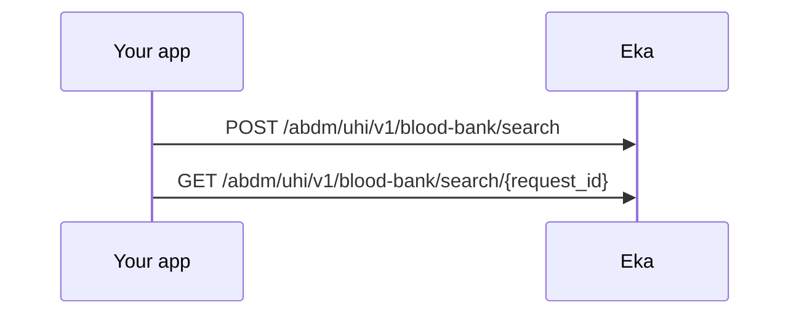

{/* TODO: confirm: this workflow needs its own journey. Blood bank search is not a step or branch of booking a physical consultation; it points at uhi-book-physical-consultation only because every workflow must name a journey. Who is the persona, and is it a journey of its own? */}

## In short

- Search blood banks over UHI by state and district, or by a location and radius.
- Keep `request_id` from Search Blood Banks and pass it to Get Blood Banks.
- Tell the user to check with the blood bank before they visit.

## When to use this

Your user needs a blood group and component, and wants to know which blood banks hold it. You search across blood banks on the Unified Health Interface (UHI) by state and district, or by a location and a radius around it. Availability is updated periodically, so tell the user to check with the blood bank before they visit.

## Before you start

- A Bearer token. Both operations use the `authApiKey` scheme. See [Authorization](/api-reference/authorization/getting-started).
- The blood group and blood component the user needs.
- Either the state and district, or the user's latitude, longitude and a search radius.
- The patient headers, if your integration sends them. {/* TODO: confirm: are X-Pt-Id, X-Partner-Pt-Id or X-Hip-Id needed for blood bank search? The spec marks all three optional. Does the user need to be logged in with an ABHA? */}

## Sequence

## Steps

<Steps>
  <Step title="Start the search">
    Send `search_type`, `blood_group` and `blood_component` to [Search Blood Banks](/api-reference/user-app/abdm-connect/blood-bank/state-district). All three are required. For a district search, also send `state` and `district`. For a location search, send `search_type` `location`, `location` with `lat` and `long`, and `radius` with `value` and `unit`, for example `km`.

    Keep `request_id` from the response. `status` is `SUCCESS` or `FAILURE`; on `FAILURE`, check the request.

    {/* TODO: confirm: the search_type value for a district search (the spec gives only location as an example). */}
    {/* TODO: confirm: the accepted values for blood_group and blood_component. */}
  </Step>
  <Step title="Read the results">
    Call [Get Blood Banks](/api-reference/user-app/abdm-connect/blood-bank/get-blood-banks) with `request_id`. The response carries `status` and `data`, which holds `context`, `message.catalog` with the matching blood banks, and `error_code` if the search failed. Show each blood bank's name, contact details and availability.

    {/* TODO: confirm: poll interval and timeout, and which status means the results are ready. No webhook is documented for blood bank search. */}
    {/* TODO: confirm: where in message.catalog the name, address, contact, availability, distance and last-updated time sit. */}
  </Step>
</Steps>

## State you must persist

| Field | From | Keep | For |
|---|---|---|---|
| `request_id` | Search Blood Banks | Until the results are read {/* TODO: confirm: how long a request_id stays valid */} | Get Blood Banks |

## When it fails

<Warning>
Which of these codes each call returns is not yet confirmed. The codes come from the [errors page](/api-reference/user-app/abdm-connect/errors), matched by meaning. Log the code you actually receive.
</Warning>

Both operations return `GenericError` with `code`, `error` and `source_error` on a 4XX or 5XX. A failure in the search itself comes back in `data.error_code` with `code` and `message`. See [Errors](/api-reference/user-app/abdm-connect/errors).

| Situation | Code | Do |
|---|---|---|
| Missing `search_type`, `blood_group` or `blood_component` | 4XX {/* TODO: confirm: code */} | Fix the request |
| District search without `state` or `district`, or location search without `location` or `radius` | 4XX {/* TODO: confirm: code */} | Send the fields for that search type |
| Search not accepted | `status` `FAILURE` | {/* TODO: confirm: what causes FAILURE and what to do */} |
| Unknown `request_id` | {/* TODO: confirm: code */} | Start a new search |
| No blood bank matches | {/* TODO: confirm: how an empty result appears */} | Widen the radius or try a neighbouring district |
| Upstream unavailable | 5XX {/* TODO: confirm: code and retry rule */} | Retry later |

## Test it

The [testing page](/api-reference/user-app/abdm-connect/testing) has the sandbox base URL, credentials and the happy path for every journey.

{/* TODO: confirm: is blood bank search available on sandbox, and which state, district, blood group and component return results? */}

- [ ] District search with a test state, district, blood group and component; receive `request_id` and `SUCCESS`
- [ ] Get Blood Banks with that `request_id`; results list at least one blood bank
- [ ] Location search with a test latitude, longitude and a 10 km radius
- [ ] Failure: a search without `blood_group` returns a 4XX
