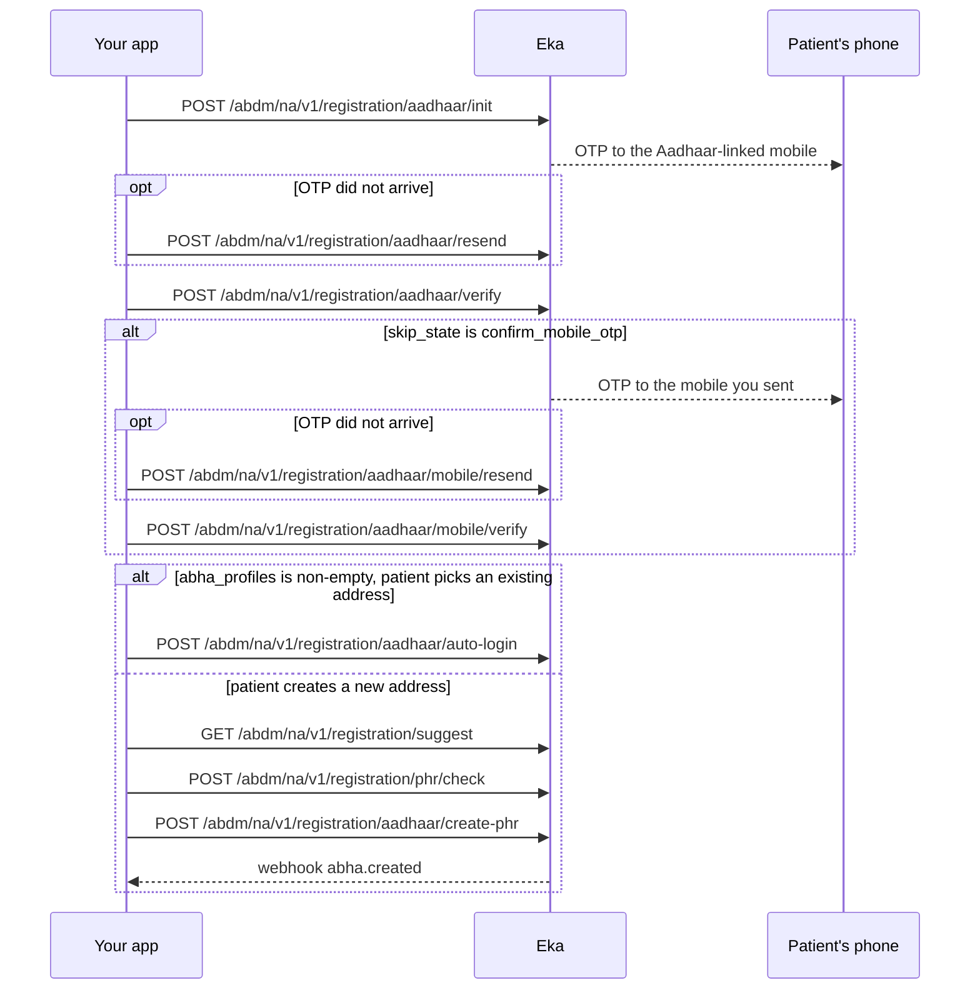

## When to use this

The patient has an Aadhaar number and can receive an OTP on the mobile linked to it. This workflow produces a KYC-verified 14-digit ABHA number and an ABHA address such as `shyam@abdm`. Aadhaar is the KYC.

Alternatives:

- The patient will not use Aadhaar: [Create an ABHA address with mobile OTP](/api-reference/user-app/abdm-connect/workflows/create-abha-mobile-otp). That address is not KYC-verified.
- Assisted creation where the patient authenticates with their face on a mobile device instead of an OTP: [Create an ABHA with face authentication](/api-reference/user-app/abdm-connect/workflows/create-abha-face-auth).
- The patient already knows their ABHA address: [Log in to an existing ABHA](/api-reference/user-app/abdm-connect/workflows/login-abha).

If the patient already has an ABHA on this Aadhaar, this workflow finds it at the verify step and logs them in instead of creating a duplicate.

## Before you start

- A client access token, sent as a Bearer token on every call. See [Client login](/api-reference/authorization/client-login).
- Your facility onboarded as a Health Information Provider (HIP), with its HIP ID. You can send it in the optional `X-Hip-Id` header.
- Your own patient id for this person. You can send it in the optional `X-Partner-Pt-Id` header. {/* TODO: confirm: does the abha.created webhook's data.partner_patient_id and data.hip_id echo the X-Partner-Pt-Id and X-Hip-Id headers sent on these calls? If so, say the headers are needed to match the webhook to the patient. */}
- A webhook endpoint registered with Eka, so you receive `abha.created`. See [Register a webhook](/api-reference/connect/webhooks/register-webhook).
- In hand: the patient's 12-digit Aadhaar number, the 10-digit mobile number they want on the ABHA, and their consent to use Aadhaar, recorded on your side.

## Sequence

## Steps

<Steps>
  <Step title="Send the Aadhaar number">
    Send `aadhaar_number` to [Generate OTP](/api-reference/user-app/abdm-connect/enrollment/aadhaar/initiate-registration). ABDM sends an OTP to the mobile linked to that Aadhaar. The response carries `txn_id` and a `hint` with the masked mobile number, for example `OTP sent successfully to your mobile number ******90973`. Show the hint to the patient so they know which phone to check.

    Keep `txn_id`. Every later call in this workflow takes the `txn_id` from the most recent response.

    If the OTP does not arrive, send `txn_id` to [Resend OTP](/api-reference/user-app/abdm-connect/enrollment/aadhaar/aadhaar-resend-otp). It returns a `txn_id`; use that one from now on. {/* TODO: confirm: how long to wait before offering resend, and how many resends are allowed before ABDM-1100. */}
  </Step>
  <Step title="Verify the Aadhaar OTP">
    Send `txn_id`, the `otp` the patient reads out, and `mobile` to [Verify OTP](/api-reference/user-app/abdm-connect/enrollment/aadhaar/verify-otp). All three are required. `mobile` is the number the ABHA will be linked to. It can differ from the mobile linked to the Aadhaar.

    The response carries a new `txn_id`, `skip_state`, `abha_profiles`, `profile` and `eka.oid`. Read `skip_state` and `abha_profiles` to decide the next call:

    - `skip_state` is `confirm_mobile_otp`: the `mobile` you sent is not the one linked to the Aadhaar. Go to the next step to verify it.
    - `skip_state` is `abha_create` and `abha_profiles` is empty: the patient has no ABHA address on this Aadhaar. Skip to "Choose an ABHA address".
    - `skip_state` is `abha_create` and `abha_profiles` is non-empty: the patient already has one or more ABHA addresses. Show each `abha_address` and `name` from `abha_profiles`. If the patient picks one, go to "Log in to the existing address". If they want a new one, go to "Choose an ABHA address".
    - `skip_state` is `abha_select`: the patient has several ABHA addresses and must choose one to log in. {/* TODO: confirm: which call follows abha_select in the Aadhaar registration flow, auto-login with the chosen address or something else? */}
    - `skip_state` is `abha_end`: the flow is complete; no further call is needed. {/* TODO: confirm: can aadhaar/verify return abha_end directly, and in what case? */}
  </Step>
  <Step title="Verify the new mobile (only if skip_state is confirm_mobile_otp)">
    An OTP goes to the `mobile` you sent in the previous step. Send `txn_id` and that `otp` to [Mobile Verify OTP](/api-reference/user-app/abdm-connect/enrollment/aadhaar/mobile-verify). The response has the same shape as Verify OTP. Read `skip_state` and `abha_profiles` again and branch exactly as in the previous step.

    If this OTP does not arrive, send `txn_id` to [Mobile Resend OTP](/api-reference/user-app/abdm-connect/enrollment/aadhaar/mobile-resend-otp) and use the `txn_id` it returns.
  </Step>
  <Step title="Choose an ABHA address">
    The patient chooses the ABHA address to create. Two helpers make this reliable.

    Call [Suggest ABHA Address](/api-reference/user-app/abdm-connect/commons/suggest-abha-address) with `transactionId` set to your current `txn_id`. You can also pass `fn`, `mn`, `ln` and `dob` (format `YYYY-MM-DD`). The response's `suggestions` lists available addresses.

    Before you submit, send the chosen `abha_address` to [Does ABHA Address Exist](/api-reference/user-app/abdm-connect/commons/does-health-id-exist). If `exists` is `true`, ask the patient for another one.

    {/* TODO: confirm: the address format to send to phr/check and create-phr. The create-phr example is "shyam.eka@abdm"; confirm whether the "@abdm" suffix is required, optional or added by Eka. */}
  </Step>
  <Step title="Log in to the existing address (only if the patient picked one)">
    Send `txn_id` and the chosen `abha_address` from `abha_profiles` to [Auto Login](/api-reference/user-app/abdm-connect/enrollment/aadhaar/auto-login). The response carries `profile`, `eka.oid`, `token`, `refresh_token` and `skip_state`. On success `skip_state` is `abha_end`, as drawn in [Milestone 1](/api-reference/user-app/abdm-connect/flows/m1) for Aadhaar login. The patient is logged in. Stop here; do not call Create.
  </Step>
  <Step title="Create the ABHA">
    Send `txn_id` and the chosen `abha_address` to [Create](/api-reference/user-app/abdm-connect/enrollment/aadhaar/create-abha). Both are required. The response carries:

    - `profile.abha_number`: the 14-digit ABHA number, for example `12-3456-7856-8912`.
    - `profile.abha_address`: the patient's ABHA address.
    - `eka.oid`: Eka's id for this patient. Later calls take it in the `X-Pt-Id` header or the `oid` query parameter.
    - `token` and `refresh_token`: the ABHA tokens ABDM issues. {/* TODO: confirm: does the integrator need to store or send token, refresh_token or eka.min_token on any later call, or does Eka hold the gateway session itself? */}
    - `skip_state`. {/* TODO: confirm: the skip_state value Create returns on success (flows/m1 implies abha_end). */}

    Eka also sends the [`abha.created`](/api-reference/user-app/abdm-connect/webhooks/abha-created) webhook to your server. Its `data` carries `abha_address`, `abha_number`, `oid`, `hip_id` and `partner_patient_id`. Reply `200` within 5 seconds; Eka retries on any other status. Verify the `Eka-Webhook-Signature` header as described in [Webhook signature](/api-reference/connect/webhooks/webhook-signature). Use the webhook, not only the API response, to provision the patient in your database. {/* TODO: confirm: Eka's webhook retry schedule and how many times it retries. */}
  </Step>
</Steps>

## State you must persist

| Field | From | Keep | For |
|---|---|---|---|
| `txn_id` | The latest response in this workflow | Until Create or Auto Login returns {/* TODO: confirm: how long a txn_id stays valid. */} | Every call in this workflow |
| `eka.oid` | Verify, Mobile Verify, Create or Auto Login; also `data.oid` on `abha.created` | Permanently, on the patient record | The `X-Pt-Id` header or `oid` query on every later ABDM Connect call for this patient |
| `profile.abha_address` | Create or Auto Login; also `data.abha_address` on `abha.created` | Permanently, on the patient record | Care context linking, gateway session, login |
| `profile.abha_number` | Create or Auto Login; also `data.abha_number` on `abha.created` | Permanently, on the patient record | Printing the ABHA card, KYC, login by ABHA number |
| `transaction_id` | `abha.created` webhook | Until processed {/* TODO: confirm: whether transaction_id is the key to deduplicate webhook retries. */} | Ignoring a repeated delivery of the same event |

## When it fails

<Warning>
Which of these codes each call returns is not yet confirmed. The codes come from the [errors page](/api-reference/user-app/abdm-connect/errors), matched by meaning. Log the code you actually receive.
</Warning>

Error responses carry `code`, `error` and `source_error`. `source_error.code` holds codes such as `MIS-1013`. See [Error codes](/api-reference/user-app/abdm-connect/errors) for the full list. {/* TODO: confirm: which codes each operation in this workflow returns; the spec has no error examples for them, so the rows below are matched by the meaning on the errors page. */}

| Situation | Code | Do |
|---|---|---|
| Wrong OTP | `MIS-1013` | Ask the patient to re-enter the OTP. {/* TODO: confirm: how many wrong attempts are allowed before ABDM-1100. */} |
| Too many OTP requests or wrong attempts | `ABDM-1100` | Tell the patient to try again in 30 minutes. Start again from Generate OTP. |
| Patient blocked | `ABDM-1027` | Tell the patient to try again after 24 hours. |
| Too many requests | `ABDM-1022` | Back off and retry. {/* TODO: confirm: retry interval for ABDM-1022. */} |
| Expired or unknown transaction | `ABDM-1017`, `MIS-1026` | Start again from Generate OTP. |
| Aadhaar number not found | `ABDM-1112` | Ask the patient to check the number. |
| Malformed request, for example a missing `mobile` on Verify | `ABDM-1006`, `ABDM-1010` | Fix the request body against the reference page. |
| ABHA address already taken | `ABDM-1101` | Ask for another address. Call Does ABHA Address Exist before Create to avoid this. |
| Mobile verification still pending | `ABDM-1102` | Complete the Mobile Verify OTP step before Create. |
| Mobile number already claimed by another account | `EKA-1002` | Not documented yet. {/* TODO: confirm: what the integrator should do when EKA-1002 is returned. */} |
| ABDM or a dependent service is down or slow | `ABDM-1019`, `ABDM-1024`, `ABDM-1007`, `ABDM-1004` | Retry later. {/* TODO: confirm: retry interval and whether the same txn_id can be reused after a 5XX. */} |
| `abha.created` never arrives | none | Use the Create response to proceed. {/* TODO: confirm: how long to wait for abha.created before treating it as lost. */} |

## Test it

The [testing page](/api-reference/user-app/abdm-connect/testing) has the sandbox base URL, credentials and the happy path for every journey.

Run against the sandbox base URL `https://api.dev.eka.care`. {/* TODO: confirm: sandbox test Aadhaar numbers and OTPs. */}

- [ ] Happy path: Generate OTP, Verify OTP with `mobile` set to the Aadhaar-linked number, Suggest, Does ABHA Address Exist returns `exists: false`, Create. The response has `profile.abha_number` and `eka.oid`.
- [ ] `abha.created` arrives with the same `abha_address` and `oid`, and its signature verifies.
- [ ] Wrong OTP once, then the correct OTP: `MIS-1013`, then success. Record the code you receive; the expected code is not confirmed.
- [ ] Verify OTP with a `mobile` that is not the Aadhaar-linked one: `skip_state` is `confirm_mobile_otp`, then Mobile Verify OTP succeeds.
- [ ] Resend on both OTPs: each returns a `txn_id` that the next call accepts.
- [ ] Second run with the same Aadhaar: Verify OTP returns `abha_create` with a non-empty `abha_profiles`; Auto Login succeeds.
- [ ] Create with an address that Does ABHA Address Exist reports as taken: `ABDM-1101`. Record the code you receive; the expected code is not confirmed.
