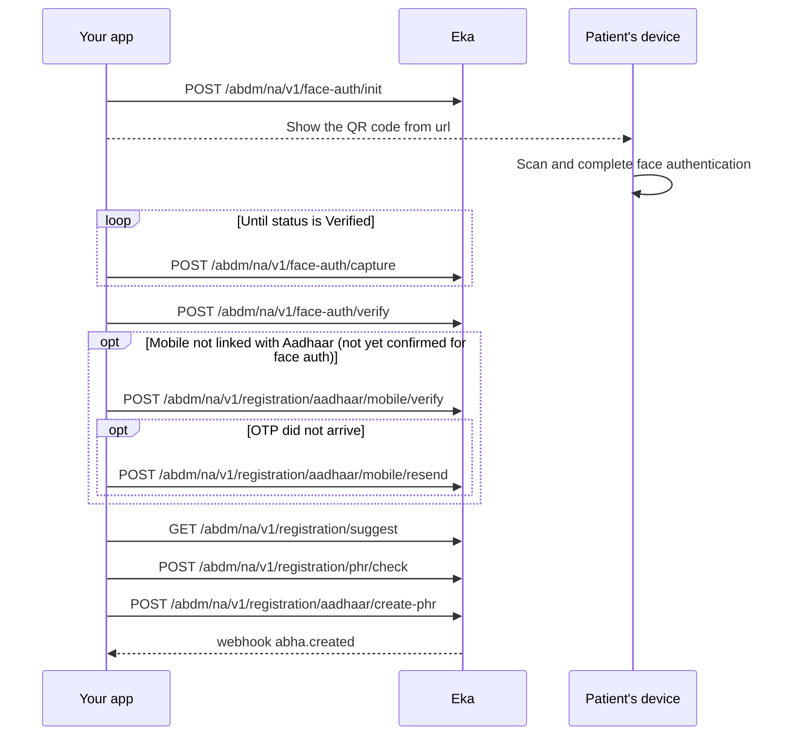

{/* TODO: confirm: which create call follows face-auth/verify. The spec and pages do not say. Evidence for aadhaar/create-phr: face-auth/verify returns the same txn_id, skip_state, abha_profiles and eka shape as aadhaar/verify, and flows/m1 draws "Verify, then Mobile linked with Aadhaar?, then Create ABHA" for face auth exactly as for Aadhaar OTP. Confirm the endpoint, and whether the mobile branch uses aadhaar/mobile/verify and aadhaar/mobile/resend (listed in operations on the m1 evidence; the page marks both as not yet confirmed). */}

## In short

- Face authentication on the patient's device replaces the Aadhaar OTP.
- Show the QR code from Face Auth Init, then poll Capture Face until `Verified`.
- Verify Face returns the identity, and Create uses the Aadhaar Create call.
- That create call is not yet confirmed for face authentication.

## When to use this

Use this for assisted ABHA creation with Aadhaar face authentication instead of an OTP. The patient scans a QR code you show and completes face authentication on a mobile device. The verified identity then creates a KYC-verified ABHA. {/* TODO: confirm: when to choose face authentication over the Aadhaar OTP. No source says it is for patients who cannot receive the OTP; flows/m1 still draws a "Mobile linked with Aadhaar?" branch after face auth. */}

Alternatives:

- The patient will use an Aadhaar OTP instead: [Create an ABHA with Aadhaar OTP](/api-reference/user-app/abdm-connect/workflows/create-abha-aadhaar-otp).
- The patient will not use Aadhaar: [Create an ABHA address with mobile OTP](/api-reference/user-app/abdm-connect/workflows/create-abha-mobile-otp).

## Before you start

- A client access token, sent as a Bearer token on every call. See [Client login](/api-reference/authorization/client-login).
- Your facility onboarded as a Health Information Provider (HIP). You can send its HIP ID in the optional `X-Hip-Id` header and your own patient id in the optional `X-Partner-Pt-Id` header.
- A webhook endpoint registered with Eka, so you receive `abha.created`. See [Register a webhook](/api-reference/connect/webhooks/register-webhook).
- A screen that can show a QR code to the patient, and a mobile device on which the patient completes face authentication. {/* TODO: confirm: what the patient needs on the device (app, camera, network) and whether the device must be the patient's own. */}
- In hand: the patient's 12-digit Aadhaar number.

## Sequence

## Steps

<Steps>
  <Step title="Start face authentication">
    Call [Face Auth Init](/api-reference/user-app/abdm-connect/enrollment/face-auth/face-auth-init). It takes no request body. The response carries `txn_id` and `url`. Show `url` to the patient as a QR code to scan with their mobile device. {/* TODO: confirm: whether url is the QR payload to render or a link to open, and how long it stays valid. */}

    Keep `txn_id`; every later call takes the `txn_id` from the most recent response.
  </Step>
  <Step title="Poll until the face is verified">
    Send `txn_id` to [Capture Face](/api-reference/user-app/abdm-connect/enrollment/face-auth/face-auth-capture) repeatedly while the patient completes face authentication. The response carries `status`, `message` and `txn_id`. Keep polling while `status` is `Pending`. Stop when it is `Verified`. {/* TODO: confirm: the poll interval, the maximum time to poll before giving up, and the status values for a failed or expired face authentication. */}
  </Step>
  <Step title="Fetch the verified identity">
    Send `txn_id` and `aadhaar` (the patient's Aadhaar number) to [Verify Face](/api-reference/user-app/abdm-connect/enrollment/face-auth/face-auth-verify). The response carries a new `txn_id`, `skip_state`, `abha_profiles`, `profile` and `eka.oid`. `profile` holds the patient's name, date of birth, gender and address from Aadhaar.

    Read `skip_state` and `abha_profiles`:

    - `abha_create` with an empty `abha_profiles`: go to the next step.
    - `abha_create` with a non-empty `abha_profiles`: the patient already has ABHA addresses. {/* TODO: confirm: whether aadhaar/auto-login accepts the face-auth txn_id to log in to one of them. */}
    - `confirm_mobile_otp`: go to "Verify the mobile". {/* TODO: confirm: when face-auth/verify returns confirm_mobile_otp, given it takes no mobile. */}
  </Step>
  <Step title="Verify the mobile (only if skip_state is confirm_mobile_otp)">
    <Note>
    This step is not yet confirmed for face authentication. flows/m1 draws a "Mobile linked with Aadhaar?" branch after Verify Face, with Mobile Verify OTP and Mobile Resend OTP, as in the Aadhaar OTP flow. Whether these calls accept the face-auth `txn_id` is not yet confirmed.
    </Note>

    Send `txn_id` and the `otp` the patient receives to [Mobile Verify OTP](/api-reference/user-app/abdm-connect/enrollment/aadhaar/mobile-verify). If the OTP does not arrive, send `txn_id` to [Mobile Resend OTP](/api-reference/user-app/abdm-connect/enrollment/aadhaar/mobile-resend-otp) and use the `txn_id` it returns. {/* TODO: confirm: whether aadhaar/mobile/verify and aadhaar/mobile/resend are the calls after face auth, and which mobile number the OTP goes to. */}
  </Step>
  <Step title="Create the ABHA">
    <Note>
    The create call after face authentication is not yet confirmed. Verify Face returns the same `txn_id`, `skip_state`, `abha_profiles` and `eka` shape as the Aadhaar OTP Verify call. flows/m1 draws the same mobile check, then create, path for both. On that evidence this step uses the Aadhaar Create call.
    </Note>

    The patient chooses an ABHA address. You can use [Suggest ABHA Address](/api-reference/user-app/abdm-connect/commons/suggest-abha-address) and [Does ABHA Address Exist](/api-reference/user-app/abdm-connect/commons/does-health-id-exist) as in [Create an ABHA with Aadhaar OTP](/api-reference/user-app/abdm-connect/workflows/create-abha-aadhaar-otp).

    Send `txn_id` and `abha_address` to [Create](/api-reference/user-app/abdm-connect/enrollment/aadhaar/create-abha). The response carries `profile.abha_number`, `profile.abha_address`, `eka.oid`, `token`, `refresh_token` and `skip_state`.

    Eka also sends the [`abha.created`](/api-reference/user-app/abdm-connect/webhooks/abha-created) webhook with `abha_address`, `abha_number`, `oid`, `hip_id` and `partner_patient_id` in `data`. Acknowledge it and verify its signature as described in [Webhooks](/api-reference/user-app/abdm-connect/webhooks#delivery-signature-and-acknowledgement).
  </Step>
</Steps>

## State you must persist

| Field | From | Keep | For |
|---|---|---|---|
| `txn_id` | The latest response in this workflow | Until Create returns {/* TODO: confirm: how long a face-auth txn_id stays valid. */} | Every call in this workflow |
| `eka.oid` | Verify Face or Create; also `data.oid` on `abha.created` | Permanently, on the patient record | The `X-Pt-Id` header or `oid` query on every later call for this patient |
| `profile.abha_address` | Create; also `data.abha_address` on `abha.created` | Permanently, on the patient record | Care context linking, gateway session, login |
| `profile.abha_number` | Create; also `data.abha_number` on `abha.created` | Permanently, on the patient record | ABHA card, KYC, login by ABHA number |

## When it fails

<Warning>
Which of these codes each call returns is not yet confirmed. The codes come from the [errors page](/api-reference/user-app/abdm-connect/errors), matched by meaning. Log the code you actually receive.
</Warning>

Error responses carry `code`, `error` and `source_error`. `source_error.code` holds the ABDM code. See [Error codes](/api-reference/user-app/abdm-connect/errors). {/* TODO: confirm: which codes face-auth init, capture and verify return, including the code or status for a face that does not match; the spec has no error examples for them. */}

| Situation | Code | Do |
|---|---|---|
| Patient never completes face authentication | Capture keeps returning `Pending` | Stop polling after your timeout and start again from Face Auth Init. {/* TODO: confirm: the timeout. */} |
| Aadhaar number does not match the face authenticated | Not documented | {/* TODO: confirm: the code returned by face-auth/verify when the Aadhaar does not match. */} Ask the patient to check the number. |
| Expired or unknown transaction | `ABDM-1017`, `MIS-1026` | Start again from Face Auth Init. |
| Too many requests | `ABDM-1022` | Back off and retry. {/* TODO: confirm: retry interval for ABDM-1022. */} |
| ABHA address already taken | `ABDM-1101` | Ask for another address. |
| ABDM or a dependent service is down | `ABDM-1019`, `ABDM-1024`, `ABDM-1007` | Retry later. |

## Test it

The [testing page](/api-reference/user-app/abdm-connect/testing) has the sandbox base URL, credentials and the happy path for every journey.

Run against the sandbox base URL `https://api.dev.eka.care`. {/* TODO: confirm: whether face authentication can be completed on sandbox at all, with which test Aadhaar and device. */}

- [ ] Happy path: Face Auth Init, show `url`, poll Capture Face until `Verified`, Verify Face, Create. The response has `profile.abha_number` and `eka.oid`.
- [ ] `abha.created` arrives with the same `abha_address` and `oid`, and its signature verifies.
- [ ] Abandon face authentication: Capture Face stays `Pending` and your timeout restarts the flow.
- [ ] Verify Face with a different Aadhaar number from the one authenticated: record the code it returns in the failure table.
