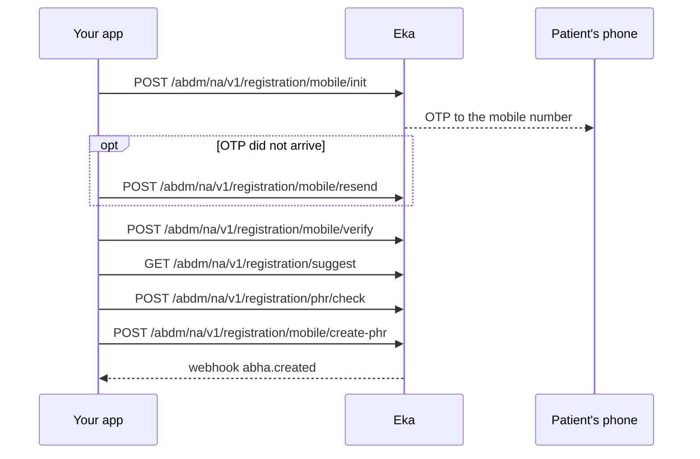

## When to use this

The patient will not use Aadhaar, or does not have it. This workflow verifies their mobile number with an OTP and creates an ABHA address such as `shyam@abdm`. The address is not KYC-verified, and the patient gets no 14-digit ABHA number from it.

Alternatives:

- The patient has Aadhaar and its linked mobile: [Create an ABHA with Aadhaar OTP](/api-reference/user-app/abdm-connect/workflows/create-abha-aadhaar-otp) gives a KYC-verified ABHA number.
- The patient already has an ABHA address: [Log in to an existing ABHA](/api-reference/user-app/abdm-connect/workflows/login-abha).
- The patient wants to upgrade the address to KYC later: [Manage the ABHA profile and KYC](/api-reference/user-app/abdm-connect/workflows/manage-profile-and-kyc).

## Before you start

- A client access token, sent as a Bearer token on every call. See [Client login](/api-reference/authorization/client-login).
- Your facility onboarded as a Health Information Provider (HIP). You can send its HIP ID in the optional `X-Hip-Id` header and your own patient id in the optional `X-Partner-Pt-Id` header.
- A webhook endpoint registered with Eka, so you receive `abha.created`. See [Register a webhook](/api-reference/connect/webhooks/register-webhook).
- In hand: the patient's mobile number, first name, gender, full date of birth and pincode. Middle name, last name and address are optional.

## Sequence

## Steps

<Steps>
  <Step title="Send the mobile number">
    Send `mobile_number` to [Generate OTP](/api-reference/user-app/abdm-connect/enrollment/mobile/init). The patient receives an OTP. The response carries `txn_id` and a `hint` with the masked number.

    Keep `txn_id`. Every later call takes the `txn_id` from the most recent response.

    If the OTP does not arrive, send `txn_id` to [Resend OTP](/api-reference/user-app/abdm-connect/enrollment/mobile/resend) and use the `txn_id` it returns. {/* TODO: confirm: how long to wait before offering resend, and how many resends are allowed. */}
  </Step>
  <Step title="Verify the OTP">
    Send `txn_id` and the `otp` to [Verify OTP](/api-reference/user-app/abdm-connect/enrollment/mobile/verify). The response carries a new `txn_id`, `skip_state`, `eka.oid` and `abha_profiles`.

    `abha_profiles` is present when ABHA addresses already exist on this mobile. If it is non-empty, show each `abha_address` and `name`, and ask whether the patient wants one of those or a new address. To use an existing one, switch to [Log in to an existing ABHA](/api-reference/user-app/abdm-connect/workflows/login-abha). {/* TODO: confirm: when abha_profiles is non-empty after mobile/verify, which call logs the patient in to the chosen address with this txn_id, or must login start again from login/init? Also confirm which skip_state values mobile/verify returns and what each means here. */}

    If the patient wants a new address, continue.
  </Step>
  <Step title="Choose an ABHA address">
    Call [Suggest ABHA Address](/api-reference/user-app/abdm-connect/commons/suggest-abha-address) with `transactionId` set to your current `txn_id`, plus `fn`, `mn`, `ln` and `dob` (format `YYYY-MM-DD`) from the patient's details. The response's `suggestions` lists available addresses.

    Send the chosen `abha_address` to [Does ABHA Address Exist](/api-reference/user-app/abdm-connect/commons/does-health-id-exist). If `exists` is `true`, ask the patient for another one.

    {/* TODO: confirm: the address format to send to phr/check and create-phr, with or without the "@abdm" suffix. */}
  </Step>
  <Step title="Create the ABHA address">
    Send `txn_id`, `abha_address` and `profile` to [Create](/api-reference/user-app/abdm-connect/enrollment/mobile/create). `profile` requires `first_name`, `gender` (`M`, `F` or `O`), `year_of_birth`, `month_of_birth`, `day_of_birth` and `pincode`. It also takes `middle_name`, `last_name` and `address`.

    The response carries `success`, `profile`, `eka.oid`, `skip_state`, `token` and `refresh_token`. {/* TODO: confirm: the skip_state value Create returns on success, and whether token, refresh_token or eka.min_token must be stored for later calls. */}

    Eka also sends the [`abha.created`](/api-reference/user-app/abdm-connect/webhooks/abha-created) webhook with `abha_address`, `oid`, `hip_id` and `partner_patient_id` in `data`. Reply `200` within 5 seconds; Eka retries on any other status. Verify the `Eka-Webhook-Signature` header as described in [Webhook signature](/api-reference/connect/webhooks/webhook-signature). {/* TODO: confirm: what data.abha_number holds on abha.created for a mobile-created address, which has no ABHA number. */}
  </Step>
</Steps>

## State you must persist

| Field | From | Keep | For |
|---|---|---|---|
| `txn_id` | The latest response in this workflow | Until Create returns {/* TODO: confirm: how long a txn_id stays valid. */} | Every call in this workflow |
| `eka.oid` | Verify OTP or Create; also `data.oid` on `abha.created` | Permanently, on the patient record | The `X-Pt-Id` header or `oid` query on every later call for this patient |
| `profile.abha_address` | Create; also `data.abha_address` on `abha.created` | Permanently, on the patient record | Care context linking, gateway session, login |
| `profile.kyc_verified` | Create | Until the patient completes KYC | Deciding whether to offer KYC later |

## When it fails

<Warning>
Which of these codes each call returns is not yet confirmed. The codes come from the [errors page](/api-reference/user-app/abdm-connect/errors), matched by meaning. Log the code you actually receive.
</Warning>

Error responses carry `code`, `error` and `source_error`. `source_error.code` holds codes such as `MIS-1013`. See [Error codes](/api-reference/user-app/abdm-connect/errors). {/* TODO: confirm: which codes each operation in this workflow returns; the spec has no error examples for them, so the rows below are matched by the meaning on the errors page. */}

| Situation | Code | Do |
|---|---|---|
| Wrong OTP | `MIS-1013` | Ask the patient to re-enter the OTP. |
| Too many OTP requests or wrong attempts | `ABDM-1100` | Tell the patient to try again in 30 minutes. Start again from Generate OTP. |
| Patient blocked | `ABDM-1027` | Tell the patient to try again after 24 hours. |
| Too many requests | `ABDM-1022` | Back off and retry. {/* TODO: confirm: retry interval for ABDM-1022. */} |
| Expired or unknown transaction | `ABDM-1017`, `MIS-1026` | Start again from Generate OTP. |
| Invalid mobile number | `ABDM-1014` | Ask the patient to check the number. |
| Missing or invalid `profile` field | `ABDM-1006`, `ABDM-1010` | Fix the request body against the reference page. |
| ABHA address already taken | `ABDM-1101` | Ask for another address. Call Does ABHA Address Exist first. |
| ABDM or a dependent service is down | `ABDM-1019`, `ABDM-1024`, `ABDM-1004` | Retry later. {/* TODO: confirm: retry interval and whether the same txn_id can be reused after a 5XX. */} |

## Test it

The [testing page](/api-reference/user-app/abdm-connect/testing) has the sandbox base URL, credentials and the happy path for every journey.

Run against the sandbox base URL `https://api.dev.eka.care`. {/* TODO: confirm: sandbox test mobile numbers and OTPs. */}

- [ ] Happy path: Generate OTP, Verify OTP, Suggest, Does ABHA Address Exist returns `exists: false`, Create. The response has `success: true` and `eka.oid`.
- [ ] `abha.created` arrives with the same `abha_address` and `oid`, and its signature verifies.
- [ ] Wrong OTP once, then the correct one: `MIS-1013`, then success. Record the code you receive; the expected code is not confirmed.
- [ ] Resend OTP, then verify with the new OTP and the returned `txn_id`.
- [ ] Second run with the same mobile: Verify OTP returns a non-empty `abha_profiles`.
- [ ] Create with an address that Does ABHA Address Exist reports as taken: `ABDM-1101`. Record the code you receive; the expected code is not confirmed.
