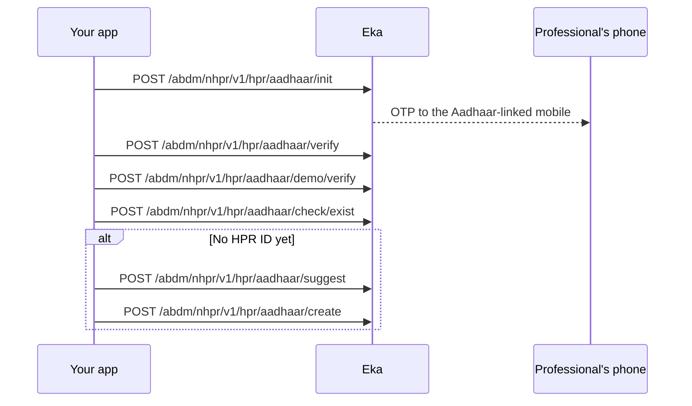

## When to use this

A doctor, nurse or other healthcare professional at the facility needs a Healthcare Professional Registry (HPR) ID, and you want them to get it without leaving your HMS. The flow verifies their Aadhaar with an OTP, confirms the mobile they give is the one linked to Aadhaar, and either returns the HPR ID they already have or creates a new one.

For a professional who already has an HPR ID and wants to sign in with their mobile, use [Log in to HPR with a mobile OTP](/api-reference/user-app/abdm-connect/workflows/hpr-mobile-login). You can also create HPR IDs by hand on the [ABDM portal](https://nhpr.abdm.gov.in/nhpr/v4/login).

## Before you start

- A bearer token for the Eka API. See [Authorization](/api-reference/authorization/getting-started).
- The headers your integration sends on ABDM Connect calls. Each operation in this workflow accepts `X-Pt-Id`, `X-Partner-Pt-Id` and `X-Hip-Id`. {/* TODO: confirm: which of X-Pt-Id, X-Partner-Pt-Id and X-Hip-Id are required on NHPR calls, given the facility has no HIP ID yet at this point? */}
- The professional's Aadhaar number, the mobile linked to it, and their consent to use Aadhaar, recorded on your side.
- The professional's category and sub-category, email, pincode and a password, which Create needs. {/* TODO: confirm: where an integrator gets the valid values for hp_category_code, hp_sub_category_code, role, id_type, source_type and domain_name */}

## Sequence

## Steps

<Steps>
  <Step title="Send the Aadhaar OTP">
    Send `aadhaar` to [Get Aadhaar OTP](/api-reference/user-app/abdm-connect/nhpr-abdm/hpr/get-aadhar-otp). The response `data` carries `txn_id`, `mobile_num` and `hint`. Keep `txn_id`; every later call in this workflow needs it. The professional receives an OTP on the mobile linked to their Aadhaar.
  </Step>
  <Step title="Verify the Aadhaar OTP">
    Send `txn_id` and the `otp` the professional reads out to [Verify Aadhaar OTP](/api-reference/user-app/abdm-connect/nhpr-abdm/hpr/verify-aadhar-otp). The response `data` carries `txn_id`. Use the `txn_id` from this response in the next call. {/* TODO: confirm: is the txn_id returned by verify the same as the one from init, or does it replace it? */}
  </Step>
  <Step title="Verify the linked mobile">
    Send `txn_id` and the `mobile_num` the professional gives to [Verify Mobile](/api-reference/user-app/abdm-connect/nhpr-abdm/hpr/verify-mobile). Read `verified` in the response `data`. If `verified` is false, stop and show `reason`; the mobile does not match Aadhaar. If it is true, keep `txnId`. The response can also carry `hpr.hprId` and `suggested_hpr_ids`. {/* TODO: confirm: when demo/verify returns hpr.hprId or suggested_hpr_ids, can the integrator skip check/exist or suggest? */}
  </Step>
  <Step title="Check for an existing HPR ID">
    Send `txn_id` and `mobile_num` to [Get HPR Info](/api-reference/user-app/abdm-connect/nhpr-abdm/hpr/check-hpr-exist). The response `data` carries the professional's profile (`first_name`, `last_name`, `category_id`, `pincode` and others), `hpr_id`, `hpr_id_number`, `new`, `token` and `txn_id`. If an HPR ID already exists, save `hpr_id` and `hpr_id_number` on the staff record and stop; do not create a second one. Otherwise continue to Suggest. {/* TODO: confirm: which field decides that an HPR ID exists: a non-empty hpr_id, or new being false? */}
  </Step>
  <Step title="Get suggested HPR IDs">
    Send `txn_id` to [Suggest IDs](/api-reference/user-app/abdm-connect/nhpr-abdm/hpr/suggest-ids). The response `data` is a list of suggested HPR ID handles. Show them to the professional and let them pick one, or type their own. {/* TODO: confirm: should the integrator call POST /abdm/nhpr/v1/hpr/aadhaar/check/available on a handle the professional types before calling create? */}
  </Step>
  <Step title="Create the HPR ID">
    Send `txnId`, the chosen `hprId`, and the professional's details to [Create HPR](/api-reference/user-app/abdm-connect/nhpr-abdm/hpr/create-hpr). Note the field names: this body uses `txnId` and `hprId` in camel case, where earlier calls use `txn_id`. Prefill `first_name`, `middle_name`, `last_name` and `pincode` from the Get HPR Info response. The response `data` carries `hprId` and `hpr_id_number`. Save both on the staff record.
  </Step>
</Steps>

## State you must persist

| Field | From | Keep | For |
|---|---|---|---|
| `txn_id` | Get Aadhaar OTP, then Verify Aadhaar OTP | Until Create returns {/* TODO: confirm: how long an NHPR transaction stays valid */} | Every call in this workflow; sent as `txnId` to Create |
| `mobile_num` | The professional, checked by Verify Mobile | Until Get HPR Info returns | Verify Mobile and Get HPR Info |
| Profile fields (`first_name`, `last_name`, `pincode`) | Get HPR Info | Until Create returns | Prefilling the Create body {/* TODO: confirm: whether Get HPR Info's category_id maps to Create's hp_category_code; Create's schema has only hp_category_code and hp_sub_category_code */} |
| `hprId` or `hpr_id` | Create, or Get HPR Info for an existing ID | Permanently, on the staff record | Registering the facility, and identifying the professional in later ABDM calls {/* TODO: confirm: which later calls need the professional's HPR ID */} |
| `hpr_id_number` | Create, or Get HPR Info for an existing ID | Permanently, on the staff record | Display and reconciliation with the HPR registry |
| `token` | Get HPR Info | {/* TODO: confirm: what the token from check/exist is for, and how long to keep it */} | {/* TODO: confirm: which call consumes it */} |

## When it fails

<Warning>
Which of these codes each call returns is not yet confirmed. The codes come from the [errors page](/api-reference/user-app/abdm-connect/errors), matched by meaning. Log the code you actually receive.
</Warning>

Errors come back as `4XX` or `5XX` with a body carrying `code`, `error` and `source_error` (`code`, `message`). Read `source_error.code` for the upstream code, and look it up on the [errors page](/api-reference/user-app/abdm-connect/errors).

{/* TODO: confirm: do the NHPR endpoints return the ABDM and MIS codes below, or their own codes? None of the spec's NHPR operations carry an error example. */}

| Situation | Code | Do |
|---|---|---|
| Malformed body, such as a missing `aadhaar` | `ABDM-1006` | Fix the request; do not retry unchanged |
| Wrong OTP | `MIS-1013` | Let the professional enter it again {/* TODO: confirm: how many OTP attempts before the transaction must restart from init */} |
| Too many OTP requests or attempts | `ABDM-1100` | Wait 30 minutes, then restart from Get Aadhaar OTP; show the professional the lockout |
| Transaction expired or unknown | `ABDM-1017` or `MIS-1026` | Restart from Get Aadhaar OTP |
| Mobile does not match Aadhaar | Verify Mobile returns `verified` false with `error_code` and `reason` | Show `reason`; ask for the Aadhaar-linked mobile |
| HPR ID handle already taken | {/* TODO: confirm: the code create returns for a taken hprId */} | Offer another suggested handle |
| ABDM registry unavailable | `ABDM-1019` or `ABDM-1024` | Retry later {/* TODO: confirm: retry interval and limit for NHPR calls */} |

## Test it

The [testing page](/api-reference/user-app/abdm-connect/testing) has the sandbox base URL, credentials and the happy path for every journey.

Run against the sandbox base URL `https://api.dev.eka.care`. {/* TODO: confirm: sandbox Aadhaar numbers and OTPs for HPR creation, and the testing page to link */}

- [ ] Happy path for a new professional: Get Aadhaar OTP, Verify Aadhaar OTP, Verify Mobile with `verified` true, Get HPR Info shows no existing ID, Suggest IDs, Create returns `hprId` and `hpr_id_number`
- [ ] Second run with the same Aadhaar: Get HPR Info returns the existing `hpr_id`, and your app stops without calling Create
- [ ] Wrong OTP once, then the correct OTP
- [ ] A mobile that is not linked to the Aadhaar: Verify Mobile returns `verified` false and your app shows `reason`
- [ ] Create with a handle that is already taken
