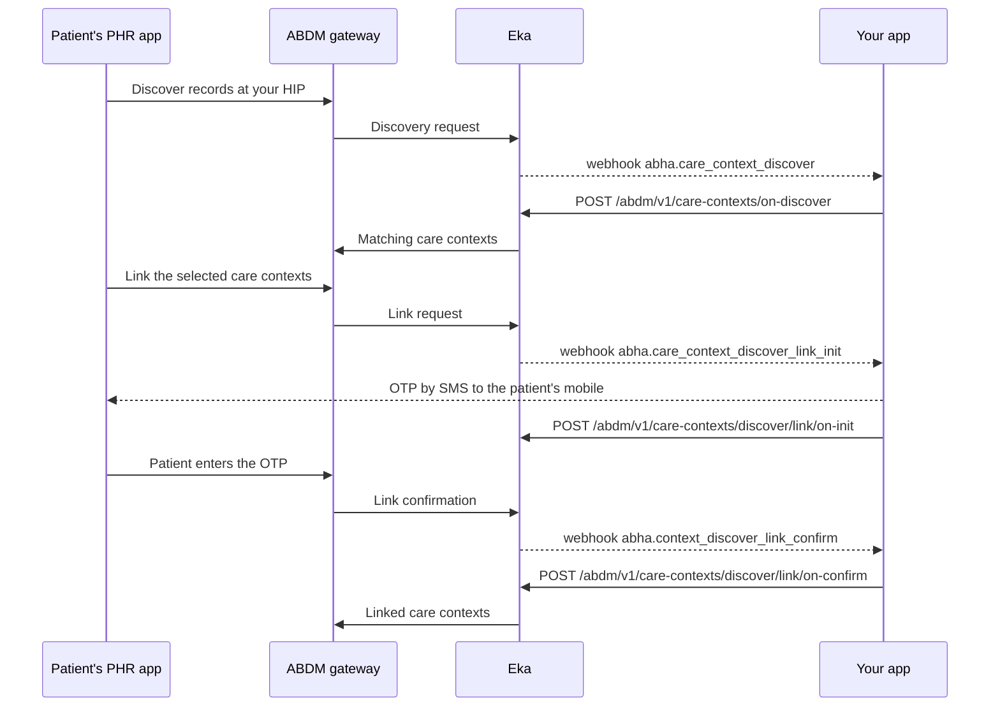

## When to use this

A patient searches for their records at your facility from a PHR app, such as the ABHA app. The records exist in your system but were never linked to their ABHA. You answer three webhooks in turn: you return the matching records, you send the patient an OTP, and you confirm the link once the OTP checks out.

You never talk to ABDM directly. ABDM sends each request to Eka, Eka forwards it to your webhook, and you answer by calling Eka.

For records created after you know the patient's ABHA, link them yourself with [Link a care context as a HIP](/api-reference/user-app/abdm-connect/workflows/link-care-context-hip). You do not call that API in this workflow; the on-confirm call does the linking.

## Before you start

- A client access token, sent as a Bearer token. See [Authorization](/api-reference/authorization/getting-started).
- Your facility onboarded as a Health Information Provider (HIP), with its HIP ID. ABDM routes discovery requests by HIP ID.
- A webhook URL registered with Eka that can receive the three discovery events, and the means to verify the [webhook signature](/api-reference/connect/webhooks/webhook-signature).
- A patient search in your system by mobile number, name, gender and year of birth.
- A way to generate an OTP and send it by SMS to the patient's registered mobile number. You send this OTP yourself.

## Sequence

## Steps

<Steps>
  <Step title="Answer the discovery request">
    Eka sends the [`abha.care_context_discover`](/api-reference/user-app/abdm-connect/webhooks/discover-care-context) webhook. Acknowledge it with HTTP `200` within 5 seconds; Eka retries on any other status.

    From `data`, read `abha_address`, `patient_name`, `gender`, `year_of_birth` and the `identifiers` list (`MOBILE`, `ABHA_NUMBER`, `abhaAddress`). These are verified by ABDM, not typed in by the patient. Keep `request_id` and `txn_id`.

    Search your system with these identifiers. Collect the care contexts for this patient that are not yet linked: visits, prescriptions, lab reports.

    Call [On Discover](/api-reference/user-app/abdm-connect/care-contexts/discover/on_discover) with `request_id` and `txn_id` from the webhook, and `patients`: each entry with your patient reference number in `ref_num`, a `display` name, the `hi_type`, and `care_contexts` (each with `ref_num` and `display`). If you find no match, send `error` with `code` and `message` instead of `patients`. The call returns `204 No Content`.

    You may save `abha_address` to the matched patient's record. ABDM leaves that to you. If you save it, you can link the patient's future records directly with [Link a care context as a HIP](/api-reference/user-app/abdm-connect/workflows/link-care-context-hip).

    {/* TODO: confirm: which identifiers must match for a record to count as the patient's (mobile alone, or mobile plus name, gender and year of birth), and what to return when several patients match */}
    {/* TODO: confirm: hi_type sits on each patients entry, not on each care context; do you send one patients entry per hi_type when a patient's care contexts have different types? */}
    {/* TODO: confirm: the error.code and message to send when no patient matches; error.code is an integer and the errors page lists string codes */}
    {/* TODO: confirm: the deadline for the on-discover reply after the webhook */}
  </Step>
  <Step title="Send the OTP and report it">
    When the patient selects records to link, Eka sends the [`abha.care_context_discover_link_init`](/api-reference/user-app/abdm-connect/webhooks/discover-link-init) webhook. Acknowledge it with HTTP `200` within 5 seconds.

    From `data`, read `patient`: each entry carries `ref_num`, `hi_type`, `count` and `care_contexts` (each with `reference_number`). Save these as the care contexts to link. Keep `request_id` and `txn_id`. The `txn_id` is the same one the discovery webhook carried.

    Generate an OTP and send it to the patient's registered mobile number. Record when it expires.

    Call [On Link Init](/api-reference/user-app/abdm-connect/care-contexts/discover/link_on_init) with `request_id` and `txn_id` from this webhook, the patient's `ref_num`, and `otp_expiry`. If you cannot send the OTP, send `error` instead. The call returns `204 No Content`.

    {/* TODO: confirm: the format of otp_expiry (ISO 8601 timestamp or a duration) and any required OTP length or validity window */}
    {/* TODO: confirm: is each care_contexts reference_number the care context ref_num you sent in on-discover? */}
    {/* TODO: confirm: is the ref_num sent in on-init the value that comes back as linkRefNumber in the confirm webhook? */}
    {/* TODO: confirm: what to do if the selected reference_number values include care contexts you did not return in on-discover, or that are already linked */}
  </Step>
  <Step title="Verify the OTP and confirm the link">
    When the patient enters the OTP in the PHR app, Eka sends the [`abha.context_discover_link_confirm`](/api-reference/user-app/abdm-connect/webhooks/discover-link-confirm) webhook. Acknowledge it with HTTP `200` within 5 seconds.

    From `data`, read `token` (the OTP the patient entered), `linkRefNumber`, `request_id` and `hip_id`. Find the pending link from step 2 and compare `token` with the OTP you generated. Check it has not expired.

    If the OTP is valid, call [On Link Confirm](/api-reference/user-app/abdm-connect/care-contexts/discover/link_on_confirm) with `request_id` from this webhook and `patients`: the care contexts to link, in the same shape as on-discover. ABDM then registers the link under the patient's ABHA, against the HIP in `hip_id`. Mark those care contexts as linked in your system. The call returns `204 No Content`.

    If the OTP is wrong or expired, call On Link Confirm with `error` instead of `patients`.

    {/* TODO: confirm: how to match the confirm webhook to the pending link, since it carries no txn_id (by linkRefNumber?) */}
    {/* TODO: confirm: the error.code to send for a wrong or expired OTP, and whether the patient can retry the OTP or must start linking again */}
  </Step>
</Steps>

Once linked, these care contexts are discoverable and shareable like any other. If you keep their data yourself, answer HIU requests for them with [Serve records on a fetch request](/api-reference/user-app/abdm-connect/workflows/serve-data-on-fetch).

{/* TODO: confirm: are care contexts linked through on-confirm always served through abha.hip_data_fetch, or can the HIP send their FHIR data to Eka afterwards? */}

## State you must persist

| Field | From | Keep | For |
|---|---|---|---|
| `txn_id` | `abha.care_context_discover` | Until on-confirm returns | Every reply in this transaction; it ties discovery to link init |
| `request_id` | Each webhook | Until that webhook's reply returns | The reply to that webhook; each webhook has its own |
| Care contexts returned, with `ref_num` | Your on-discover reply | Until on-confirm returns | Checking what the patient selected |
| Selected `reference_number` values | `abha.care_context_discover_link_init` | Until on-confirm returns | The `patients` list in on-confirm |
| OTP and its expiry | You, in step 2 | Until the confirm webhook arrives or the OTP expires | Checking `token` |
| `abha_address` | `abha.care_context_discover` | Forever, on the patient record, if you choose to save it | Linking future records directly |
| Linked flag per care context | You, after on-confirm | Forever | Leaving it out of the next discovery answer |

{/* TODO: confirm: how long a discovery transaction stays open on ABDM's side, which bounds how long to keep txn_id and the pending OTP */}

## When it fails

<Warning>
Which of these codes each call returns is not yet confirmed. The codes come from the [errors page](/api-reference/user-app/abdm-connect/errors), matched by meaning. Log the code you actually receive.
</Warning>

Error responses carry `code`, `error` and `source_error`. The codes below are from the [errors page](/api-reference/user-app/abdm-connect/errors).

| Situation | Code | Do |
|---|---|---|
| Reply body malformed or `txn_id` or `request_id` missing | `ABDM-1006`, `ABDM-1010` | Check both ids are copied from the webhook and resend |
| Request id or transaction id not recognised | `ABDM-1030`, `ABDM-1052` | Use the `request_id` from the webhook you are answering, not an earlier one |
| Request id already used | `ABDM-1064` | Do not reply twice to the same webhook |
| Care context count does not match | `ABDM-1037` | Check the care contexts in on-confirm match those the patient selected |
| Link token invalid or mismatched | `ABDM-1026`, `ABDM-1038` | Not documented |
| Your system did not answer | `ABDM-1028`, `ABDM-1401`, `ABDM-1402` | Acknowledge each webhook within 5 seconds and reply promptly |
| Gateway timeout | `ABDM-1048` | Not documented |

{/* TODO: confirm: which of these codes Eka returns to the HIP's replies and which only reach the PHR app, and what the HIP should do on ABDM-1026, ABDM-1038 and ABDM-1048 */}

## Test it

The [testing page](/api-reference/user-app/abdm-connect/testing) has the sandbox base URL, credentials and the happy path for every journey.

{/* TODO: confirm: how to trigger discovery against your HIP on sandbox (which PHR app or test ABHA, and test patient data on your side) */}

- [ ] Create a test patient in your system with an unlinked visit, using the same mobile, name, gender and year of birth as a sandbox ABHA
- [ ] Discover your HIP from a sandbox PHR app; receive `abha.care_context_discover` and reply with the visit
- [ ] Select the visit; receive `abha.care_context_discover_link_init`, send the OTP, reply with on-init
- [ ] Enter the OTP; receive `abha.context_discover_link_confirm`, reply with on-confirm, and see the record linked in the PHR app
- [ ] Discover with an ABHA that matches no patient and reply with `error`
- [ ] Enter a wrong OTP and reply with `error`
