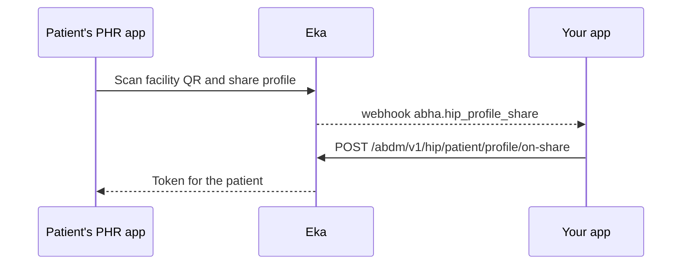

## When to use this

A patient at your registration counter scans the facility's Health Facility QR code with a PHR app and shares their ABHA profile. Eka sends you the profile on a webhook. You register or match the patient, issue an OPD token, and reply with it. The PHR app shows the patient the token.

This replaces asking the patient for their ABHA at the counter. If the patient has no PHR app, register them at the desk with [Log in to an existing ABHA](/api-reference/user-app/abdm-connect/workflows/login-abha) or [Create an ABHA with Aadhaar OTP](/api-reference/user-app/abdm-connect/workflows/create-abha-aadhaar-otp).

The PHR app's side of this exchange, scanning and fetching the token, is a separate set of calls: [Request to generate token](/api-reference/user-app/abdm-connect/scan-and-share/phr-scan-share) and [Get appointment token](/api-reference/user-app/abdm-connect/scan-and-share/phr-scan-share-token).

## Before you start

- A client access token, sent as a Bearer token. See [Authorization](/api-reference/authorization/getting-started).
- Your facility onboarded as a Health Information Provider (HIP), with its HIP ID.
- A Health Facility QR code displayed at each counter, each with its counter id (`hip_code`).
- A webhook URL registered with Eka that can receive `abha.hip_profile_share`, and the means to verify the [webhook signature](/api-reference/connect/webhooks/webhook-signature).
- A way to issue OPD token numbers in your system.

{/* TODO: confirm: where the facility gets its Health Facility QR code, and where each counter's hip_code is configured */}

## Sequence

## Steps

<Steps>
  <Step title="Receive the shared profile">
    Eka sends the [`abha.hip_profile_share`](/api-reference/user-app/abdm-connect/webhooks/hip-scan-and-share) webhook. Acknowledge it with HTTP `200` within 5 seconds; Eka retries on any other status.

    From `data`, keep `req_id`, `abha_address`, `abha_number`, `hip_code` (the counter the patient scanned), `hip_id`, `oid` and `partner_patient_id`.

    Look the patient up by `abha_address` or `abha_number`. If you find them, use that record. If not, register a new patient and save `abha_address`, `abha_number` and `oid` on the record. Issue an OPD token for the counter in `hip_code`.

    {/* TODO: confirm: does the webhook carry the patient's name, gender, year of birth and mobile, as "share their ABHA profile" suggests, or only the identifiers in the example? If only identifiers, how does the HIP get the demographics to register a new patient? */}
    {/* TODO: confirm: when partner_patient_id is filled in (only for a patient already known to you?), and what it is when the patient is new */}
  </Step>
  <Step title="Reply with the token">
    Call [On-Share](/api-reference/user-app/abdm-connect/scan-and-share/scan-on-share). Send the patient's `oid` in `X-Pt-Id`, your patient id in `X-Partner-Pt-Id` and your HIP ID in `X-Hip-Id`. In the body send:
    - `request_id`: the `req_id` from the webhook.
    - `abha_address`: from the webhook.
    - `hip_code`: the counter id from the webhook.
    - `token`: with `token_number` (required) and `expires_at`.

    If you cannot register the patient or issue a token, send `error` with `code` and `message` instead of `token`.

    The call returns `202 Accepted`. Eka passes the token to the patient's PHR app.

    {/* TODO: confirm: that request_id in on-share is the webhook's data.req_id (the names differ) */}
    {/* TODO: confirm: the unit of token.expires_at (epoch seconds or milliseconds) */}
    {/* TODO: confirm: which error.code values to send, since error.code is an integer and the errors page lists string codes */}
    {/* TODO: confirm: the deadline for the on-share reply after the webhook, and what the patient sees if it is missed */}
  </Step>
</Steps>

## State you must persist

| Field | From | Keep | For |
|---|---|---|---|
| `req_id` | `abha.hip_profile_share` | Until on-share returns `202` | `request_id` in the on-share reply |
| `hip_code` | `abha.hip_profile_share` | Until on-share returns `202` | Issuing the token for the right counter, and the reply |
| `abha_address`, `abha_number`, `oid` | `abha.hip_profile_share` | Forever, on the patient record | Linking this visit as a care context, and every later ABDM call |
| `token_number` | Your token system | For the visit | Calling the patient at the counter |

## When it fails

Error responses carry `code`, `error` and `source_error`. The codes below are from the [errors page](/api-reference/user-app/abdm-connect/errors).

| Situation | Code | Do |
|---|---|---|
| On-share body malformed or a field missing | `ABDM-1006`, `ABDM-1010` | Check `request_id` and `abha_address` are set and resend |
| Request id not recognised | `ABDM-1030`, `ABDM-1052` | Check you sent the webhook's `req_id` |
| Share could not reach the hospital | `ABDM-1018` | Retry later; register the patient at the desk meanwhile |
| Profile share keys invalid | `ABDM-1049`, `ABDM-1050` | Not documented |
| Your webhook did not answer within 5 seconds | No code; Eka retries the webhook | Acknowledge first, then register and reply |

{/* TODO: confirm: which of these codes on-share returns, and what an integrator should do on ABDM-1049 and ABDM-1050 */}

## Test it

{/* TODO: confirm: how to produce a facility QR and trigger abha.hip_profile_share on sandbox, and which test ABHA to share; there is no testing page for ABDM Connect yet */}

- [ ] Scan your sandbox facility QR from a PHR app with a test ABHA and receive `abha.hip_profile_share`
- [ ] Reply with a `token_number` and get `202 Accepted`; the PHR app shows the token
- [ ] Share the same ABHA again and confirm you match the existing patient instead of creating a duplicate
- [ ] Reply with `error` instead of `token` and check what the PHR app shows
