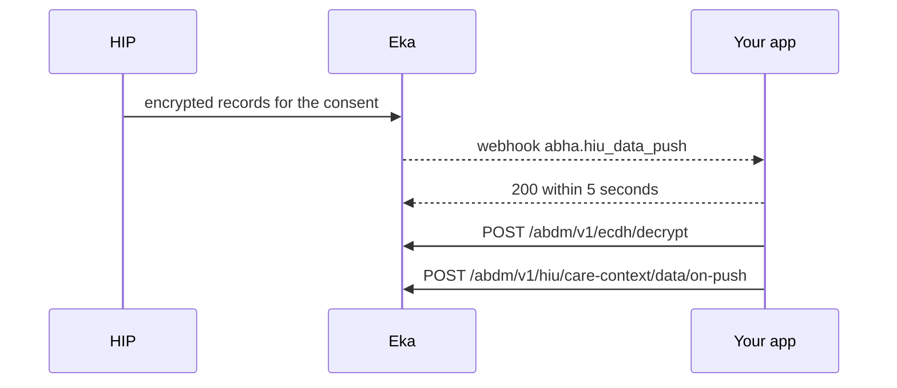

## When to use this

The patient has granted a consent you raised in [Request a patient's consent as a HIU](/api-reference/user-app/abdm-connect/workflows/hiu-request-consent), and you manage the data on your side. Each HIP encrypts the approved records with your public keyset and Eka delivers them to you on a webhook. This workflow decrypts them and tells Eka which care contexts you could parse.

If Eka stores the data for you, nothing arrives on a webhook. Read each approved care context with [Retrieve Health Records](/api-reference/user-app/records/retrieve-health-records) in the records product, passing the `care_context_id` from Consent Details as the identifier. That call belongs to the records product and is documented there.

## Before you start

- A bearer token for the API. See [Authorization](/api-reference/authorization/getting-started).
- Your public keyset registered, and the matching `private_key` and `nonce` stored on your side. See the keyset steps in [Request a patient's consent as a HIU](/api-reference/user-app/abdm-connect/workflows/hiu-request-consent).
- A granted consent, with its `consent_id` and the approved `care_contexts[].id`.
- A webhook endpoint registered with Eka that verifies the `Eka-Webhook-Signature` header. See [Webhook signature](/api-reference/connect/webhooks/webhook-signature).
- A way to decrypt: either the [Ecdh decrypt](/api-reference/user-app/abdm-connect/care-contexts/ecdh/decrypt) call, or the [abdm-ecdh library](/api-reference/user-app/abdm-connect/care-contexts/ecdh-encryption) in Go, Python or Java.

## Sequence

## Steps

<Steps>
  <Step title="Receive the push and acknowledge it">
    Eka sends [`abha.hiu_data_push`](/api-reference/user-app/abdm-connect/webhooks/hiu-data-push) when a HIP pushes records for your consent. Verify the signature and reply `200` within 5 seconds; Eka retries on any other status. Decrypt after you reply, so the 5 seconds are not spent on decryption.

    From `data`, keep:

    - `consent_id` and `transaction_id`: you send both back in the acknowledge step.
    - `entries`: one per care context, each with `care_context_id`, `content` (the encrypted FHIR bundle), `checksum` and `media` (`application/fhir+json`).
    - `key_information`: the sender's key material, with `dh_public_key.key_value` and `nonce`.
    - `hip_id`, `abha_address` and `oid`: which HIP and which patient the records belong to.

    Match `consent_id` against the consents you raised.

    {/* TODO: confirm: whether one consent can produce several abha.hiu_data_push events (one per HIP, or paged entries), and how to tell when the last one has arrived. */}
    {/* TODO: confirm: how to deduplicate a retried delivery: by the top-level transaction_id or by data.transaction_id. */}
  </Step>
  <Step title="Decrypt each entry">
    Call [Ecdh decrypt](/api-reference/user-app/abdm-connect/care-contexts/ecdh/decrypt) once per entry, or decrypt locally with the [abdm-ecdh library](/api-reference/user-app/abdm-connect/care-contexts/ecdh-encryption). Map the fields like this:

    | Decrypt field | Value |
    |---|---|
    | `encrypted_data` | `entries[].content` |
    | `sender_public_key` | `key_information.dh_public_key.key_value` |
    | `sender_nonce` | `key_information.nonce` |
    | `receiver_private_key` | your stored `private_key` |
    | `receiver_nonce` | your stored `nonce` |

    The response carries `decrypted_data`, the FHIR bundle as plain text. Parse it as JSON.

    {/* TODO: confirm: the webhook page describes key_information.dh_public_key as the HIU's public key, while the keyset page says the HIP's public key is shared for decryption. Which is it? The mapping above assumes the HIP's key. */}
    {/* TODO: confirm: how to verify entries[].checksum (which hash, over the encrypted or the decrypted content). */}
    {/* TODO: confirm: whether to reject an entry when key_information.dh_public_key.expiry has passed. */}
  </Step>
  <Step title="Report the parsing status">
    Call [Push FHIR parsing status](/api-reference/user-app/abdm-connect/care-contexts/data-on-push) with `consent_id` and `transaction_id` from the webhook, and one `status_response` item per entry: `care_context_id`, `success` (`true` if you decrypted and parsed it), and a `description` when it failed. Eka returns `202 Accepted`.

    {/* TODO: confirm: what happens to an entry reported with success false; does Eka or the HIP resend it? */}
    {/* TODO: confirm: the deadline for calling on-push after the webhook arrives. */}
  </Step>
</Steps>

## State you must persist

| Field | From | Keep | For |
|---|---|---|---|
| `consent_id` | `abha.hiu_data_push` | As long as you keep the records {/* TODO: confirm: retention period */} | The on-push call; tying records to the consent for audit |
| `data.transaction_id` | `abha.hiu_data_push` | Until on-push returns `202` | The on-push call |
| `care_context_id` | each entry | As long as you keep the record | On-push status; matching the record to the consent |
| Decrypted FHIR bundle | Ecdh decrypt | Until the consent expires or is revoked {/* TODO: confirm: whether the HIU must delete records when the consent's expiry or erase_at passes, or on revoke */} | Showing the record to your users |
| `hip_id` | `abha.hiu_data_push` | With the record | Knowing which facility a record came from |

## When it fails

Error responses carry `code`, `error` and `source_error` (`code`, `message`). Codes are listed on the [errors page](/api-reference/user-app/abdm-connect/errors).

| Situation | Code | Do |
|---|---|---|
| Your endpoint does not reply `200` within 5 seconds | none | Eka retries; reply first, decrypt after {/* TODO: confirm: retry count and schedule */} |
| Decryption fails | none from Eka if you use the library | Check you used the private key and nonce registered at the time of the consent; report the entry with `success` `false` |
| Ecdh decrypt rejects the body | `ABDM-1006`, `ABDM-1010` | Check every field is the Base64 value from the webhook or your store |
| Consent artefact expired | `ABDM-1061` | Do not use the records; raise a new consent {/* TODO: confirm: which call returns ABDM-1061 in this workflow */} |
| Transaction not recognised on on-push | `ABDM-1017`, `ABDM-1052` | Send `data.transaction_id` from the same webhook, not the top-level `transaction_id` {/* TODO: confirm: which transaction_id on-push expects */} |
| HIP unavailable or no acknowledgement from the HIP | `ABDM-1401`, `ABDM-1402` | No records arrive from that HIP {/* TODO: confirm: whether the HIU can trigger a re-fetch for one HIP, or must raise a new consent */} |
| No webhook arrives after the consent is granted | none | Check your keyset is registered and your webhook endpoint is reachable; check whether Eka stores the data for you |

## Test it

Sandbox base URL: `https://api.dev.eka.care`. {/* TODO: confirm: a sandbox HIP that pushes test records, and how to trigger a push in sandbox. No testing page exists yet. */}

- [ ] Run [Request a patient's consent as a HIU](/api-reference/user-app/abdm-connect/workflows/hiu-request-consent) to a granted consent
- [ ] `abha.hiu_data_push` arrives; your endpoint replies `200` within 5 seconds
- [ ] Each entry decrypts to a FHIR bundle with Ecdh decrypt and with the abdm-ecdh library, and both give the same result
- [ ] On-push with every entry `success` `true` returns `202`
- [ ] Decrypt with a wrong private key; report that entry with `success` `false`
