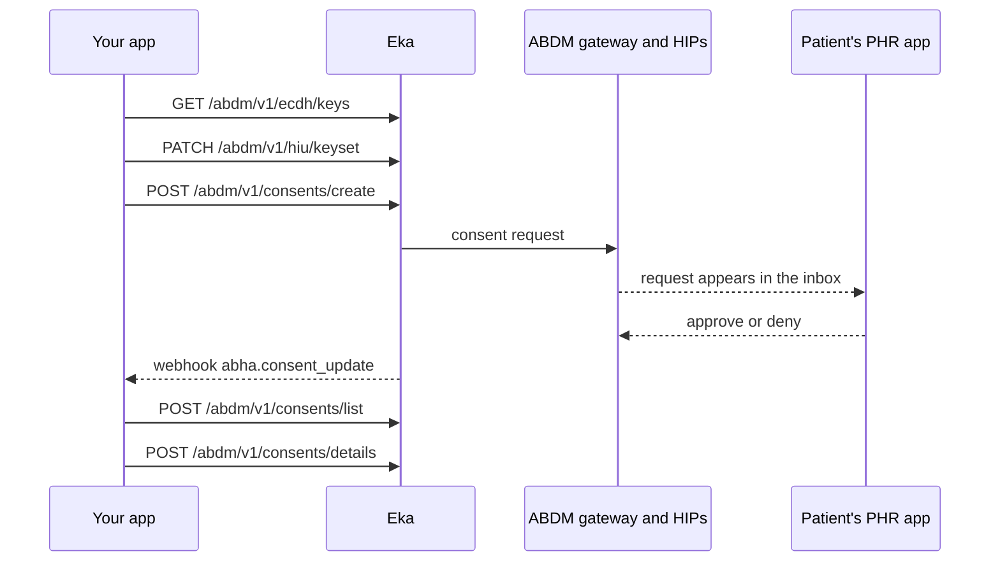

## When to use this

You are a Health Information User (HIU) and you need a patient's records from one or more Health Information Providers (HIPs). This workflow raises the consent request and follows it to a decision. Once the patient approves, Eka drives the ABDM gateway callbacks that ask each HIP for the data; you do nothing in between. Receiving the records is the next workflow, [Receive and decrypt records as a HIU](/api-reference/user-app/abdm-connect/workflows/hiu-receive-data).

A PHR app that pulls records on the patient's behalf is also a HIU and uses the same calls.

## Before you start

- A bearer token for the API. See [Authorization](/api-reference/authorization/getting-started).
- Your software set up as a HIU, with the facility onboarded on Eka. {/* TODO: confirm: which onboarding step registers a facility as HIU rather than HIP, and which page documents it? */}
- A webhook endpoint registered with Eka that verifies the `Eka-Webhook-Signature` header. See [Webhook signature](/api-reference/connect/webhooks/webhook-signature).
- The patient's ABHA address (`health_id`), and the patient's Eka user id (`oid`) if they are registered on Eka.
- Your `clinic_id` and the requesting doctor's `d_oid`. {/* TODO: confirm: where an HIU gets the clinic_id and d_oid it sends in the hiu object, and whether both are required. */}
- The HIP ids and care context references you want, if you know them.
- A decision on where the records go. If you manage the data on your side, you need the keyset steps. If Eka stores the data for you, skip them. {/* TODO: confirm: how an integration chooses between "you store the data" and "Eka stores the data", and whether it is a per-account setting. */}

## Sequence

## Steps

<Steps>
  <Step title="Generate a key pair (once)">
    Call [Ecdh keys](/api-reference/user-app/abdm-connect/care-contexts/ecdh/keys) to generate a key pair. The response carries `private_key`, `public_key` and `nonce`. Store `private_key` and `nonce` securely on your side; you need both to decrypt every record you receive. You can generate the key material locally with the [abdm-ecdh library](/api-reference/user-app/abdm-connect/care-contexts/ecdh-encryption) instead of calling Eka.

    Skip this step and the next if Eka stores the data for you.

    {/* TODO: confirm: whether the keyset expects the raw public_key from GET /abdm/v1/ecdh/keys or the x509_public_key form that the abdm-ecdh library returns. */}
  </Step>
  <Step title="Register your public keyset (once, and on rotation)">
    Send `public_key` and `nonce` to [Update public keyset](/api-reference/user-app/abdm-connect/care-contexts/hiu-keys). Both fields are required. Eka shares them with each HIP so the HIP can encrypt the records for you. You can update the keyset at any time.

    {/* TODO: confirm: whether records already in flight under an old keyset still decrypt with the old private key after a rotation, and how long to keep old private keys. */}
  </Step>
  <Step title="Create the consent request">
    Call [Consent Create](/api-reference/user-app/abdm-connect/consents/consent-create). The body names:

    - `patient`: the patient's `health_id` (ABHA address) and `oid`.
    - `hiu`: your `clinic_id`, `d_oid` and the `requester`.
    - `purpose`: one of `Self Requested`, `Care management`, `Public Health`, `Disease Specific Health Research`.
    - `record_types`: the record types you want, such as `Prescription` or `DischargeSummary`.
    - `period`: `from` and `to` for the records' date range, and `expiry` for when the consent ends.
    - `hip_identifier` and `care_contexts`: the HIP and the care contexts (`cc_ref`, `patient_ref`) to fetch from.

    Keep `consent_init_id` from the response. The patient now sees the request in their PHR app.

    {/* TODO: confirm: whether hip_identifier and care_contexts are optional, and what the request covers when they are left out. */}
    {/* TODO: confirm: the spec documents the success response as 204 with a body carrying consent_init_id; is the status 200 or 204? */}
  </Step>
  <Step title="Wait for the patient's decision">
    Wait for the [`abha.consent_update`](/api-reference/user-app/abdm-connect/webhooks/consent-update) webhook. Reply `200` within 5 seconds; Eka retries on any other status. Read `data.notification.consentRequestId`, `data.notification.status` and `data.notification.consentArtefacts.id`.

    The webhook fires whenever the consent is updated, so expect it more than once for the same request. Treat the latest status as current.

    {/* TODO: confirm: the list of values data.notification.status takes (granted, denied, expired, revoked?) and their exact case. */}
    {/* TODO: confirm: whether consentRequestId equals the consent_init_id from Create or the consent_id from List. */}
    {/* TODO: confirm: whether you should poll Consent List if the webhook never arrives, and at what interval. */}
  </Step>
  <Step title="Find the consent and its status">
    Call [Consent List](/api-reference/user-app/abdm-connect/consents/consent-list) with the same `hiu` (`clinic_id`, `d_oid`) and `patient` (`health_id`, `oid`) you used in Create. Each entry in `consents` carries `consent_init_id`, `consent_id`, `status`, `hi_types` and `period`. Match on `consent_init_id` and keep `consent_id`.

    If `status` shows the request was denied or has expired, stop here and close the request on your side.

    {/* TODO: confirm: the values of status in Consent List, and whether consent_id is empty until the patient grants. */}
  </Step>
  <Step title="Read what the patient approved">
    Call [Consent Details](/api-reference/user-app/abdm-connect/consents/consent-details) with `consent_id` and the patient's `health_id`. Each entry in `data` names one `hip` (`id`, `name`) and the `care_contexts` the patient approved from it, each with `id`, `display`, `status` and `documents`.

    Keep each `care_contexts[].id`. If you manage the data on your side, the records arrive next on a webhook. If Eka stores the data, you read each care context with the records product. Both paths are in [Receive and decrypt records as a HIU](/api-reference/user-app/abdm-connect/workflows/hiu-receive-data).
  </Step>
</Steps>

## State you must persist

| Field | From | Keep | For |
|---|---|---|---|
| `private_key` | Ecdh keys, or the abdm-ecdh library | As long as any consent registered under it can still deliver records {/* TODO: confirm: retention period after rotation */} | Decrypting every record on `abha.hiu_data_push` |
| `nonce` | Ecdh keys, or the abdm-ecdh library | Same as `private_key` | Decrypting every record |
| `consent_init_id` | Consent Create | Until the consent ends {/* TODO: confirm: retention period */} | Matching the request in Consent List |
| `consent_id` | Consent List | Until the consent ends, and as long as you keep records fetched under it for audit {/* TODO: confirm: retention period */} | Consent Details, matching `abha.hiu_data_push`, acknowledging on-push |
| `consentArtefacts.id` | `abha.consent_update` | Until the consent ends | Tying a status change to a HIP's artefact |
| `care_contexts[].id` | Consent Details | As long as you keep the records | Matching pushed entries, or reading them from Eka's records product |
| `status` | `abha.consent_update`, Consent List | Until the consent ends | Whether you may still use the records |

## When it fails

Error responses carry `code`, `error` and `source_error` (`code`, `message`). The codes below are from the [errors page](/api-reference/user-app/abdm-connect/errors).

| Situation | Code | Do |
|---|---|---|
| Malformed or incomplete body | `ABDM-1006`, `ABDM-1010` | Fix the request against the reference page and resend |
| Date range rejected | `ABDM-1063` | Check that `period.from` is before `period.to` {/* TODO: confirm: which rules make a date range invalid, such as a future to date or an expiry before to */} |
| Purpose rejected | `ABDM-1046`, `ABDM-1047` | Send one of the four `purpose` values exactly as the spec writes them |
| HIU id not recognised | `ABDM-1040` | Check your facility's HIU onboarding |
| Consent id not recognised | `ABDM-1039` | Check you sent `consent_id` from Consent List, not `consent_init_id` {/* TODO: confirm: which call returns ABDM-1039 */} |
| Consent not granted or expired | `ABDM-1062`, `ABDM-1061` | Raise a new consent request; do not retry the old one |
| Too many requests | `ABDM-1022` | Back off and retry {/* TODO: confirm: rate limit and the back-off to use */} |
| Gateway or HIP unavailable | `ABDM-1024`, `ABDM-1028`, `ABDM-1401` | Retry later {/* TODO: confirm: whether Eka retries the HIP fetch itself, and when the integrator should retry */} |
| `abha.consent_update` never arrives | none | Check your webhook registration and signature check, then read the status from Consent List |

## Test it

Sandbox base URL: `https://api.dev.eka.care`. {/* TODO: confirm: sandbox test patient (ABHA address), HIP id, clinic_id and d_oid to use, and how to approve the request as the patient in sandbox. No testing page exists yet. */}

- [ ] Generate a key pair and register the keyset; the call returns `200`
- [ ] Create a consent request for a sandbox patient; keep `consent_init_id`
- [ ] Approve the request as the patient; `abha.consent_update` arrives and your endpoint replies `200` within 5 seconds
- [ ] Consent List shows the request with a `consent_id`; Consent Details lists the approved care contexts
- [ ] Deny a second request as the patient; your app closes it
- [ ] Send a `period` with `from` after `to`; confirm the error code
