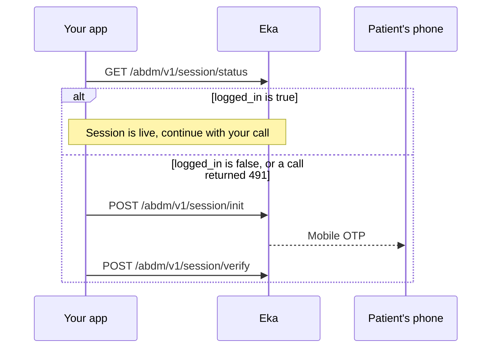

## In short

- Patient-scoped calls without a live ABHA Gateway session return HTTP `491`.
- Check the session with Status, and renew it with Init and Verify on a mobile OTP.
- Once the session is live, retry the call that returned `491`.

## When to use this

Registering or creating an ABHA opens a session for the patient with the ABHA Gateway. Whether logging in also opens one is not yet confirmed. {/* TODO: confirm: whether ABHA login opens an ABHA Gateway session; session/getting-started names only registration and creation. */} The session expires after a period. Patient-scoped calls made without a live session return HTTP `491`. Run this workflow before a patient-scoped call such as fetching the profile, and whenever a call returns `491`.

This workflow renews a session for a patient whose ABHA you already hold. To find or create the ABHA in the first place, use [Log in to an existing ABHA](/api-reference/user-app/abdm-connect/workflows/login-abha) or one of the create workflows.

## Before you start

- A client access token, sent as a Bearer token on every call. See [Client login](/api-reference/authorization/client-login).
- The patient's `oid` and `abha_address`, stored when the ABHA was created or the patient logged in. Session Status needs the `oid` in the `X-Pt-Id` header.
- Access to the patient's phone for the mobile OTP.

## Sequence

## Steps

<Steps>
  <Step title="Check the session">
    Call [Status](/api-reference/user-app/abdm-connect/session/status) with the patient's `oid` in the `X-Pt-Id` header. The response carries `logged_in`, `kyc_verified` and `hpr_id`.

    - `logged_in` is `true`: the session is live. Continue with the patient-scoped call you were about to make.
    - `logged_in` is `false`: renew the session with the next two steps.

    {/* TODO: confirm: how often to call session/status, for example once per screen or once per patient visit, and whether its result can be cached. */}
  </Step>
  <Step title="Send the mobile OTP">
    Send the patient's `abha_address` to [Init](/api-reference/user-app/abdm-connect/session/init), with the `oid` in the `X-Pt-Id` header or the `oid` query parameter. An OTP goes to the patient's mobile. The response carries `txn_id`. {/* TODO: confirm: which mobile receives the session OTP, the one linked to the ABHA address or another, and whether a resend call exists for session/init. */}
  </Step>
  <Step title="Verify the OTP">
    Send `txn_id` and `otp` to [Verify](/api-reference/user-app/abdm-connect/session/verify), with the same `oid`. The response carries `token`, the user's access token, and `refresh_token`. The session is live again. Retry the call that returned `491`.

    {/* TODO: confirm: whether the integrator must send token on later patient-scoped calls (and in which header), or Eka holds the session against the oid; whether token is the user_x_token that profile/kyc/init and profile/kyc/verify take; and whether refresh_token can renew the session without a new OTP. */}
  </Step>
</Steps>

## State you must persist

| Field | From | Keep | For |
|---|---|---|---|
| `oid` | The create or login workflow | Permanently, on the patient record | `X-Pt-Id` header on every call here |
| `abha_address` | The create or login workflow | Permanently, on the patient record | Session Init |
| `txn_id` | Session Init | Until Session Verify returns {/* TODO: confirm: how long a session txn_id stays valid. */} | Session Verify |
| `token` | Session Verify | Until the session expires {/* TODO: confirm: the session lifetime and whether token must be stored at all. */} | Not documented {/* TODO: confirm: what token is used for. */} |
| `refresh_token` | Session Verify | {/* TODO: confirm: how long to keep refresh_token. */} Not documented | Not documented {/* TODO: confirm: what refresh_token is used for. */} |

## When it fails

<Warning>
Which of these codes each call returns is not yet confirmed. The codes come from the [errors page](/api-reference/user-app/abdm-connect/errors), matched by meaning. Log the code you actually receive.
</Warning>

Error responses carry `code`, `error` and `source_error`. `source_error.code` holds codes such as `MIS-1013`. See [Error codes](/api-reference/user-app/abdm-connect/errors). {/* TODO: confirm: which codes the session operations return; the spec has no error examples for them, so the rows below are matched by the meaning on the errors page. */}

| Situation | Code | Do |
|---|---|---|
| Session expired on a patient-scoped call | HTTP `491` | Run Session Init and Session Verify, then retry the call. |
| Session Status called without `X-Pt-Id` | Not documented | Send the patient's `oid` in `X-Pt-Id`. |
| Wrong OTP | `MIS-1013` | Ask the patient to re-enter the OTP. |
| Too many OTP requests or wrong attempts | `ABDM-1100` | Tell the patient to try again in 30 minutes. |
| No ABHA found for the address | `ABDM-1012`, `ABDM-1110` | Check the stored `abha_address` against the patient record. |
| Expired or unknown transaction | `ABDM-1017`, `MIS-1026` | Start again from Session Init. |
| ABDM or a dependent service is down | `ABDM-1019`, `ABDM-1024`, `ABDM-1004` | Retry later. |

## Test it

The [testing page](/api-reference/user-app/abdm-connect/testing) has the sandbox base URL, credentials and the happy path for every journey.

Run against the sandbox base URL `https://api.dev.eka.care`, with an ABHA you created on sandbox. {/* TODO: confirm: how to force a session to expire on sandbox to test the 491 path, sandbox OTPs. */}

- [ ] Straight after creating an ABHA, Session Status returns `logged_in: true`.
- [ ] After the session expires, Session Status returns `logged_in: false`. Session Init and Session Verify return a `token`; Session Status returns `logged_in: true` again.
- [ ] A patient-scoped call such as [Profile Details](/api-reference/user-app/abdm-connect/profile/details/profile-details) returns `491` on an expired session and succeeds after renewal.
- [ ] Wrong OTP on Session Verify: `MIS-1013`. Record the code you receive; the expected code is not confirmed.
