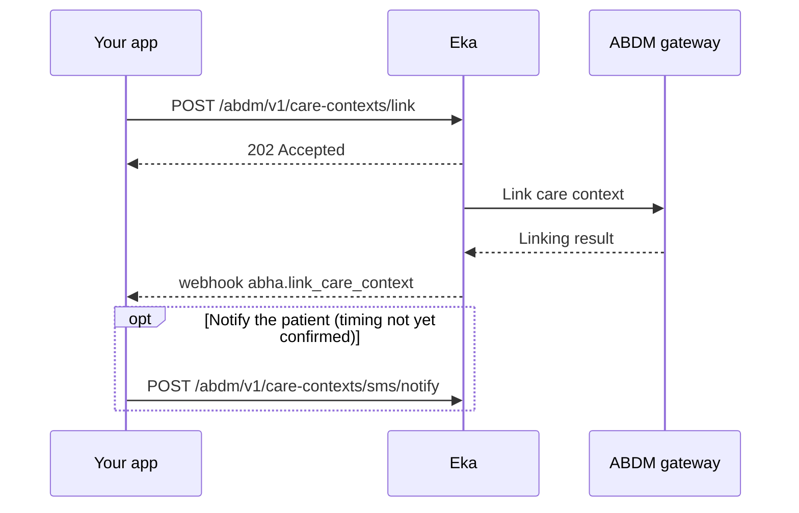

## In short

- One call links a visit to the patient's ABHA address as a care context.
- Send the FHIR bundle in `data` if Eka stores the record; leave it out if you keep it.
- The call returns `202`; the result arrives on `abha.link_care_context`.
- `LINKED` means the record is shareable; on `ERRORED`, read `data.error`.

## When to use this

A patient with an ABHA has finished a visit, test or admission at your facility. You want that record linked to their ABHA address as a care context. Once linked, the care context is registered with ABDM and any Health Information User (HIU) the patient grants consent to can request it.

Before you link, decide one thing: does Eka store the clinical data, or do you? If Eka stores it, you send the FHIR bundle with the link call and Eka answers every later data request for you. If you keep it, you leave the bundle out and answer each request yourself with [Serve records on a fetch request](/api-reference/user-app/abdm-connect/workflows/serve-data-on-fetch).

For records created before the patient's ABHA was known, the patient claims them from a PHR app instead. See [Answer discovery and link old records](/api-reference/user-app/abdm-connect/workflows/hip-discovery-and-link).

## Before you start

- A client access token, sent as a Bearer token. See [Authorization](/api-reference/authorization/getting-started).
- Your facility onboarded as a Health Information Provider (HIP), with its HIP ID. See [Milestone 4](/api-reference/user-app/abdm-connect/flows/m4).
- A webhook URL registered with Eka that can receive `abha.link_care_context`, and the means to verify the [webhook signature](/api-reference/connect/webhooks/webhook-signature).
- The patient's `abha_address` and Eka user id `oid`, saved on the patient record. They come from [Create an ABHA with Aadhaar OTP](/api-reference/user-app/abdm-connect/workflows/create-abha-aadhaar-otp) or [Log in to an existing ABHA](/api-reference/user-app/abdm-connect/workflows/login-abha).
- Your own id for the care context, its display name and its health information type (`hi_type`, for example `OPConsultation` or `Prescription`).
- If Eka is to store the data: the ABDM-compliant FHIR bundle for the care context.

## Sequence

## Steps

<Steps>
  <Step title="Link the care context">
    Call [Care context linking](/api-reference/user-app/abdm-connect/care-contexts/link/hip-linking). Send the patient's `oid` in the `X-Pt-Id` header, your patient id in `X-Partner-Pt-Id` and your HIP ID in `X-Hip-Id`. In the body, send `abha_address`, `oid`, `partner_user_id` and one entry in `care_contexts` per record, each with `care_context_id`, `display` and `hi_type`.

    Decide on the data now. If Eka stores the data, put the base64-encoded FHIR bundle in each entry's `data` field and list its health information types in `hi_types`. Eka then answers data requests for you, and you never receive `abha.hip_data_fetch` for this care context. If you keep the data, leave `data` out and run [Serve records on a fetch request](/api-reference/user-app/abdm-connect/workflows/serve-data-on-fetch) whenever a request arrives.

    The call returns `202 Accepted`. That means Eka has taken the request, not that the care context is linked.

    {/* TODO: confirm: which of the X-Pt-Id, X-Partner-Pt-Id and X-Hip-Id headers are required on this call, and do they duplicate oid and partner_user_id in the body? */}
    {/* TODO: confirm: is there a maximum number of entries in care_contexts per call, or a maximum size for the base64 data field? */}
  </Step>
  <Step title="Wait for the linking status">
    Eka sends the [`abha.link_care_context`](/api-reference/user-app/abdm-connect/webhooks/link-care-context) webhook with the result. Acknowledge it with HTTP `200` within 5 seconds; Eka retries on any other status.

    Read `data.status`. If it is `LINKED`, mark the care context as linked on your side; it is now discoverable and shareable. If it is `ERRORED`, read `data.error` for the reason. `data.retry_count` reports how many times linking was retried.

    Match the webhook to your record by `data.care_context_id`.

    {/* TODO: confirm: is data.care_context_id in the webhook the same care_context_id you sent in the link request? The example shows a UUID. */}
    {/* TODO: confirm: does Eka retry linking itself after ERRORED (what retry_count counts), or must you call the link API again, and after how long? */}
    {/* TODO: confirm: how long after the 202 the webhook normally arrives, and how long to wait before treating it as lost */}
  </Step>
  <Step title="Notify the patient (optional)">
    Call [Notify unlinked care contexts](/api-reference/user-app/abdm-connect/care-contexts/records/notify) with the patient's 10-digit `mobile_number`. It notifies the gateway that a new health record is ready to be shared with the patient. It returns `202 Accepted`.

    {/* TODO: confirm: when to call sms/notify. Is it for patients without an ABHA (so they can later discover the record), after a LINKED status, or both? Does the patient receive an SMS, and from whom? */}
  </Step>
</Steps>

## State you must persist

| Field | From | Keep | For |
|---|---|---|---|
| `abha_address`, `oid` | ABHA creation or login | Forever, on the patient record | Every link call for this patient |
| `care_context_id` | You, sent in the link call | Forever, on the visit or document | Matching the status webhook; answering `abha.hip_data_fetch` later |
| Whether `data` was sent | Your decision in step 1 | Forever, on the care context | Knowing whether you must serve this care context on a fetch request |
| `status` | `abha.link_care_context` | Forever, on the care context | Showing the visit as linked; retrying when `ERRORED` |
| The FHIR bundle, if you keep the data | Your clinical system | As long as the care context is linked | Serving it on a fetch request |

{/* TODO: confirm: is there a retention requirement for the FHIR data you keep yourself, or for data Eka stores on your behalf? */}

## When it fails

<Warning>
Which of these codes each call returns is not yet confirmed. The codes come from the [errors page](/api-reference/user-app/abdm-connect/errors), matched by meaning. Log the code you actually receive.
</Warning>

Error responses carry `code`, `error` and `source_error`. The codes below are from the [errors page](/api-reference/user-app/abdm-connect/errors); match the one you receive there.

| Situation | Code | Do |
|---|---|---|
| Request body malformed or a field invalid | `ABDM-1006`, `ABDM-1010` | Fix the request against the reference page and resend |
| ABHA address or number not recognised | `ABDM-1051` | Check the `abha_address` saved on the patient record |
| Wrong HIP ID | `ABDM-1035` (Invalid HIP ID) | `ABDM-1035` also means "OTP does not match" on the errors page. Tell them apart by HTTP status (`500` for Invalid HIP ID, `400` for the OTP) and `source_error.message`. For Invalid HIP ID, check the `X-Hip-Id` header against your onboarded HIP ID |
| Too many requests | `ABDM-1022` | Back off and retry |
| Gateway or a dependent service down | `ABDM-1019`, `ABDM-1024`, `ABDM-1048` | Retry later |
| Status webhook reports `ERRORED` | `data.error` in the webhook | Read the reason; correct and link again |

{/* TODO: confirm: which of these codes the link API actually returns, and the retry interval and limit for rate limits and gateway outages */}

## Test it

The [testing page](/api-reference/user-app/abdm-connect/testing) has the sandbox base URL, credentials and the happy path for every journey.

{/* TODO: confirm: sandbox test ABHA address, HIP ID and a sample FHIR bundle to use */}

- [ ] Link one `OPConsultation` care context with `data` set, and receive `abha.link_care_context` with `status` `LINKED`
- [ ] Link one care context without `data`, receive `LINKED`, then confirm a later consent request arrives as `abha.hip_data_fetch`
- [ ] Send an invalid `abha_address` and check the error response
- [ ] Return a non-`200` from your webhook once and confirm Eka retries
