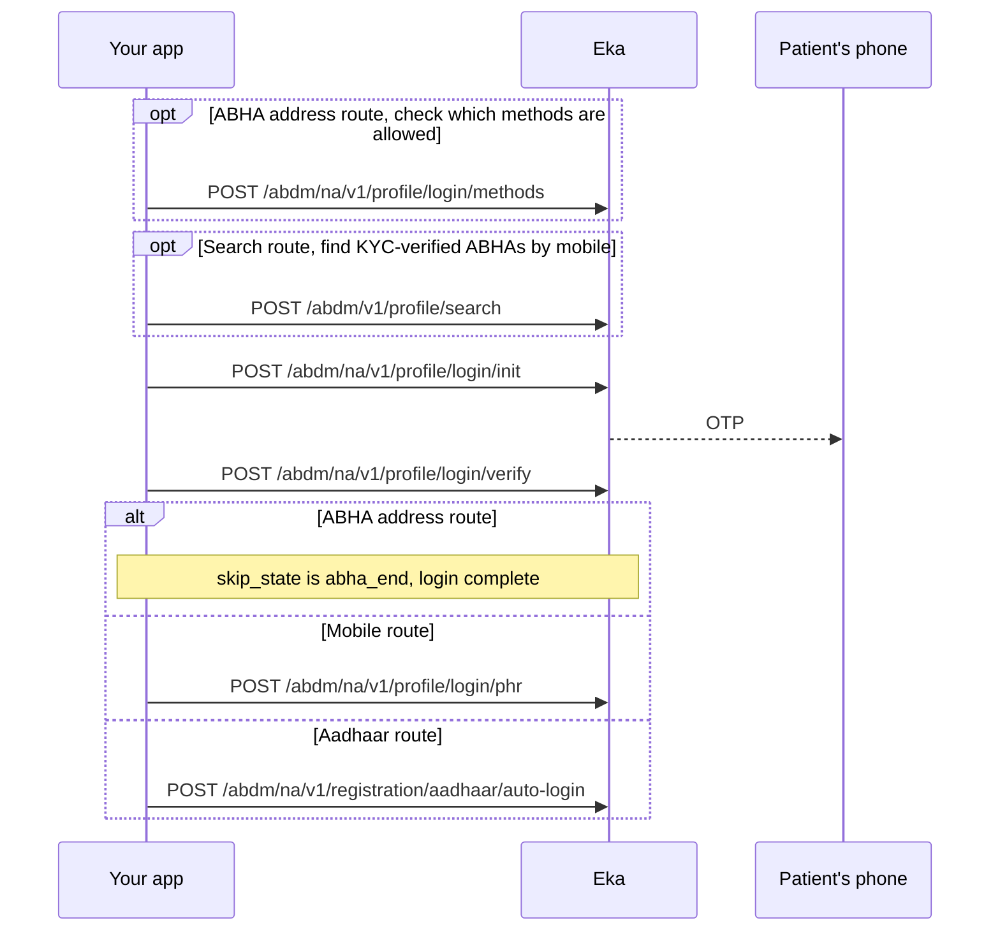

## In short

- Log in by ABHA address, mobile or Aadhaar, each with an OTP.
- Every route ends with `skip_state` set to `abha_end` and the patient's `oid`.
- Each call takes the `txn_id` from the most recent response.

## When to use this

The patient already has an ABHA and can identify it by one of: their ABHA address, their Aadhaar number, or a mobile number. They authenticate with an OTP. All three routes end with `skip_state` set to `abha_end` and give you the patient's `oid`.

Pick the route from what the patient can offer:

- **ABHA address** (`shyam@abdm`): two calls, init and verify.
- **Mobile number**: init, verify, then pick one of the ABHA addresses on that mobile.
- **Aadhaar number**: init, verify, then auto-login into one of the ABHA addresses on that Aadhaar.

If the patient has no ABHA, use [Create an ABHA with Aadhaar OTP](/api-reference/user-app/abdm-connect/workflows/create-abha-aadhaar-otp) or [Create an ABHA address with mobile OTP](/api-reference/user-app/abdm-connect/workflows/create-abha-mobile-otp).

## Before you start

- A client access token, sent as a Bearer token on every call. See [Client login](/api-reference/authorization/client-login).
- Your facility onboarded as a Health Information Provider (HIP).
- In hand: the patient's ABHA address, Aadhaar number or mobile number, and access to the phone that receives the OTP.

## Sequence

## Steps

<Steps>
  <Step title="Check the login methods (ABHA address route)">
    Send `abha_address` to [Search Auth Methods](/api-reference/user-app/abdm-connect/login/methods). The response carries `auth_methods` and `blocked_methods`. Offer the patient only methods in `auth_methods`. {/* TODO: confirm: the possible values in auth_methods and blocked_methods, and how each maps to the method and otp_system values on login/init. */}
  </Step>
  <Step title="Search by mobile (search route, optional)">
    Send `mobile` to [Search](/api-reference/user-app/abdm-connect/profile/search/search). It returns KYC-verified ABHA profiles on that mobile in `profiles`, each with an `index` and `abha_address`, plus a `txn_id`. The patient picks one. Pass its `index` as `identifier` and the `txn_id` to the next step with `method` set to `search`. {/* TODO: confirm: that login/init's "search api response" means POST /abdm/v1/profile/search, and which skip_state login/verify returns on the search route. */}
  </Step>
  <Step title="Send the OTP">
    Send `method`, `identifier` and `otp_system` to [Generate OTP](/api-reference/user-app/abdm-connect/login/init):

    - ABHA address route: `method` is `phr_address`, `identifier` is the ABHA address.
    - Mobile route: `method` is `mobile`, `identifier` is the mobile number.
    - Aadhaar route: `method` is `aadhaar_number`, `identifier` is the Aadhaar number.
    - `method` also accepts `abha_number`. {/* TODO: confirm: which call completes login on the abha_number route after login/verify. */}

    `otp_system` is `abdm` or `aadhaar`. {/* TODO: confirm: which otp_system to send for each method. */}

    The response carries `txn_id` and a `hint`. Keep `txn_id`; every later call takes the `txn_id` from the most recent response.
  </Step>
  <Step title="Verify the OTP">
    Send `txn_id` and `otp` to [Verify OTP](/api-reference/user-app/abdm-connect/login/verify). The response carries `skip_state`, `abha_profiles`, `profile`, `eka.oid` and a new `txn_id`. Branch on the route and `skip_state`:

    - ABHA address route: `skip_state` is `abha_end`. Login is complete. Stop here.
    - Mobile route: `abha_profiles` lists the ABHA addresses on the mobile. The patient picks one. Go to "Complete the mobile login". {/* TODO: confirm: the skip_state login/verify returns on the mobile route (abha_select is expected). */}
    - Aadhaar route: `skip_state` is `abha_create`. If `abha_profiles` is non-empty, the patient picks one and you go to "Complete the Aadhaar login". If it is empty, the patient has no ABHA address on this Aadhaar; create one. {/* TODO: confirm: whether the login txn_id can continue into aadhaar/create-phr when abha_profiles is empty, or the patient must start Create an ABHA with Aadhaar OTP from the beginning. */}
  </Step>
  <Step title="Complete the mobile login">
    Send `txn_id` and the chosen address as `phr_address` to [Login](/api-reference/user-app/abdm-connect/login/login). The response carries `skip_state` set to `abha_end`, `profile` and `eka.oid`.
  </Step>
  <Step title="Complete the Aadhaar login">
    Send `txn_id` and the chosen `abha_address` to [Auto Login](/api-reference/user-app/abdm-connect/enrollment/aadhaar/auto-login). The response carries `skip_state` set to `abha_end`, `profile`, `eka.oid`, `token` and `refresh_token`.
  </Step>
</Steps>

Whether login also opens the patient's ABHA Gateway session is not yet confirmed; the session overview names only registration and creation. {/* TODO: confirm: whether ABHA login opens an ABHA Gateway session. */} When a session expires, renew it with [Hold the ABHA Gateway session](/api-reference/user-app/abdm-connect/workflows/hold-gateway-session) rather than logging in again.

## State you must persist

| Field | From | Keep | For |
|---|---|---|---|
| `txn_id` | The latest response in this workflow | Until login completes {/* TODO: confirm: how long a login txn_id stays valid. */} | Every call in this workflow |
| `eka.oid` | The call that returns `abha_end` | Permanently, on the patient record | The `X-Pt-Id` header or `oid` query on every later call for this patient |
| `profile.abha_address` | The call that returns `abha_end` | Permanently, on the patient record | Care context linking, gateway session |
| `profile.abha_number` | The call that returns `abha_end` | Permanently, on the patient record, when present | ABHA card, later logins |
| `token`, `refresh_token` | Auto Login | {/* TODO: confirm: whether these must be stored and what they are used for. */} Not documented | Not documented |

## When it fails

<Warning>
Which of these codes each call returns is not yet confirmed. The codes come from the [errors page](/api-reference/user-app/abdm-connect/errors), matched by meaning. Log the code you actually receive.
</Warning>

Error responses carry `code`, `error` and `source_error`. `source_error.code` holds codes such as `MIS-1013`. See [Error codes](/api-reference/user-app/abdm-connect/errors). {/* TODO: confirm: which codes each login operation returns; the spec has no error examples for them, so the rows below are matched by the meaning on the errors page. */}

| Situation | Code | Do |
|---|---|---|
| Wrong OTP | `MIS-1013` | Ask the patient to re-enter the OTP. |
| Too many OTP requests or wrong attempts | `ABDM-1100` | Tell the patient to try again in 30 minutes. |
| Patient blocked | `ABDM-1027` | Tell the patient to try again after 24 hours. |
| No ABHA found for the identifier | `ABDM-1110`, `ABDM-1012` | Offer to create an ABHA instead. |
| Invalid ABHA number | `ABDM-1013` | Ask the patient to check the number. |
| Mobile or Aadhaar not found | `ABDM-1111`, `ABDM-1112` | Ask the patient to check it, or try another route. |
| Method not allowed for this ABHA | `ABDM-1113`, `ABDM-1114`, `ABDM-1115` | Offer a method from `auth_methods` in Search Auth Methods. |
| Expired or unknown transaction | `ABDM-1017`, `MIS-1026` | Start again from Generate OTP. |
| Too many requests | `ABDM-1022` | Back off and retry. {/* TODO: confirm: retry interval for ABDM-1022. */} |
| ABDM or a dependent service is down | `ABDM-1019`, `ABDM-1024`, `ABDM-1004` | Retry later. |

## Test it

The [testing page](/api-reference/user-app/abdm-connect/testing) has the sandbox base URL, credentials and the happy path for every journey.

Use an ABHA you created on sandbox through one of the create workflows. {/* TODO: confirm: sandbox test identifiers and OTPs. */}

- [ ] ABHA address route: Search Auth Methods, Generate OTP with `phr_address`, Verify OTP returns `abha_end` and `eka.oid`.
- [ ] Mobile route: Generate OTP with `mobile`, Verify OTP, Login with one address from `abha_profiles` returns `abha_end`.
- [ ] Aadhaar route: Generate OTP with `aadhaar_number`, Verify OTP returns `abha_create` with a non-empty `abha_profiles`, Auto Login returns `abha_end`.
- [ ] The `eka.oid` from login equals the one stored when the ABHA was created.
- [ ] Wrong OTP once: `MIS-1013`. Record the code you receive; the expected code is not confirmed.
- [ ] Unknown ABHA address on Search Auth Methods: an error from the failure table.
