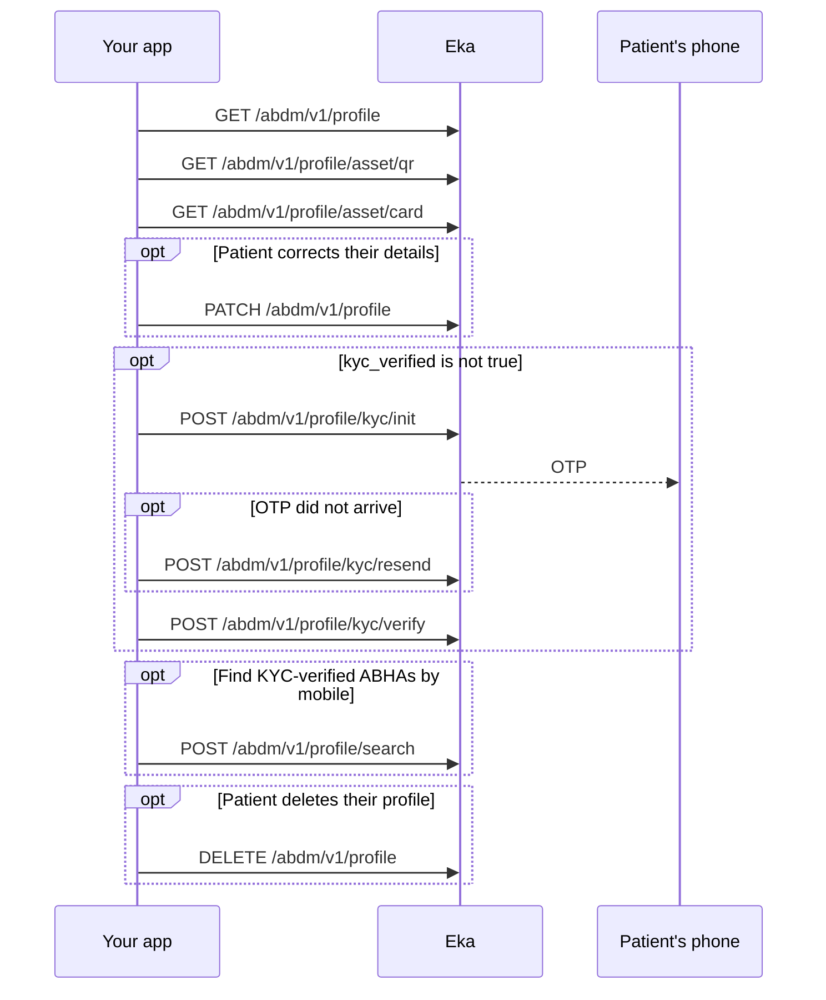

## When to use this

The patient has an ABHA and is logged in. Use this workflow to show their ABHA profile, card and QR code, correct their details, and run KYC on an ABHA address that was created with a mobile OTP. KYC links the address to a KYC-verified 14-digit ABHA number. Deleting the profile is also here; it is irreversible.

These calls are independent. Run the ones your screen needs, in any order, except that KYC is a sequence of init then verify.

## Before you start

- A client access token, sent as a Bearer token on every call. See [Client login](/api-reference/authorization/client-login).
- The patient's `oid`, stored when the ABHA was created or the patient logged in. Every call here except Search takes it in the `X-Pt-Id` header or the `oid` query parameter.
- A live ABHA Gateway session for the patient. Check it first with [Hold the ABHA Gateway session](/api-reference/user-app/abdm-connect/workflows/hold-gateway-session); a `491` means the session has expired.
- For KYC: the patient's 14-digit ABHA number or 12-digit Aadhaar number, and access to the phone that receives the OTP.

## Sequence

## Steps

<Steps>
  <Step title="Fetch the profile">
    Call [Profile Details](/api-reference/user-app/abdm-connect/profile/details/profile-details). The response carries the patient's `abha_address`, `abha_addresses`, `abha_number`, names, `gender`, date of birth as `day_of_birth`, `month_of_birth` and `year_of_birth`, `mobile`, address fields, `profile_photo` and `kyc_verified`.

    Cache the response on your side. Do not call it on every page load. Evict the cache when the profile is updated.
  </Step>
  <Step title="Show the QR code">
    Call [ABHA QR Code](/api-reference/user-app/abdm-connect/profile/cards/qr-code). The response is JSON with no fixed structure; it varies with how the ABHA was created. Generate the QR code from the whole response body rather than from named fields. Cache it and evict it when the profile is updated. {/* TODO: confirm: the accepted values of the format query parameter. */}
  </Step>
  <Step title="Show the ABHA card">
    Call [ABHA card](/api-reference/user-app/abdm-connect/profile/cards/abha-card). The response is the card as a binary image. Cache it and evict it when the profile is updated. {/* TODO: confirm: the image content type returned. */}
  </Step>
  <Step title="Update the profile">
    Send the profile to [Update Profile](/api-reference/user-app/abdm-connect/profile/details/update-profile). The request must include every field that Profile Details returned, not only the changed ones. `first_name`, `gender`, `day_of_birth`, `month_of_birth`, `year_of_birth` and `pincode` are required. A successful update returns `204` with no body. Evict your cached profile, QR code and card.

    For a KYC-verified ABHA, name, gender and date of birth cannot be changed. Most fields of an ABHA created with a mobile OTP can be changed. {/* TODO: confirm: the error returned when a locked field is changed on a KYC-verified ABHA. */}
  </Step>
  <Step title="Start KYC (only if kyc_verified is not true)">
    Send `method` and `identifier` to [Kyc Init](/api-reference/user-app/abdm-connect/profile/kyc/kyc-init). `method` is `abha-number` with the 14-digit ABHA number as `identifier`, or `aadhaar` with the 12-digit Aadhaar number. The request also takes `user_x_token`, the user authorization token. {/* TODO: confirm: where user_x_token comes from (the token from session/verify, create or login?) and whether it is required. */}

    An OTP goes to the patient. The response carries `txn_id`. If the OTP does not arrive, send `txn_id` to [Kyc Resend](/api-reference/user-app/abdm-connect/profile/kyc/kyc-resend) and use the `txn_id` it returns. {/* TODO: confirm: which mobile receives the KYC OTP for each method. */}
  </Step>
  <Step title="Verify KYC">
    Send `txn_id`, `otp` and `user_x_token` to [Kyc Verify](/api-reference/user-app/abdm-connect/profile/kyc/kyc-verify). The response carries `txn_id`. Fetch the profile again and check that `kyc_verified` is `true` and `abha_number` is set. Evict your cached QR code and card. {/* TODO: confirm: that kyc_verified and abha_number on GET /abdm/v1/profile reflect the completed KYC immediately. */}
  </Step>
  <Step title="Search by mobile (optional)">
    Send `mobile` to [Search ABHA](/api-reference/user-app/abdm-connect/profile/search/search). It returns KYC-verified ABHA profiles on that mobile in `profiles`, with masked `abha_number`s, and a `txn_id`. To log the patient in to one of them, continue with [Log in to an existing ABHA](/api-reference/user-app/abdm-connect/workflows/login-abha).
  </Step>
  <Step title="Delete the profile (only on the patient's request)">
    Call [Delete Profile](/api-reference/user-app/abdm-connect/profile/details/delete). It removes the profile and every associated document, vital record and related data from Eka, with no recovery. The ABHA metadata stays in the ABDM system, because ABDM offers no delete. A successful delete returns `204`. Ask the patient to confirm before you call it, and clear the `oid` and cached assets from your patient record afterwards.
  </Step>
</Steps>

## State you must persist

| Field | From | Keep | For |
|---|---|---|---|
| Profile response | Profile Details | Until the next Update Profile or KYC Verify | Showing the profile without calling the API on every page load; the full body for Update Profile |
| QR code response | ABHA QR Code | Until the next Update Profile or KYC Verify | Showing the QR code |
| ABHA card image | ABHA card | Until the next Update Profile or KYC Verify | Showing or printing the card |
| `kyc_verified` | Profile Details | With the cached profile | Deciding whether to offer KYC and which fields can be edited |
| `txn_id` | Kyc Init or Kyc Resend | Until Kyc Verify returns {/* TODO: confirm: how long a KYC txn_id stays valid. */} | Kyc Resend and Kyc Verify |

## When it fails

Error responses carry `code`, `error` and `source_error`. `source_error.code` holds codes such as `MIS-1013`. See [Error codes](/api-reference/user-app/abdm-connect/errors). {/* TODO: confirm: which codes each profile and KYC operation returns; the spec has no error examples for them, so the rows below are matched by the meaning on the errors page. */}

| Situation | Code | Do |
|---|---|---|
| Gateway session expired | HTTP `491` | Renew it with [Hold the ABHA Gateway session](/api-reference/user-app/abdm-connect/workflows/hold-gateway-session), then retry. |
| Update Profile missing fields | `ABDM-1006`, `ABDM-1010` | Send every field Profile Details returned. |
| Wrong KYC OTP | `MIS-1013` | Ask the patient to re-enter the OTP. |
| Too many OTP requests or wrong attempts | `ABDM-1100` | Tell the patient to try again in 30 minutes. |
| ABHA address does not match the KYC details | `ABDM-1043` | {/* TODO: confirm: what the integrator should do when ABDM-1043 is returned during KYC. */} Not documented yet. |
| Invalid ABHA number on KYC | `ABDM-1013` | Ask the patient to check the number. |
| Expired or unknown KYC transaction | `ABDM-1017`, `MIS-1026` | Start again from Kyc Init. |
| ABDM or a dependent service is down | `ABDM-1019`, `ABDM-1024` | Retry later. |

## Test it

Run against the sandbox base URL `https://api.dev.eka.care`, with a patient whose ABHA you created on sandbox and whose session is live. {/* TODO: confirm: sandbox test identifiers and OTPs for KYC, and link the ABDM Connect testing page once it exists. */}

- [ ] Profile Details returns the `abha_address` you stored at creation.
- [ ] ABHA QR Code returns JSON you can encode as a QR code; ABHA card returns an image.
- [ ] Update Profile with every field from Profile Details and one changed value returns `204`; Profile Details shows the change.
- [ ] On a mobile-created address: Kyc Init, Kyc Verify, then Profile Details shows `kyc_verified: true`.
- [ ] Wrong OTP on Kyc Verify: `MIS-1013`.
- [ ] Profile Details on an expired session returns `491`.
- [ ] Delete Profile on a throwaway sandbox ABHA returns `204`; Profile Details for that `oid` then fails.
