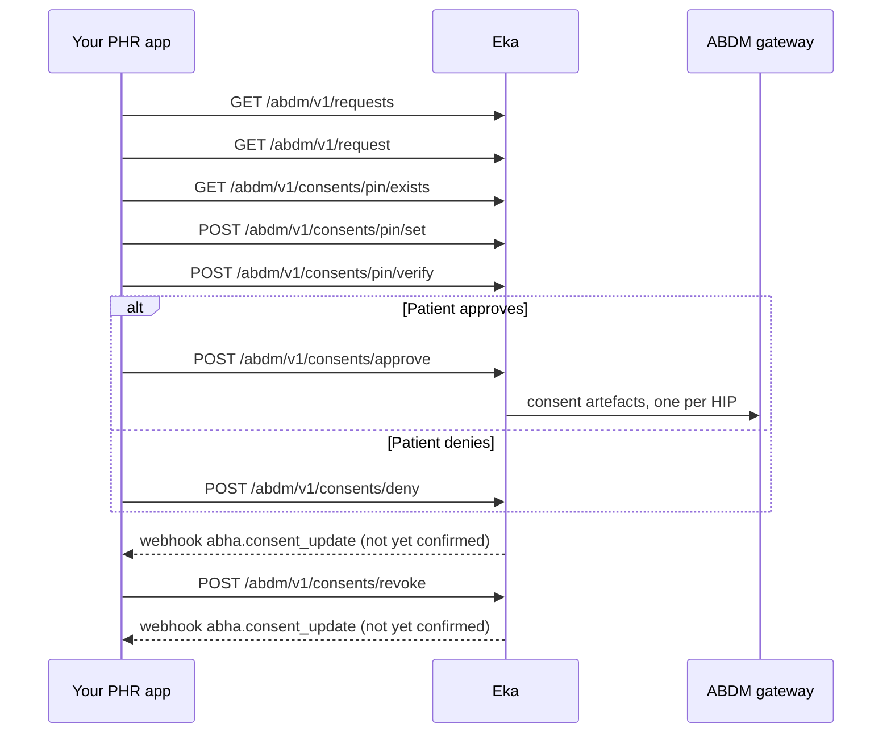

## When to use this

Your app is a personal health record (PHR) app, and a Health Information User (HIU) such as a doctor, hospital, insurer or another PHR app has asked for the patient's records. This workflow shows the patient the request, records their decision, and lets them revoke a granted consent later. On approval, ABDM generates one consent artefact per Health Information Provider (HIP), and the patient can revoke each artefact on its own.

To stop asking the patient for every request from a trusted source, set up auto-approval instead: [Set up the patient's health locker](/api-reference/user-app/abdm-connect/workflows/set-up-health-locker).

## Before you start

- A bearer token for the API. See [Authorization](/api-reference/authorization/getting-started).
- A live ABHA Gateway session for the patient. Every consent operation needs one. See [User Session](/api-reference/user-app/abdm-connect/session/getting-started).
- The patient's Eka user id (`oid`), sent as the `X-Pt-Id` header. List Requests, Get Details, approve, deny and revoke also accept it as the `oid` query parameter; the three PIN calls take the header only. {/* TODO: confirm: whether X-Pt-Id or the oid query parameter is required where both are accepted, and what X-Partner-Pt-Id and X-Hip-Id should carry for a PHR app. */}
- A webhook endpoint registered with Eka that verifies the `Eka-Webhook-Signature` header. See [Webhook signature](/api-reference/connect/webhooks/webhook-signature).

## Sequence

## Steps

<Steps>
  <Step title="List the patient's pending requests">
    Call [List Requests](/api-reference/user-app/abdm-connect/patient-requests/list-requests) with `type` set to `consent` and `status` set to `requested`. Both parameters are required. The response groups requests into `consents`, `subscriptions` and `authorizations`; each item carries `id`, `hiu`, `requester`, `purpose`, `duration` and `created_at`.

    Show the patient who is asking (`hiu`, `requester`) and why (`purpose`). Keep the `id` of the request they open. To show granted consents they can revoke, call again with `status` set to `granted`.
  </Step>
  <Step title="Show the request's details">
    Call [Requests Get Details](/api-reference/user-app/abdm-connect/patient-requests/requests-get-details) with `id` and `type` set to `consent`. The response carries `hi_types` (the record types asked for), `duration` (`from`, `to`), `erase_at`, `access_mode` and `providers`. Each provider names a `hip` (`id`, `name`), its `care_contexts` (`id`, `display`) and, once granted, its `consent_artefact_id`.

    Let the patient choose which providers, care contexts and record types to share.
  </Step>
  <Step title="Check whether the patient has a consent PIN">
    Call [Consent pin exists](/api-reference/user-app/abdm-connect/consents/pin/exists). If `exist` is `true`, go to the verify step. If `false`, set one first.

    {/* TODO: confirm: whether approve, deny and revoke fail without a verified consent PIN, or whether the PIN is optional. The spec says pin/verify is used "to approve/revoke consents" but does not say what approve checks. */}
  </Step>
  <Step title="Set a consent PIN (first time only)">
    Ask the patient to choose a PIN and send it as `pin` to [Consent pin set](/api-reference/user-app/abdm-connect/consents/pin/set). Eka returns `204`.

    {/* TODO: confirm: PIN format (length, digits only). The spec example is four digits. */}
  </Step>
  <Step title="Verify the consent PIN">
    Ask the patient for their PIN and send it as `pin` to [Consent pin verify](/api-reference/user-app/abdm-connect/consents/pin/verify) before you approve or revoke. Eka returns `204`.

    {/* TODO: confirm: the values of scope in the verify body, and which scope approve and revoke each need. */}
    {/* TODO: confirm: how long a verified PIN stays valid, and whether deny needs it too. */}
  </Step>
  <Step title="Approve or deny">
    **To approve,** call [Consent Approve](/api-reference/user-app/abdm-connect/consents/consent-approve). Send `id` (the request id) and `consent_artefacts`, both required. Add one `consent_artefacts` item per HIP the patient chose, with `hip_id`, the chosen `care_contexts` (`id`, `display`), `hi_types`, `access_mode` (`view`), `duration` and `erase_at`. Eka returns `204`.

    **To deny,** call [Consent Deny](/api-reference/user-app/abdm-connect/consents/consent-deny) with `id` and, optionally, the patient's `reason` in plain text. Eka returns `204`.

    Then update the request in your inbox. Whether a PHR app receives [`abha.consent_update`](/api-reference/user-app/abdm-connect/webhooks/consent-update) for requests the patient acts on is not yet confirmed. If it arrives, reply `200` within 5 seconds and read `data.notification.status`. If it does not, call [List Requests](/api-reference/user-app/abdm-connect/patient-requests/list-requests) with `type` set to `consent` and `status` set to `granted` (or `denied` after a denial) and find the request by `id`.

    {/* TODO: confirm: whether the patient may narrow duration or hi_types below what the HIU asked for, or only remove items. */}
    {/* TODO: confirm: whether a PHR app receives abha.consent_update for requests the patient acts on, or only HIUs do. */}
  </Step>
  <Step title="Revoke a granted consent (later)">
    When the patient wants to cut off a HIP, call [Requests Get Details](/api-reference/user-app/abdm-connect/patient-requests/requests-get-details) for the granted request and read `providers[].consent_artefact_id`. Verify the PIN again, then send the artefact ids to cut off as `consent_artefacts` to [Consent Revoke](/api-reference/user-app/abdm-connect/consents/consent-revoke). Eka returns `204`. Artefacts you leave out stay granted.
  </Step>
</Steps>

## State you must persist

| Field | From | Keep | For |
|---|---|---|---|
| Request `id` | List Requests | Until the patient acts, then as long as you show the request in history | Get Details, Approve, Deny |
| `consent_artefact_id` per HIP | Get Details, after grant | Until the artefact is revoked or expires | Revoke |
| Request `status` | `abha.consent_update`, or List Requests | Until it changes | Showing the inbox correctly |
| Whether a PIN is set | Consent pin exists | {/* TODO: confirm: whether you may cache the exists result, or must ask Eka each time */} | Choosing set or verify |

The patient's PIN is not state. Do not store it.

## When it fails

<Warning>
Which of these codes each call returns is not yet confirmed. The codes come from the [errors page](/api-reference/user-app/abdm-connect/errors), matched by meaning. Log the code you actually receive.
</Warning>

Error responses carry `code`, `error` and `source_error` (`code`, `message`). Codes are listed on the [errors page](/api-reference/user-app/abdm-connect/errors).

| Situation | Code | Do |
|---|---|---|
| ABHA Gateway session expired | HTTP `491` | Re-run the session OTP, then retry. See [User Session](/api-reference/user-app/abdm-connect/session/getting-started) |
| Wrong PIN | Not documented yet {/* TODO: confirm: error code for a wrong consent PIN, and the attempt limit */} | Let the patient retry |
| Patient forgot the PIN | none | Use [Consent pin forgot init](/api-reference/user-app/abdm-connect/consents/pin/forgot-init), [Consent pin forgot verify](/api-reference/user-app/abdm-connect/consents/pin/forgot-verify) and [Consent pin reset](/api-reference/user-app/abdm-connect/consents/pin/reset) {/* TODO: confirm: the order of the forgot-PIN calls and whether reset needs the txn_id from forgot init */} |
| Patient wants to change the PIN | none | Send `old` and `new` to [Consent pin change](/api-reference/user-app/abdm-connect/consents/pin/change) |
| Missing `id` or `consent_artefacts` | `ABDM-1006`, `ABDM-1010` | Fix the body and resend |
| Request expired before the patient acted | `ABDM-1061` | Tell the patient; the HIU must raise a new request {/* TODO: confirm: which code approve returns for an expired request */} |
| Consent request id not recognised | `ABDM-1039` | Refresh the inbox from List Requests |
| Gateway unavailable | `ABDM-1024`, `ABDM-1048` | Retry later {/* TODO: confirm: retry rule */} |

## Test it

The [testing page](/api-reference/user-app/abdm-connect/testing) has the sandbox base URL, credentials and the happy path for every journey.

Sandbox base URL: `https://api.dev.eka.care`. {/* TODO: confirm: a sandbox patient with a pending consent request, and how to raise one from a sandbox HIU. No testing page exists yet. */}

- [ ] Raise a request against a sandbox patient with [Request a patient's consent as a HIU](/api-reference/user-app/abdm-connect/workflows/hiu-request-consent)
- [ ] It appears in List Requests with `status` `requested`; Get Details shows its providers and care contexts
- [ ] Pin exists returns `false` for a new patient; set a PIN; exists now returns `true`
- [ ] Verify the PIN and approve one care context; record whether `abha.consent_update` arrives (not yet confirmed), otherwise List Requests with `status` `granted` shows the request
- [ ] Get Details now shows a `consent_artefact_id`; revoke it
- [ ] Deny a second request with a reason
- [ ] Let the session expire and confirm the `491` path
