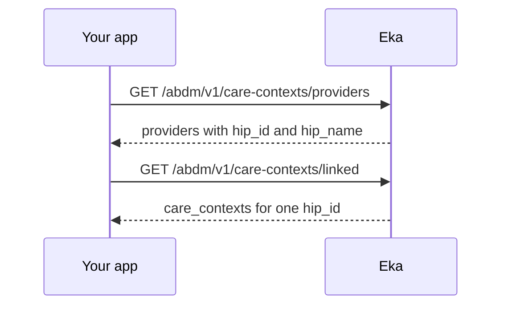

## When to use this

Your PHR app shows the patient what is linked to their ABHA. An ABHA address can carry thousands of care contexts across many facilities, so listing takes two calls: the facilities first, then the care contexts under the one the patient opens.

This lists metadata only. Reading a record's contents needs the patient's consent and a data transfer: see [Request a patient's consent as a HIU](/api-reference/user-app/abdm-connect/workflows/hiu-request-consent) and [Receive and decrypt records as a HIU](/api-reference/user-app/abdm-connect/workflows/hiu-receive-data).

## Before you start

- A client access token, sent as a Bearer token. See [Authorization](/api-reference/authorization/getting-started).
- The patient's Eka user id (`oid`), sent as the `X-Pt-Id` header or the `oid` query parameter. It comes from ABHA creation or [Log in to an existing ABHA](/api-reference/user-app/abdm-connect/workflows/login-abha). {/* TODO: confirm: which of the `X-Pt-Id` header and the `oid` query parameter is required; the spec marks neither as required. */}
- A live ABHA gateway session, if these calls need one. See [Hold an ABHA gateway session](/api-reference/user-app/abdm-connect/workflows/hold-gateway-session). {/* TODO: confirm: whether these two operations return HTTP `491` without a live gateway session. */}
- At least one linked care context, from [Discover and link records from a facility](/api-reference/user-app/abdm-connect/workflows/phr-discover-and-link) or linked by a facility.

## Sequence

## Steps

<Steps>
  <Step title="List linked facilities">
    Call [Get Linked Providers](/api-reference/user-app/abdm-connect/care-contexts/providers/providers). The response carries `providers`, each with `hip_id` and `hip_name`. Show the list. If `providers` is empty or null, the patient has nothing linked yet; offer [Discover and link records from a facility](/api-reference/user-app/abdm-connect/workflows/phr-discover-and-link).
  </Step>
  <Step title="List care contexts for one facility">
    When the patient opens a facility, send its `hip_id` as the required `hip_id` query parameter to [Get Linked CareContexts](/api-reference/user-app/abdm-connect/care-contexts/records/records). The response carries `care_contexts`, each with `care_context_id`, `display`, `created_at` and `status`.

    `status` is one of `ConsentRaised`, `ConsentGranted`, `ConsentError`, `DataRequested`, `DataReceived`, `DataProcessing`, `DataProcessed`, `InvalidDataReceived` or `NoDataAvailable`. Use it to show where each record is in the consent and data flow. {/* TODO: confirm: what `status` holds for a care context that is linked but has had no consent raised yet, and what each value means for what the app shows. */} {/* TODO: confirm: whether either list is paginated; the spec has no paging parameters. */}
  </Step>
</Steps>

## State you must persist

| Field | From | Keep | For |
|---|---|---|---|
| `oid` | ABHA creation or login | On the patient record, for as long as the patient uses your app | `X-Pt-Id` or `oid` on both calls |
| `hip_id` | Get Linked Providers | For the screen, or cached on the patient record {/* TODO: confirm: whether caching the provider list is safe, or whether it must be fetched each time. */} | Get Linked CareContexts |
| `care_context_id` | Get Linked CareContexts | On the patient record | Matching consent requests and received data to the record |

## When it fails

<Warning>
Which of these codes each call returns is not yet confirmed. The codes come from the [errors page](/api-reference/user-app/abdm-connect/errors), matched by meaning. Log the code you actually receive.
</Warning>

Errors come back as HTTP 4XX or 5XX with a `GenericError` body: `code`, `error` and `source_error`. Codes are on the [errors page](/api-reference/user-app/abdm-connect/errors). {/* TODO: confirm: which codes these two operations return; the spec has no error examples for them. */}

| Situation | Code | Do |
|---|---|---|
| `hip_id` missing from Get Linked CareContexts | HTTP 4XX | Send the `hip_id` from Get Linked Providers |
| Patient's gateway session expired | HTTP `491` | Run [Hold an ABHA gateway session](/api-reference/user-app/abdm-connect/workflows/hold-gateway-session), then repeat the call |
| Nothing linked under the ABHA address | [`ABDM-1012`](/api-reference/user-app/abdm-connect/errors), or an empty list | Offer discovery and linking |
| Server or gateway error | HTTP 5XX, for example [`ABDM-1019`](/api-reference/user-app/abdm-connect/errors) | Show the last list you have and retry later {/* TODO: confirm: retry rule for 5XX on these calls. */} |

## Test it

The [testing page](/api-reference/user-app/abdm-connect/testing) has the sandbox base URL, credentials and the happy path for every journey.

Run against the Stage/Sandbox server, `https://api.dev.eka.care`. {/* TODO: confirm: a sandbox patient with linked care contexts to list. */}

- [ ] Link one care context with [Discover and link records from a facility](/api-reference/user-app/abdm-connect/workflows/phr-discover-and-link)
- [ ] Get Linked Providers returns that facility's `hip_id`
- [ ] Get Linked CareContexts with that `hip_id` returns the care context with a `status`
- [ ] Get Linked CareContexts without `hip_id` fails with a 4XX
- [ ] A patient with nothing linked gets an empty list or `ABDM-1012`, and the app offers discovery. Record the code you receive; the expected code is not confirmed.
