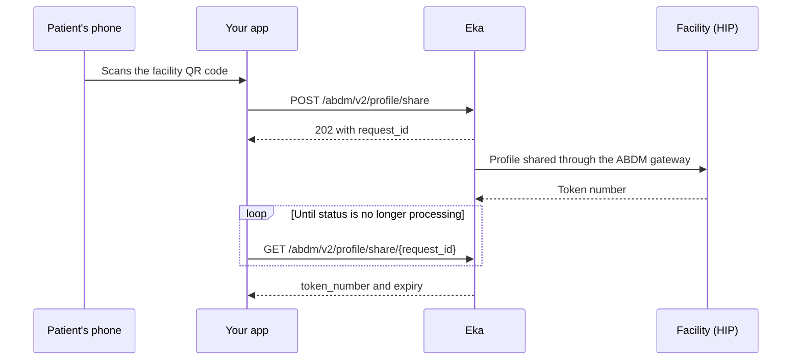

## When to use this

The patient is at a facility's registration counter and scans its Health Facility QR code in your PHR app. You share their ABHA profile with that counter, so the facility's software registers them without a form, and you show the token number the facility issues.

This is the PHR side. If your software runs the facility's counter and receives the scanned profile, use [Receive a scanned profile as a HIP](/api-reference/user-app/abdm-connect/workflows/hip-scan-and-share) instead.

## Before you start

- A client access token, sent as a Bearer token. See [Authorization](/api-reference/authorization/getting-started).
- A logged-in patient and their Eka user id (`oid`), sent as the `X-Pt-Id` header or the `oid` query parameter. See [Log in to an existing ABHA](/api-reference/user-app/abdm-connect/workflows/login-abha). {/* TODO: confirm: which of the `X-Pt-Id` header and the `oid` query parameter is required; the spec marks neither as required. */}
- A live ABHA gateway session, if this call needs one. See [Hold an ABHA gateway session](/api-reference/user-app/abdm-connect/workflows/hold-gateway-session). {/* TODO: confirm: whether these two operations return HTTP `491` without a live gateway session, and whether `user_x_token` in the request body is that session token. */}
- A QR scanner in your app, and permission to read the device location.
- The patient's profile: ABHA address, name, gender, day, month and year of birth, and mobile. See [Manage the ABHA profile and KYC](/api-reference/user-app/abdm-connect/workflows/manage-profile-and-kyc).

## Sequence

## Steps

<Steps>
  <Step title="Share the profile">
    Read `hip_id` and `counter_id` from the scanned QR code. Send both, the device's `latitude` and `longitude` in `location`, and the patient's profile in `patient`, to [Request to generate token](/api-reference/user-app/abdm-connect/scan-and-share/phr-scan-share). In `patient`, `abha_address`, `name`, `gender`, `day_of_birth`, `month_of_birth`, `year_of_birth` and `mobile` are required.

    The call is asynchronous. It returns HTTP `202` with `request_id` and `status`. Keep `request_id`. {/* TODO: confirm: what the QR code encodes and how to extract `hip_id` and `counter_id` from it. */} {/* TODO: confirm: the request body also accepts an optional `request_id` and `user_x_token`. When should you send each, and where does `user_x_token` come from? */}
  </Step>
  <Step title="Poll for the token">
    Call [Get appointment token](/api-reference/user-app/abdm-connect/scan-and-share/phr-scan-share-token) with `request_id` in the path. The response carries `status`, `token_number` and `expiry`.

    The spec gives `status` three values: `success`, `processing` and `failed`. While it is `processing`, the facility has not answered; call again. When it is `success`, show `token_number` and its `expiry` to the patient. When it is `failed`, tell the patient the share did not go through and offer to scan again. {/* TODO: confirm: the poll interval and the maximum time to keep polling before giving up. */} {/* TODO: confirm: that `success` and `failed` are the only terminal states. The spec writes the enum values as `" processing"` and `" failed"` with a leading space; is that what the API returns? */} {/* TODO: confirm: phr/scan-and-share.mdx says the response carries HIP details and whether to display the token, but the spec response (`ScanandshareResponse`) has neither. Which is right? */} {/* TODO: confirm: what `token_number` holds when the facility shares no token, since returning one is optional for the facility. */}
  </Step>
</Steps>

## State you must persist

| Field | From | Keep | For |
|---|---|---|---|
| `oid` | ABHA creation or login | On the patient record, for as long as the patient uses your app | `X-Pt-Id` or `oid` on both calls |
| `hip_id`, `counter_id` | The scanned QR code | Until polling ends | Share request; show the patient which facility they checked in at |
| `request_id` | Share response | Until `status` is `success` or `failed` | Every poll |
| `token_number`, `expiry` | Poll response | Until `expiry` | Show the patient their token at the counter |

## When it fails

Errors come back as HTTP 4XX or 5XX with a `GenericError` body: `code`, `error` and `source_error`. Codes are on the [errors page](/api-reference/user-app/abdm-connect/errors). {/* TODO: confirm: which codes these two operations return; the spec has no error examples for them. */}

| Situation | Code | Do |
|---|---|---|
| `hip_id` or `counter_id` missing, or a required `patient` field missing | HTTP 4XX, for example [`ABDM-1010`](/api-reference/user-app/abdm-connect/errors) | Rescan the QR code; fill the profile fields |
| QR code from an unknown facility | [`ABDM-1035`](/api-reference/user-app/abdm-connect/errors) (Invalid HIP ID) | Ask the patient to scan the counter's QR code again |
| Patient's gateway session expired | HTTP `491` | Run [Hold an ABHA gateway session](/api-reference/user-app/abdm-connect/workflows/hold-gateway-session), then share again |
| Unknown `request_id` on the poll | [`ABDM-1030`](/api-reference/user-app/abdm-connect/errors) | Use the `request_id` from the share response; if lost, share again |
| Profile could not reach the facility | [`ABDM-1018`](/api-reference/user-app/abdm-connect/errors) (Unable to share the details with Hospital), [`ABDM-1028`](/api-reference/user-app/abdm-connect/errors) | Tell the patient to register at the counter by hand |
| Poll returns `failed` | `status: failed` | Offer to scan again {/* TODO: confirm: whether a failed share can be retried with the same `request_id` or needs a new share. */} |
| Facility never answers | `status` stays `processing` | Stop polling at your limit and tell the patient {/* TODO: confirm: the limit. */} |

## Test it

Run against the Stage/Sandbox server, `https://api.dev.eka.care`. {/* TODO: confirm: a sandbox facility QR code, or a test `hip_id` and `counter_id`, whose counter answers with a token. There is no ABDM Connect testing page yet. */}

- [ ] Share with the test `hip_id`, `counter_id`, a location and the patient's profile returns `202` and a `request_id`
- [ ] Polling with that `request_id` moves from `processing` to `success` with a `token_number` and `expiry`
- [ ] Share without `counter_id` fails with a 4XX
- [ ] Poll with an unknown `request_id` fails
- [ ] A facility that does not answer: polling stops at your limit and the app tells the patient
