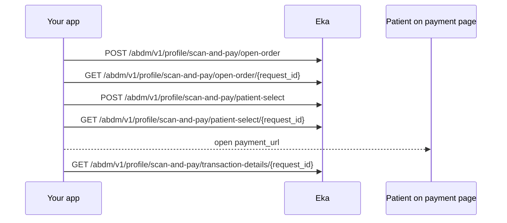

## When to use this

The patient has scanned a facility's Scan and Pay QR code in your Personal Health Record (PHR) app and wants to pay an open bill. This workflow shares the patient's profile with the facility, lists their open orders, gets a payment link for the ones they select, and reads the payment result.

Each `POST` returns a `request_id` and a `status` at once. You pass that `request_id` to the matching `GET` to read the result. No webhook is documented for Scan and Pay, so you poll.

## Before you start

- A Bearer token. Every Scan and Pay operation uses the `authApiKey` scheme. See [Authorization](/api-reference/authorization/getting-started).
- The patient logged in on your app, with their Eka user id (`oid`) to send as `X-Pt-Id`. See [Log in to an existing ABHA](/api-reference/user-app/abdm-connect/workflows/login-abha). {/* TODO: confirm: which of X-Pt-Id, X-Partner-Pt-Id and X-Hip-Id are required here? The spec marks all three optional. */}
- The `hip_id` and `counter_id` read from the facility's QR code. {/* TODO: confirm: the QR code's format, and how to read hip_id and counter_id from it. */}

## Sequence

## Steps

All five operations return a `status` from the same list: `REQUESTED_OPEN_ORDER`, `PROCESSING_OPEN_ORDER`, `REQUESTED_PATIENT_SELECT`, `PROCESSING_PATIENT_SELECT`, `PROCESSING_PATIENT_NOTIFY`, `REQUESTING_PATIENT_NOTIFY` and `ERROR`.

{/* TODO: confirm: the spec writes every value after the first with a leading space (" PROCESSING_OPEN_ORDER"). Is that in the API response, or a spec typo? */}
{/* TODO: confirm: poll interval and timeout for each GET, and which status means each result is ready. */}

<Steps>
  <Step title="Share the profile and request open orders">
    Send `hip_id` and `counter_id` from the QR code to [Open Orders](/api-reference/user-app/abdm-connect/scan-and-pay/open-orders). This shares the patient's profile with the facility. Keep `request_id` from the response. `status` is `REQUESTED_OPEN_ORDER`.
  </Step>
  <Step title="Read the open orders">
    Call [Get Open Orders](/api-reference/user-app/abdm-connect/scan-and-pay/get-open-orders) with `request_id`. When the facility has answered, `data` carries `abha_address`, `intent` and `procedures`. Each procedure has a `category` and `services`, each with `serviceId`, `name`, `description` and `amount`. If `status` is `ERROR`, read `data.error.code` and `data.error.message`. If `procedures` is empty, the patient has nothing to pay here. The patient selects what to pay.

    {/* TODO: confirm: the status that means the open orders are ready to read. */}
  </Step>
  <Step title="Select the orders to pay">
    Send `request_id` from step 1, `intent` set to `PAYMENT_ORDER`, and the selected `procedures` to [Patient Select](/api-reference/user-app/abdm-connect/scan-and-pay/patient-select). All three are required. The spec describes this call as returning the payment link for the selected order. Keep `request_id` from the response.

    {/* TODO: confirm: does the response's request_id equal the one you sent, or is it new? */}
  </Step>
  <Step title="Read the payment link">
    Call [Get Patient Select Details](/api-reference/user-app/abdm-connect/scan-and-pay/get-patient-select) with `request_id`. `data.payment_bundle` carries `payment_url`, `amount`, `order_number`, `merchant_id`, `payment_mode` and `description`. Show `amount` and open `payment_url` for the patient. The patient pays on that page; no Scan and Pay operation takes the payment.

    {/* TODO: confirm: how your app learns the patient has finished on the payment page (redirect, deep link, or polling transaction details). */}
  </Step>
  <Step title="Read the transaction details">
    Call [Get Transaction Details](/api-reference/user-app/abdm-connect/scan-and-pay/get-transaction-details) with `request_id`. `data` carries `status`, `transactionId`, `orderNumber`, `paymentDate`, `paymentReceiptLink`, `abhaAddress` and `openOrderRequestId`. Show the status and the receipt link to the patient.

    {/* TODO: confirm: which request_id this call takes: the one from Open Orders or from Patient Select? */}
    {/* TODO: confirm: the values data.status can take, and which one means paid. */}
  </Step>
</Steps>

## State you must persist

| Field | From | Keep | For |
|---|---|---|---|
| `oid` | ABHA login | On the patient record | `X-Pt-Id` header on every call |
| `hip_id`, `counter_id` | Facility QR code | Until the payment completes | Open Orders |
| `request_id` | Open Orders | Until the transaction details are final {/* TODO: confirm: how long a request_id stays valid */} | Get Open Orders, Patient Select, and possibly Get Transaction Details |
| `request_id` | Patient Select | Until the transaction details are final | Get Patient Select Details |
| `order_number`, `amount` | Get Patient Select Details | With the payment record | Matching the payment to the facility's order |
| `transactionId`, `paymentReceiptLink` | Get Transaction Details | With the payment record {/* TODO: confirm: retention */} | Showing the receipt later |

## When it fails

Every operation returns `GenericError` with `code`, `error` and `source_error` on a 4XX or 5XX. A failure inside the facility's answer comes back as `status` `ERROR` with `data.error`. See [Errors](/api-reference/user-app/abdm-connect/errors).

| Situation | Code | Do |
|---|---|---|
| Missing `hip_id` or `counter_id`, or an unreadable QR | 4XX {/* TODO: confirm: code */} | Ask the patient to scan again |
| Unknown or invalid `request_id` | `ABDM-1030` {/* TODO: confirm: that Scan and Pay returns this code */} | Restart from Open Orders |
| Facility does not answer | `ABDM-1028` or `ABDM-1401` {/* TODO: confirm: that Scan and Pay returns these */} | Tell the patient to pay at the counter |
| Facility answers with an error | `status` `ERROR`, `data.error.code` {/* TODO: confirm: the list of data.error codes */} | Show `data.error.message`; pay at the counter |
| Payment fails or is abandoned | Transaction details `data.status` {/* TODO: confirm: values */} | {/* TODO: confirm: can the patient retry with the same request_id? */} |
| Rate limit | `ABDM-1022` {/* TODO: confirm: that Scan and Pay returns this code */} | {/* TODO: confirm: wait time */} |

## Test it

{/* TODO: confirm: is Scan and Pay available on sandbox, and which test hip_id and counter_id return open orders? */}

- [ ] Open Orders with a test `hip_id` and `counter_id`; receive a `request_id` and `REQUESTED_OPEN_ORDER`
- [ ] Get Open Orders until `procedures` is returned
- [ ] Patient Select with one procedure and `PAYMENT_ORDER`; Get Patient Select Details returns `payment_url`
- [ ] Complete the payment on `payment_url` with sandbox payment details {/* TODO: confirm: sandbox payment method */}
- [ ] Get Transaction Details returns a `transactionId` and `paymentReceiptLink`
- [ ] Failure: Get Open Orders with an unknown `request_id`
- [ ] Failure: a `counter_id` with no open orders returns empty `procedures`
