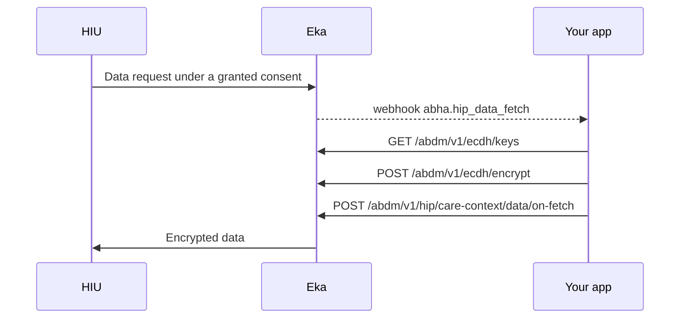

## When to use this

You linked care contexts without sending their FHIR data to Eka, so you hold the records yourself. When a Health Information User (HIU) requests those records after the patient grants consent, Eka sends you a webhook. You build the FHIR bundles, encrypt them for the HIU, and push them back.

If you send the base64 FHIR bundle in the `data` field when you [link a care context](/api-reference/user-app/abdm-connect/workflows/link-care-context-hip), or upload records through the [Upload API](/api-reference/user-app/records/obtain-authorization), Eka serves the data itself and you never receive this webhook. You do not need this workflow.

## Before you start

- A client access token, sent as a Bearer token. See [Authorization](/api-reference/authorization/getting-started).
- Your facility onboarded as a Health Information Provider (HIP), with its HIP ID.
- Care contexts linked without `data`, through [Link a care context as a HIP](/api-reference/user-app/abdm-connect/workflows/link-care-context-hip) or [Answer discovery and link old records](/api-reference/user-app/abdm-connect/workflows/hip-discovery-and-link).
- A webhook URL registered with Eka that can receive `abha.hip_data_fetch`, and the means to verify the [webhook signature](/api-reference/connect/webhooks/webhook-signature).
- A way to produce an ABDM-compliant FHIR bundle for each care context you linked.
- A choice of how to encrypt: the open-source `abdm-ecdh` library in your own code, described in [Encryption](/api-reference/user-app/abdm-connect/care-contexts/ecdh-encryption), or Eka's ECDH endpoints. The library keeps your private key on your server. The [Ecdh encrypt](/api-reference/user-app/abdm-connect/care-contexts/ecdh/encrypt) endpoint takes your private key in the request body.

## Sequence

If you use the `abdm-ecdh` library, the two `/abdm/v1/ecdh/` calls run in your own code instead.

## Steps

<Steps>
  <Step title="Receive the fetch request">
    Eka sends the [`abha.hip_data_fetch`](/api-reference/user-app/abdm-connect/webhooks/hip-data-fetch) webhook. Acknowledge it with HTTP `200` within 5 seconds; Eka retries on any other status. Do the rest of the work after you acknowledge.

    From `data`, keep:
    - `care_contexts`: the ids of the care contexts to send, the same ids you linked.
    - `hi_types`: the health information types the HIU asked for.
    - `key_information`: the HIU's key material. You need `dh_public_key.key_value`, `dh_public_key.expiry` and `nonce`.
    - `transaction_id`: you send it back in the push.
    - `abha_address`, `oid`, `partner_patient_id` and `hip_id`: to find the patient and for the push headers.

    {/* TODO: confirm: which transaction_id to send in on-fetch, the top-level webhook transaction_id or data.transaction_id? The webhook page says "the transaction_id from this webhook", and the example shows data.transaction_id as an empty string. */}
    {/* TODO: confirm: should the bundle contain only the resources matching hi_types, or the whole care context? */}
    {/* TODO: confirm: what to do if dh_public_key.expiry has already passed when the webhook arrives */}
  </Step>
  <Step title="Generate your key material">
    Call [Ecdh keys](/api-reference/user-app/abdm-connect/care-contexts/ecdh/keys). The response carries `private_key`, `public_key` and `nonce` for your side of the exchange. With the library, call `generate_key_material` (or `GenerateKeyMaterial`) instead; it returns `private_key`, `x509_public_key` and `nonce`.

    {/* TODO: confirm: generate a new key pair for every fetch request, or reuse one across requests? */}
    {/* TODO: confirm: is public_key from GET /abdm/v1/ecdh/keys in the X.509 SubjectPublicKeyInfo encoding the library calls x509_public_key? */}
  </Step>
  <Step title="Encrypt each care context's bundle">
    Build the FHIR bundle for each id in `care_contexts`. Call [Ecdh encrypt](/api-reference/user-app/abdm-connect/care-contexts/ecdh/encrypt) once per bundle with:
    - `plain_text_data`: the FHIR bundle as a string.
    - `sender_private_key`, `sender_public_key`, `sender_nonce`: your key material from the previous step.
    - `receiver_public_key`: `key_information.dh_public_key.key_value` from the webhook.
    - `receiver_nonce`: `key_information.nonce` from the webhook.

    The response carries `encrypted_data` and `key_to_share`. With the library, call `encrypt` with the same inputs; it returns `encrypted_data`.

    Compute a checksum of the plain-text bundle before you encrypt it; the push needs it.

    {/* TODO: confirm: which checksum algorithm the checksum field expects (the spec says only "checksum of the non encrypted plain text fhir data") */}
  </Step>
  <Step title="Push the encrypted data">
    Call [Push care context data to HIU](/api-reference/user-app/abdm-connect/care-contexts/data-on-fetch). Send the patient's `oid` in `X-Pt-Id`, your patient id in `X-Partner-Pt-Id` and your HIP ID in `X-Hip-Id`. In the body send:
    - `transaction_id` from the webhook.
    - `entries`: one per care context, each with `care_context_id`, `content` set to `encrypted_data`, `media` set to `application/fhir+json`, and `checksum`.
    - `key_information`: your side of the exchange, with `crypto_alg` `ECDH`, `curve` `Curve25519`, `dh_public_key` (`key_value`, `expiry`, `parameters`) and `nonce` set to your `nonce`.
    - `page_number` and `page_count`.

    The call returns `202 Accepted`.

    {/* TODO: confirm: is dh_public_key.key_value in the push your public_key from GET /abdm/v1/ecdh/keys or key_to_share from POST /abdm/v1/ecdh/encrypt? What expiry and parameters values should you send? */}
    {/* TODO: confirm: when to split a response across pages, what page_number starts at, and whether each page is a separate on-fetch call with the same transaction_id */}
    {/* TODO: confirm: the deadline for the push after the webhook arrives, and whether Eka reports delivery success or failure back to you */}
  </Step>
</Steps>

## State you must persist

| Field | From | Keep | For |
|---|---|---|---|
| `care_context_id` and its FHIR source | Your link call | As long as the care context is linked | Building the bundle when a fetch arrives |
| `transaction_id` | `abha.hip_data_fetch` | Until the last page is accepted | Every on-fetch call for this request |
| `key_information` | `abha.hip_data_fetch` | Until the last page is accepted | Encrypting each bundle |
| `private_key`, `public_key`, `nonce` | Your key material | Until the last page is accepted | Encrypting and the push's `key_information` |
| Plain-text checksum per bundle | You | Until the push is accepted | The `checksum` field |

{/* TODO: confirm: can the same transaction_id be served twice (for a retry), and should your private key be discarded once the push is accepted? */}

## When it fails

<Warning>
Which of these codes each call returns is not yet confirmed. The codes come from the [errors page](/api-reference/user-app/abdm-connect/errors), matched by meaning. Log the code you actually receive.
</Warning>

Error responses carry `code`, `error` and `source_error`. The codes below are from the [errors page](/api-reference/user-app/abdm-connect/errors).

| Situation | Code | Do |
|---|---|---|
| Push body malformed or a field invalid | `ABDM-1006`, `ABDM-1010` | Fix the request against the reference page and resend |
| Transaction id unknown | `ABDM-1017`, `ABDM-1052` | Check you sent the `transaction_id` from the webhook |
| Consent expired or not granted | `ABDM-1061`, `ABDM-1062` | Stop; do not send data for this request |
| HIU unavailable | `ABDM-1033` | Retry later |
| Gateway timeout or dependent service down | `ABDM-1048`, `ABDM-1019` | Retry later |
| Your webhook did not answer within 5 seconds | No code; Eka retries the webhook | Acknowledge first, then build and push |
| Encryption fails or the HIU cannot decrypt | Not documented | Check the receiver key and nonce came from this webhook's `key_information` |

{/* TODO: confirm: which of these codes on-fetch actually returns, and the retry interval and limit for each */}
{/* TODO: confirm: how you learn that an HIU failed to decrypt or verify the checksum */}

## Test it

The [testing page](/api-reference/user-app/abdm-connect/testing) has the sandbox base URL, credentials and the happy path for every journey.

{/* TODO: confirm: how to trigger abha.hip_data_fetch on sandbox (which test HIU, consent and ABHA to use) */}

- [ ] Link a care context without `data`, then raise a consent request for it from a sandbox HIU and receive `abha.hip_data_fetch`
- [ ] Encrypt one bundle with `GET /abdm/v1/ecdh/keys` and `POST /abdm/v1/ecdh/encrypt`, push it, and get `202 Accepted`
- [ ] Repeat with the `abdm-ecdh` library and compare the result
- [ ] Round-trip the library on its own first: generate two key sets, `encrypt` with one, `decrypt` with the other, as in [Encryption](/api-reference/user-app/abdm-connect/care-contexts/ecdh-encryption)
- [ ] Return a non-`200` from your webhook once and confirm Eka retries
