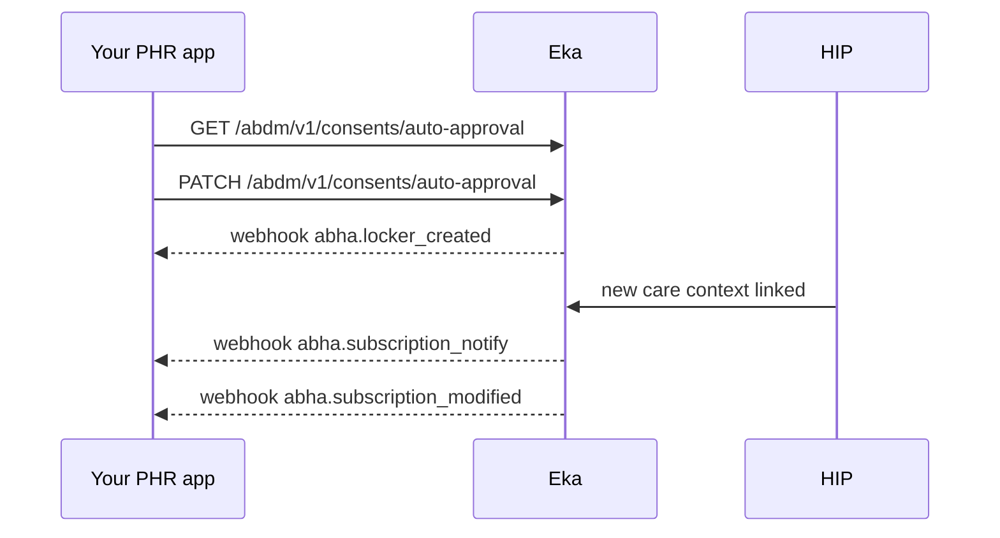

## When to use this

Your app is a personal health record (PHR) app, and the patient wants new records from their facilities to arrive without approving each one. An auto-approval policy lets the patient authorise a class of requests once. With it in place, your app is the patient's health locker: Eka sets up an auto-approval and a subscription, and tells you each time a Health Information Provider (HIP) links a new care context to the patient's ABHA address.

For one request at a time, the patient approves or denies by hand: [Approve, deny or revoke a consent in a PHR app](/api-reference/user-app/abdm-connect/workflows/phr-act-on-consent).

## Before you start

- A bearer token for the API. See [Authorization](/api-reference/authorization/getting-started).
- A live ABHA Gateway session for the patient. Every consent operation needs one. See [User Session](/api-reference/user-app/abdm-connect/session/getting-started).
- The patient's Eka user id (`oid`).
- A webhook endpoint registered with Eka that verifies the `Eka-Webhook-Signature` header. See [Webhook signature](/api-reference/connect/webhooks/webhook-signature).
- Your keyset registered, if you manage the data on your side, so records fetched for the locker can be encrypted for you. See [Request a patient's consent as a HIU](/api-reference/user-app/abdm-connect/workflows/hiu-request-consent).

## Sequence

## Steps

<Steps>
  <Step title="Check the current policy">
    Call [Get Status](/api-reference/user-app/abdm-connect/consents/auto-approval/get-status) with the patient's `oid`. The response carries `status`, either `enabled` or `disabled`. If it is `enabled`, the locker is already set up; skip to handling the webhooks.
  </Step>
  <Step title="Turn on auto-approval">
    Call [Update Auto Approval Policy](/api-reference/user-app/abdm-connect/consents/auto-approval/update-auto-approval-policy). The body is `application/x-www-form-urlencoded` and carries the patient's `oid`. The response carries the new `status`.

    {/* TODO: confirm: the spec's PATCH body has only oid. How does the caller choose enabled or disabled, and which HIUs, HIPs or record types the policy covers? */}
    {/* TODO: confirm: whether the patient must verify their consent PIN before this call. */}
  </Step>
  <Step title="Store the locker ids">
    Wait for [`abha.locker_created`](/api-reference/user-app/abdm-connect/webhooks/locker-created). Reply `200` within 5 seconds; Eka retries on any other status. Store `data.auto_approval_id` and `data.subscription_id` against the patient (`data.oid`, `data.abha_address`). Together they identify the standing arrangement.

    {/* TODO: confirm: what to do if abha.locker_created never arrives after Update returns enabled. */}
  </Step>
  <Step title="Handle new care contexts">
    Each time a HIP links a new care context to the patient's ABHA address, Eka sends [`abha.subscription_notify`](/api-reference/user-app/abdm-connect/webhooks/subscription-notify). Reply `200` within 5 seconds. Read `data.subscription_meta`: `hip_id` (the HIP that created the record), `event_id`, and `care_contexts`, each with `care_context_id` and `patient_reference`.

    The notification carries no records. To fetch them, raise a consent request for those care contexts with [Request a patient's consent as a HIU](/api-reference/user-app/abdm-connect/workflows/hiu-request-consent), then receive them with [Receive and decrypt records as a HIU](/api-reference/user-app/abdm-connect/workflows/hiu-receive-data).

    {/* TODO: confirm: whether a consent raised for care contexts under an active subscription is approved automatically by the auto-approval policy, so the patient sees no prompt. */}
  </Step>
  <Step title="Handle subscription changes">
    When the subscription changes, Eka sends [`abha.subscription_modified`](/api-reference/user-app/abdm-connect/webhooks/subscription-modify). Reply `200` within 5 seconds. Read `data.subscription_details`: `subscription_id`, `period` (`from`, `to`), `categories` (such as `DATA` and `LINK`) and `status` (such as `GRANTED`). Update your stored subscription to match.

    {/* TODO: confirm: the full list of subscription status values, and what each means for the locker (for example, whether a revoked subscription also turns auto-approval off). */}
    {/* TODO: confirm: what the DATA and LINK categories each cover. */}
  </Step>
</Steps>

## State you must persist

| Field | From | Keep | For |
|---|---|---|---|
| `auto_approval_id` | `abha.locker_created` | As long as the locker is active {/* TODO: confirm: what to do with it when auto-approval is turned off */} | Identifying the auto-approval behind the locker |
| `subscription_id` | `abha.locker_created` | As long as the subscription is active | Matching `abha.subscription_modified` to the patient |
| Subscription `status`, `period`, `categories` | `abha.subscription_modified` | Until the next update | Whether new care contexts will be notified |
| `care_context_id`, `hip_id` | `abha.subscription_notify` | Until you have fetched the records | Raising the consent request for the new records |
| `event_id` | `abha.subscription_notify` | {/* TODO: confirm: retention period */} | Deduplicating retried deliveries {/* TODO: confirm: whether event_id is unique per notification */} |

## When it fails

<Warning>
Which of these codes each call returns is not yet confirmed. The codes come from the [errors page](/api-reference/user-app/abdm-connect/errors), matched by meaning. Log the code you actually receive.
</Warning>

Error responses carry `code`, `error` and `source_error` (`code`, `message`). Codes are listed on the [errors page](/api-reference/user-app/abdm-connect/errors).

| Situation | Code | Do |
|---|---|---|
| ABHA Gateway session expired | HTTP `491` | Re-run the session OTP, then retry. See [User Session](/api-reference/user-app/abdm-connect/session/getting-started) |
| `oid` missing or not recognised | `ABDM-1023`, `ABDM-1110` | Check you sent the patient's Eka user id {/* TODO: confirm: which code auto-approval returns for an unknown oid */} |
| Subscription request id not recognised | `ABDM-1054` | Not documented yet {/* TODO: confirm: when ABDM-1054 occurs in this workflow and what to do */} |
| Your endpoint does not reply `200` within 5 seconds | none | Eka retries; reply first, process after {/* TODO: confirm: retry count and schedule */} |
| Gateway unavailable | `ABDM-1024`, `ABDM-1048` | Retry later {/* TODO: confirm: retry rule */} |

## Test it

The [testing page](/api-reference/user-app/abdm-connect/testing) has the sandbox base URL, credentials and the happy path for every journey.

Sandbox base URL: `https://api.dev.eka.care`. {/* TODO: confirm: a sandbox patient to enable the locker for, and a sandbox HIP that can link a care context to trigger abha.subscription_notify. No testing page exists yet. */}

- [ ] Get Status returns `disabled` for a new sandbox patient
- [ ] Update Auto Approval Policy returns `enabled`; `abha.locker_created` arrives with `auto_approval_id` and `subscription_id`
- [ ] Get Status now returns `enabled`
- [ ] Link a new care context at a sandbox HIP; `abha.subscription_notify` arrives with its `care_context_id`
- [ ] Raise a consent for that care context and confirm whether it is approved without a prompt
- [ ] Let the session expire and confirm the `491` path
