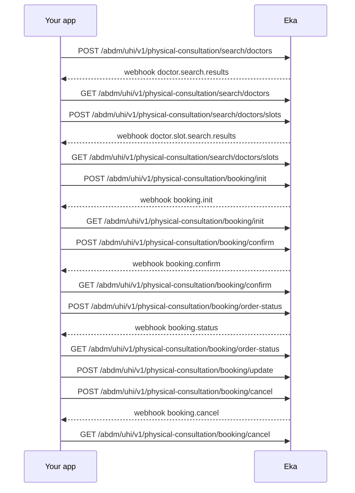

## When to use this

Your user wants to see a doctor in person and you book the visit for them over the Unified Health Interface (UHI). The workflow covers the whole booking: doctor search, slot search, initiate, confirm, then status, reschedule and cancel.

Every step is asynchronous. A `POST` starts the request and returns identifiers at once. The result arrives on a webhook, and you can also read it with the matching `GET`.

## Before you start

- A Bearer token. Every UHI operation uses the `authApiKey` scheme. See [Authorization](/api-reference/authorization/getting-started).
- The patient logged in on your app, with their Eka user id (`oid`) in hand to send as `X-Pt-Id`. See [Log in to an existing ABHA](/api-reference/user-app/abdm-connect/workflows/login-abha). {/* TODO: confirm: which of X-Pt-Id, X-Partner-Pt-Id and X-Hip-Id are required on UHI calls? The spec marks all three optional. */}
- A webhook endpoint registered with Eka that verifies `Eka-Webhook-Signature`. See [Webhook signature](/api-reference/connect/webhooks/webhook-signature).
- The patient's search criteria and the time window they are free, and their billing name, phone and address for the booking.

## Sequence

{/* TODO: confirm: which party Eka forwards each request to (UHI gateway, provider), so the diagram can show it. */}

## Steps

Every `POST` in this workflow returns `txn_id`, `provider_id` and `order_id`. The spec describes `txn_id` and `provider_id` as the values for the next call. Every `GET` except Get Doctors takes the same three as query parameters; the spec gives Get Doctors none.

{/* TODO: confirm: poll interval and timeout for every GET in this workflow, and which response tells you the result is not ready yet. */}
{/* TODO: confirm: does the webhook envelope's transaction_id equal the txn_id from the POST, so you can match a webhook to its request? */}

<Steps>
  <Step title="Search for doctors">
    Send the patient's criteria to [Search Doctors](/api-reference/user-app/abdm-connect/phys-cons/search-doctors). `start_time` and `end_time` set the availability window. Narrow the search with any of `speciality`, `doctor_name`, `hpr_id`, `facility_name`, `state_code` or `state_name`, `district_code` or `district_name`, `pincode`, or `latitude`, `longitude` and `radius_km`. Specialities follow the FHIR specialty value set linked on the reference page. Keep `txn_id` and `provider_id` from the response.

    {/* TODO: confirm: which search fields are required together, for example whether radius_km needs latitude and longitude. */}
  </Step>
  <Step title="Read the doctor results">
    The `doctor.search.results` webhook carries the list. You can also read it from [Get Doctors](/api-reference/user-app/abdm-connect/phys-cons/get-doctors). Each result has `doctor_name`, `hpr_id`, `facility_id`, `transaction_id` and the provider's name and address. If `data` is empty, widen the search and repeat step 1. The patient picks one doctor; keep that result's `hpr_id`, `facility_id` and `transaction_id`.

    {/* TODO: confirm: the spec gives Get Doctors no query parameters. How does it know which search to return? */}
  </Step>
  <Step title="Search the doctor's slots">
    Send `hpr_id`, `facility_id`, `transaction_id`, `provider_id`, `start_time` and `end_time` to [Search Slots](/api-reference/user-app/abdm-connect/phys-cons/search-slots). All six are required. Keep `txn_id`, `provider_id` and `order_id` from the response.

    {/* TODO: confirm: is provider_id here the one from the Search Doctors response? The spec describes it as the doctor's identifier, and the doctor results carry no provider_id. */}
  </Step>
  <Step title="Read the slots">
    The `doctor.slot.search.results` webhook carries `doctor`, `provider_info` and `slots`. You can also read them from [Get Slots](/api-reference/user-app/abdm-connect/phys-cons/get-slots). Each slot has `id`, `date`, `start_time`, `end_time`, `price` and `currency`. If `slots` is empty, pick another window or doctor. The patient picks one slot.
  </Step>
  <Step title="Initiate the booking">
    Send [Init](/api-reference/user-app/abdm-connect/phys-cons/init) the chosen slot's `id` as `slot_id`, its `start_time` and `end_time`, its price as `price.value` and `price.currency`, the doctor's `doctor.id` as `doctor_id`, plus `facility_id` from the chosen doctor, `provider_id`, `transaction_id`, and the patient's `billing`. The spec describes `transaction_id` only as received in the previous API response. Keep `txn_id`, `provider_id` and `order_id` from the response.

    {/* TODO: confirm: is Init's transaction_id the txn_id from the Search Slots response, the webhook transaction_id, or the doctor result's transaction_id? */}
  </Step>
  <Step title="Show the quote and terms">
    The `booking.init` webhook carries `quote` with `total` and `breakup`, `terms`, `payment` with `status` and `type`, and the `order_id`. You can also read them from [Get Init](/api-reference/user-app/abdm-connect/phys-cons/get-init). Show the total and the terms. The patient must accept the terms before you confirm.

    {/* TODO: confirm: how does the patient's acceptance of the terms reach the provider? Confirm takes only provider_id and transaction_id. */}
    {/* TODO: confirm: when payment.status is not paid, where and when does the patient pay? No payment operation exists in the spec. */}
  </Step>
  <Step title="Confirm the booking">
    Send `provider_id` and `transaction_id` from Init to [Confirm](/api-reference/user-app/abdm-connect/phys-cons/confirm). Keep `txn_id`, `provider_id` and `order_id` from the response.
  </Step>
  <Step title="Read the confirmation and PIN">
    The `booking.confirm` webhook carries `order_id`, `pin`, `slot`, `doctor_info` and `state`. You can also read them from [Get Confirm](/api-reference/user-app/abdm-connect/phys-cons/get-confirm). Show `pin` to the patient; they present it to the doctor before the consultation. Store `order_id` on the booking.

    {/* TODO: confirm: the list of values state can take, and which one means confirmed. */}
  </Step>
  <Step title="Check the booking status">
    Send `order_id`, `provider_id` and `transaction_id` to [Order Status](/api-reference/user-app/abdm-connect/phys-cons/order-status). The `booking.status` webhook carries the booking. You can also read it from [Get Order Status](/api-reference/user-app/abdm-connect/phys-cons/get-order-status), which returns `state`, `pin`, `slot`, `price` and `doctor`.
  </Step>
  <Step title="Reschedule, if the patient asks">
    Send `order_id`, `provider_id`, `transaction_id`, `facility_id` and the new `slot_id`, `start_time` and `end_time` to [Update](/api-reference/user-app/abdm-connect/phys-cons/update). Get a new slot, for example by repeating steps 3 and 4.

    {/* TODO: confirm: how do you learn the update's result? Update has no GET and no webhook in the spec. Is it Order Status? Does it need a fresh slot search first? */}
  </Step>
  <Step title="Cancel, if the patient asks">
    Send `order_id`, `provider_id` and `transaction_id` to [Cancel](/api-reference/user-app/abdm-connect/phys-cons/cancel). The `booking.cancel` webhook carries `status`. You can also read it from [Get Cancel](/api-reference/user-app/abdm-connect/phys-cons/get-cancel). The spec gives `SUCCESS`, `FAILED` and `PENDING` as examples. Mark the booking cancelled only on `SUCCESS`.
  </Step>
</Steps>

## State you must persist

| Field | From | Keep | For |
|---|---|---|---|
| `oid` | ABHA login | On the patient record | `X-Pt-Id` header on every call |
| `txn_id` | Each `POST` response | Until the next step's `POST` returns {/* TODO: confirm: how long a txn_id stays valid */} | The `GET` poll and the next `POST` as `transaction_id` |
| `provider_id` | Each `POST` response | With the booking, until the visit or cancellation | Every later call for this booking |
| `hpr_id`, `transaction_id` | Chosen doctor result | Until slot search returns | Search Slots |
| `facility_id` | Chosen doctor result | With the booking, until the visit or cancellation | Search Slots, Init, Update |
| `slot_id`, `start_time`, `end_time`, price | Chosen slot | Until Init returns | Init |
| `order_id` | Init, then Confirm | With the booking, until the visit or cancellation {/* TODO: confirm: retention */} | Order Status, Update, Cancel |
| `pin` | Confirm | Until the visit | The patient shows it to the doctor |

## When it fails

<Warning>
Which of these codes each call returns is not yet confirmed. The codes come from the [errors page](/api-reference/user-app/abdm-connect/errors), matched by meaning. Log the code you actually receive.
</Warning>

Every UHI operation returns `GenericError` with `code`, `error` and `source_error` on a 4XX or 5XX. The spec lists no UHI-specific codes. See [Errors](/api-reference/user-app/abdm-connect/errors).

| Situation | Code | Do |
|---|---|---|
| Missing or malformed field | 4XX {/* TODO: confirm: the ABDM or UHI code returned */} | Fix the request; check the required fields on the reference page |
| Search returns no doctors or no slots | Empty `data` or `slots` | Widen the criteria or the time window |
| Expired or unknown transaction | {/* TODO: confirm: code for an expired txn_id */} | Restart from the step that issued it |
| Webhook never arrives | None | Poll the matching `GET` {/* TODO: confirm: interval and timeout */} |
| Provider or network unavailable | 5XX {/* TODO: confirm: code */} | {/* TODO: confirm: retry rule */} |
| Rate limit | {/* TODO: confirm: is there a rate limit on UHI calls? */} | {/* TODO: confirm */} |
| Cancel returns `FAILED` or `PENDING` | `status` | Keep the booking active; check again with Get Cancel |

## Test it

The [testing page](/api-reference/user-app/abdm-connect/testing) has the sandbox base URL, credentials and the happy path for every journey.

{/* TODO: confirm: is UHI physical consultation available on sandbox, and which test doctors, facilities and time windows return results? */}

- [ ] Search doctors with a speciality and a seven-day window; receive `doctor.search.results`
- [ ] Search slots for one result; receive `doctor.slot.search.results` with at least one slot
- [ ] Init with that slot; receive `booking.init` with a quote and terms
- [ ] Confirm; receive `booking.confirm` with a `pin` and `order_id`
- [ ] Order Status; receive `booking.status` with the same `order_id`
- [ ] Update to another slot, then check Order Status shows the new slot
- [ ] Cancel; receive `booking.cancel` with `SUCCESS`
- [ ] Failure: a search that matches nothing returns empty `data`
- [ ] Failure: Search Slots without `hpr_id` returns a 4XX
