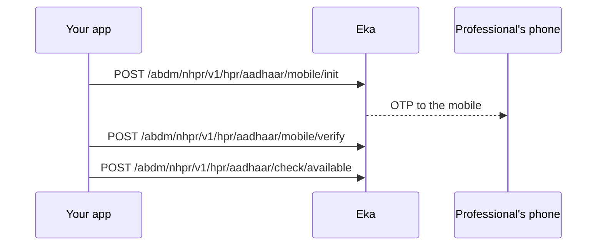

## When to use this

A healthcare professional who has registered before signs in to your HMS with their mobile rather than Aadhaar. You send an OTP to their mobile, verify it, and check the HPR ID. This is the alternative entry for returning professionals.

For a first-time registration, use [Create an HPR ID with Aadhaar OTP](/docs/hie-cm/workflows/create-hpr-id).

{/* TODO: confirm: what this flow gives the integrator at the end (a session, a token, the HPR profile), and what the integrator does with it */}

## Before you start

- A bearer token for the Eka API. See [Authorization](/api-sdk/auth/getting-started).
- The headers your integration sends on ABDM Connect calls. Each operation accepts `X-Pt-Id`, `X-Partner-Pt-Id` and `X-Hip-Id`. {/* TODO: confirm: which of these headers are required on NHPR calls */}
- The professional's mobile number.
- The professional's HPR ID, which Check If HPR is Available takes as `hprId`. {/* TODO: confirm: where the hprId for check/available comes from in this flow; mobile/verify returns only txn_id, mobile_num and hint */}

## Sequence

## Steps

<Steps>
  <Step title="Send the mobile OTP">
    Send `mobile_num` to [Get Mobile OTP](/api-sdk/hie-cm/nhpr-abdm/hpr/get-mobile-otp). The body also accepts `txn_id`. {/* TODO: confirm: is txn_id sent on mobile/init, and if so, from which earlier call? */} The response carries `txn_id`, `mobile_num` and `hint`. Unlike the other NHPR calls, the spec does not wrap this response in `data`. {/* TODO: confirm: is the mobile/init response wrapped in data like the other NHPR responses? */}

    Keep `txn_id`. The professional receives an OTP.
  </Step>
  <Step title="Verify the mobile OTP">
    Send `txnId` (the `txn_id` from step 1, in camel case) and the `otp` the professional reads out to [Verify Mobile OTP](/api-sdk/hie-cm/nhpr-abdm/hpr/verify-mobile-otp). The response `data` carries `txn_id`, `mobile_num` and `hint`.
  </Step>
  <Step title="Check the HPR ID">
    Send `hprId` to [Check If HPR is Available](/api-sdk/hie-cm/nhpr-abdm/hpr/check-hpr-available). Read `available` in the response `data`. {/* TODO: confirm: what available true means for a returning professional (the ID is free, or the ID is found and active), and what the integrator does in each case */}
  </Step>
</Steps>

## State you must persist

| Field | From | Keep | For |
|---|---|---|---|
| `txn_id` | Get Mobile OTP | Until Verify Mobile OTP returns {/* TODO: confirm: how long the transaction stays valid */} | Sent as `txnId` to Verify Mobile OTP |
| `mobile_num` | The professional | On the staff record | Next login |
| `hprId` | The staff record, saved by [Create an HPR ID with Aadhaar OTP](/docs/hie-cm/workflows/create-hpr-id) | Permanently, on the staff record | Check If HPR is Available |

## When it fails

<Warning>
Which of these codes each call returns is not yet confirmed. The codes come from the [errors page](/docs/hie-cm/errors), matched by meaning. Log the code you actually receive.
</Warning>

Errors come back as `4XX` or `5XX` with a body carrying `code`, `error` and `source_error` (`code`, `message`). Read `source_error.code` and look it up on the [errors page](/docs/hie-cm/errors).

{/* TODO: confirm: do the NHPR endpoints return the ABDM and MIS codes below, or their own codes? None of the spec's NHPR operations carry an error example. */}

| Situation | Code | Do |
|---|---|---|
| Malformed body, such as a missing `mobile_num` | `ABDM-1006` | Fix the request; do not retry unchanged |
| Mobile not registered with HPR | {/* TODO: confirm: the code mobile/init returns for a mobile with no HPR account */} | Send the professional to [Create an HPR ID with Aadhaar OTP](/docs/hie-cm/workflows/create-hpr-id) |
| Wrong OTP | `MIS-1013` | Let the professional enter it again {/* TODO: confirm: attempt limit before restarting from mobile/init */} |
| Too many OTP requests or attempts | `ABDM-1100` | Wait 30 minutes, then restart from Get Mobile OTP |
| Transaction expired or unknown | `ABDM-1017` or `MIS-1026` | Restart from Get Mobile OTP |
| ABDM registry unavailable | `ABDM-1019` or `ABDM-1024` | Retry later {/* TODO: confirm: retry interval and limit */} |

## Test it

The [testing page](/docs/hie-cm/testing) has the sandbox base URL, credentials and the happy path for every journey.

Run against the sandbox base URL `https://api.dev.eka.care`. {/* TODO: confirm: a sandbox mobile with an HPR ID, its OTP, and the testing page to link */}

- [ ] Happy path: Get Mobile OTP, Verify Mobile OTP, Check If HPR is Available returns `available` for the professional's `hprId`
- [ ] Wrong OTP once, then the correct OTP
- [ ] A mobile with no HPR account
