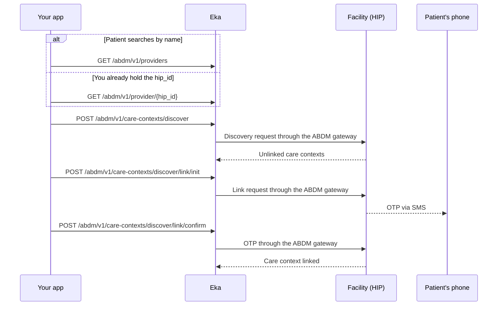

## In short

- Find the facility, discover its unlinked care contexts, then link them with an OTP.
- The facility sends the link OTP to the patient's registered mobile.
- An empty `patient` list means the facility found nothing; retry with a `ref_id`.
- Each call takes the `txn_id` from the call before it.

## When to use this

The patient uses your PHR app to claim records that a facility holds against them but never linked to their ABHA. You search for the facility and ask it for unlinked care contexts. The patient picks the ones to link and enters an OTP the facility sends.

This is the PHR side of discovery. If your software is the facility answering these requests, use [Answer discovery and link old records](/docs/hie-cm/workflows/hip-discovery-and-link) instead.

## Before you start

- A client access token, sent as a Bearer token. See [Authorization](/api-sdk/auth/getting-started).
- A logged-in patient and their Eka user id (`oid`). It comes from [Create an ABHA with Aadhaar OTP](/docs/hie-cm/workflows/create-abha-aadhaar-otp), [Create an ABHA address with mobile OTP](/docs/hie-cm/workflows/create-abha-mobile-otp) or [Log in to an existing ABHA](/docs/hie-cm/workflows/login-abha). Every call here takes it as the `X-Pt-Id` header or the `oid` query parameter. {/* TODO: confirm: which of the `X-Pt-Id` header and the `oid` query parameter is required on these calls; the spec marks neither as required. */}
- A live ABHA gateway session for the patient. See [Hold an ABHA gateway session](/docs/hie-cm/workflows/hold-gateway-session). {/* TODO: confirm: which of these five operations need a live ABHA gateway session and return HTTP `491` without one. */}
- The patient's mobile, to receive the facility's OTP.

## Sequence

## Steps

<Steps>
  <Step title="Find the facility">
    If the patient searches by name, call [Search Providers](/api-sdk/hie-cm/providers/search/providers) with `name`, at least three characters. The response is a list of facilities, each with `hip_id`, `hip_name`, `city` and `state`. Show the list and keep the `hip_id` the patient picks.

    If you already hold a `hip_id`, for example from an earlier link, call [Get Provider Details](/api-sdk/hie-cm/providers/provider) with it instead. It returns the same four fields for that one facility. {/* TODO: confirm: providers/getting-started says Provider Details returns the care contexts available to the user, but the spec response (`ProviderResponseType2`) carries only `hip_id`, `hip_name`, `city` and `state`. Which is right? */}
  </Step>
  <Step title="Discover unlinked care contexts">
    Send `hip_id` to [Discover unlinked care-contexts](/api-sdk/hie-cm/care-contexts/discover/discover). Add `ref_id` if the patient knows the identifier the facility holds for them, such as a registration number or the phone number they gave there. The facility matches the patient's verified ABHA identifiers against its records.

    The response carries `txn_id` and a `patient` list. Each `patient` entry has an `id`, a `display` name and `care_contexts`, each with its own `id` and `display`. Keep `txn_id` and both ids. If `patient` is empty or null, the facility found nothing: let the patient retry with a `ref_id`, or pick another facility. {/* TODO: confirm: how long discover waits for the facility to answer, and what it returns when the facility does not answer in time. */}
  </Step>
  <Step title="Start linking">
    Send `txn_id` from Discover, `patient_ref_id` and `cc_ref_id` to [Initialise Linking](/api-sdk/hie-cm/care-contexts/discover/link-init). The facility sends an OTP to the patient's registered mobile. Keep the new `txn_id` from the response. {/* TODO: confirm: that `patient_ref_id` is `patient[].id` and `cc_ref_id` is `patient[].care_contexts[].id` from the Discover response. */} {/* TODO: confirm: `cc_ref_id` is a single string. How does the patient link several care contexts from one facility: one Link Init per care context, or one call with a list? */}
  </Step>
  <Step title="Confirm with the OTP">
    Send `txn_id` from Link Init and the `otp` the patient enters to [Confirm Linking](/api-sdk/hie-cm/care-contexts/discover/link-confirm). The response carries `cc_ref_id`, the care context now linked to the patient's ABHA. It appears under the facility in [List a patient's linked records](/docs/hie-cm/workflows/phr-list-records). {/* TODO: confirm: whether a 200 from Link Confirm means the link is final, or whether a later event reports it. */}
  </Step>
</Steps>

## State you must persist

| Field | From | Keep | For |
|---|---|---|---|
| `oid` | ABHA creation or login | On the patient record, for as long as the patient uses your app | `X-Pt-Id` or `oid` on every call |
| `hip_id` | Search Providers or Get Provider Details | On the patient record once a link succeeds | Discover again later; list records under that facility |
| `txn_id` (Discover) | Discover | Until Link Init returns {/* TODO: confirm: how long a Discover `txn_id` stays valid. */} | Link Init |
| `patient[].id`, `care_contexts[].id` | Discover | Until Link Confirm returns | `patient_ref_id` and `cc_ref_id` on Link Init |
| `txn_id` (Link Init) | Link Init | Until Link Confirm returns {/* TODO: confirm: how long the link OTP and its `txn_id` stay valid. */} | Link Confirm |
| `cc_ref_id` | Link Confirm | On the patient record | Match the linked care context in later lists |

## When it fails

<Warning>
Which of these codes each call returns is not yet confirmed. The codes come from the [errors page](/docs/hie-cm/errors), matched by meaning. Log the code you actually receive.
</Warning>

Errors come back as HTTP 4XX or 5XX with a `GenericError` body: `code`, `error` and `source_error`. The codes below are from the [errors page](/docs/hie-cm/errors). {/* TODO: confirm: which of these codes these five operations actually return, and whether the ABDM code arrives in `source_error.code`; the spec has no error examples for them. */}

| Situation | Code | Do |
|---|---|---|
| Search name shorter than three characters | HTTP 4XX | Ask the patient for a longer name before calling |
| Malformed request or missing field | [`ABDM-1006`](/docs/hie-cm/errors), [`ABDM-1010`](/docs/hie-cm/errors) | Fix the request; do not retry unchanged |
| Patient's gateway session expired | HTTP `491` | Run [Hold an ABHA gateway session](/docs/hie-cm/workflows/hold-gateway-session), then repeat the step |
| Facility found no records | [`ABDM-1012`](/docs/hie-cm/errors), or an empty `patient` list | Retry with a `ref_id`, or try another facility |
| Wrong OTP | [`ABDM-1035`](/docs/hie-cm/errors) (OTP does not match) | Let the patient re-enter it {/* TODO: confirm: how many OTP attempts are allowed and whether link OTP can be resent. */} |
| Too many OTP attempts | [`ABDM-1100`](/docs/hie-cm/errors) | Stop; the message says to try again in 30 minutes |
| Transaction expired or unknown | [`ABDM-1017`](/docs/hie-cm/errors), [`ABDM-1052`](/docs/hie-cm/errors) | Restart from Discover |
| Facility unreachable or did not acknowledge | [`ABDM-1028`](/docs/hie-cm/errors), [`ABDM-1401`](/docs/hie-cm/errors), [`ABDM-1402`](/docs/hie-cm/errors), [`ABDM-1048`](/docs/hie-cm/errors) | Tell the patient the facility is not responding {/* TODO: confirm: retry rule and backoff when the HIP is unavailable. */} |
| Rate limit | [`ABDM-1022`](/docs/hie-cm/errors) | Back off {/* TODO: confirm: the rate limit and how long to wait. */} |

## Test it

The [testing page](/docs/hie-cm/testing) has the sandbox base URL, credentials and the happy path for every journey.

Run against the Stage/Sandbox server, `https://api.dev.eka.care`. {/* TODO: confirm: a sandbox facility name and `hip_id` that answers discovery with test care contexts, and how the sandbox delivers the link OTP. */}

- [ ] Search Providers with a three-character name returns the sandbox facility
- [ ] Discover with its `hip_id` returns a `txn_id` and at least one care context
- [ ] Link Init with that care context returns a new `txn_id`
- [ ] Link Confirm with the OTP returns `cc_ref_id`
- [ ] The facility and care context appear in [List a patient's linked records](/docs/hie-cm/workflows/phr-list-records)
- [ ] Wrong OTP once, then the correct OTP
- [ ] Link Confirm with a stale `txn_id` fails, and a fresh Discover recovers
