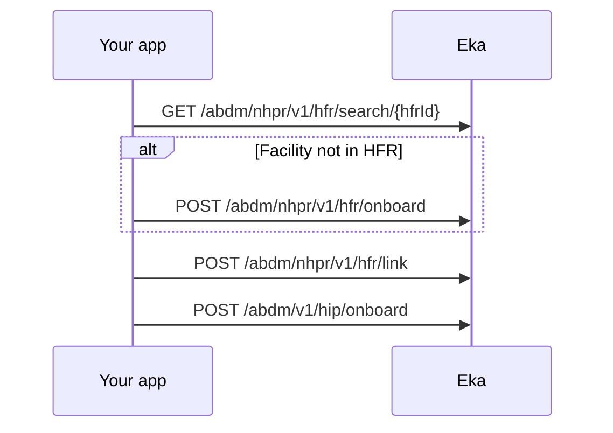

## In short

- Search HFR, register the facility if absent, link it to the Eka Bridge, then onboard it to Eka.
- The onboarding call returns the HIP ID your HMS uses on every later HIP call.
- It is a one-time setup per facility.

## When to use this

A facility needs to act as a Health Information Provider (HIP) through Eka. You take four steps:

- Search the Health Facility Registry (HFR) for it.
- Register it if it is not there.
- Link it to the Eka Bridge.
- Onboard it to Eka.

The last call returns the HIP ID your HMS uses on every later HIP call. This is a one-time setup per facility.

If the facility was registered on the [ABDM portal](https://nhpr.abdm.gov.in/nhpr/v4/login) and linked there under Software Linkage with the Eka Bridge ID, skip to the last step.

## Before you start

- A bearer token for the Eka API. See [Authorization](/api-sdk/auth/getting-started).
- The headers your integration sends on ABDM Connect calls. The three HFR operations accept `X-Pt-Id`, `X-Partner-Pt-Id` and `X-Hip-Id`. {/* TODO: confirm: which of these headers are required on HFR calls, and whose OID goes in X-Pt-Id (the authorizing professional's?) */}
- At least one professional at the facility with an HPR ID, from [Create an HPR ID with Aadhaar OTP](/docs/hie-cm/workflows/create-hpr-id). Registering a facility needs the authorizing doctor's OID.
- The facility's HFR ID if it has one, and your own `clinic_id` for it.
- The facility's name, for the onboarding call.

## Sequence

## Steps

<Steps>
  <Step title="Search for the facility">
    Call [Search HFR](/api-sdk/hie-cm/nhpr-abdm/hfr/search-facility) with the HFR ID in the path as `hfrId`. If the facility exists, the response `data` carries `facilityId`, `facilityName`, `facilityStatus`, `facilityType`, `ownership` and the address fields. Check `facilityName` and the address with the admin before you go on. If it exists, skip to Link. {/* TODO: confirm: what search returns when the facility is not in HFR (a 4XX, or success with empty data), and what facilityStatus values mean the facility can be linked */}
  </Step>
  <Step title="Register the facility if it is absent">
    Call [Onboard HFR](/api-sdk/hie-cm/nhpr-abdm/hfr/onboard-facility). The spec gives this body only `clinic_id` and `hfr_id`. The response `data` carries `facility_id`. Keep it as the facility's HFR ID. {/* TODO: confirm: the onboard request body; the guide says it needs the facility name, address and the authorizing doctor's OID, but the spec schema has only clinic_id and hfr_id */}
  </Step>
  <Step title="Link the facility to the Eka Bridge">
    Send `hfr_id` and `clinic_id` to [Link HFR](/api-sdk/hie-cm/nhpr-abdm/hfr/link-facility). Use `facilityId` from Search, or `facility_id` from Onboard HFR, as `hfr_id`. The response `data` echoes `hfr_id` and `clinic_id`; check `success` is true. This connects the facility to the Eka Bridge so it can exchange health data. {/* TODO: confirm: does this call replace the Software Linkage step on the ABDM portal, or must the admin still enter the Eka Bridge ID there? */}
  </Step>
  <Step title="Onboard the facility to Eka">
    Send `hip_id` and `name`, both required, and your `clinic_id` to [Onboard facility](/api-sdk/hie-cm/nhpr-abdm/onboarding). The response carries `hip_id`, `hip_code`, `hip_name` and `scan_share_url`. Save them on the facility record. {/* TODO: confirm: is the hip_id sent here the facility's HFR ID, or a different identifier, and what is hip_code used for */}
  </Step>
</Steps>

## State you must persist

| Field | From | Keep | For |
|---|---|---|---|
| HFR ID (`facilityId` or `facility_id`) | Search HFR, or Onboard HFR | Permanently, on the facility record | Link HFR as `hfr_id`, and the HIP ID for onboarding |
| `clinic_id` | Your own system | Permanently, on the facility record | Link HFR and Onboard facility |
| `hip_id` | Onboard facility | Permanently, on the facility record | The `X-Hip-Id` header on later HIP calls {/* TODO: confirm: that the X-Hip-Id header takes this hip_id */} |
| `hip_code` | Onboard facility | Permanently, on the facility record | {/* TODO: confirm: what hip_code is used for */} |
| `scan_share_url` | Onboard facility | Permanently, on the facility record | The facility's Scan and Share link {/* TODO: confirm: that scan_share_url is the URL to encode in the counter QR, and which workflow uses it */} |

## When it fails

<Warning>
Which of these codes each call returns is not yet confirmed. The codes come from the [errors page](/docs/hie-cm/errors), matched by meaning. Log the code you actually receive.
</Warning>

Errors come back as `4XX` or `5XX` with a body carrying `code`, `error` and `source_error` (`code`, `message`). Read `source_error.code` and look it up on the [errors page](/docs/hie-cm/errors).

{/* TODO: confirm: do the HFR and onboard endpoints return the ABDM codes below, or their own codes? None of these operations carries an error example in the spec. */}

| Situation | Code | Do |
|---|---|---|
| Malformed body, such as a missing `hip_id` or `name` on Onboard facility | `ABDM-1006` | Fix the request; do not retry unchanged |
| Facility not in HFR | {/* TODO: confirm: the response search gives for an unknown hfrId */} | Register it with Onboard HFR |
| Facility already registered | `ABDM-1053` | Search for it and continue from Link {/* TODO: confirm: that onboard HFR returns ABDM-1053 for a duplicate facility */} |
| Invalid HIP ID on Onboard facility | `ABDM-1035` (the [errors page](/docs/hie-cm/errors) lists two meanings: Invalid HIP ID on a 500, and OTP does not match on a 400; tell them apart by HTTP status and `source_error.message`) | Check the `hip_id` you sent |
| Facility not yet approved | {/* TODO: confirm: the code returned when linking or onboarding a facility whose HFR registration is pending approval */} | Wait for approval, then retry from Link |
| ABDM registry unavailable | `ABDM-1019` or `ABDM-1024` | Retry later {/* TODO: confirm: retry interval and limit */} |

## Test it

The [testing page](/docs/hie-cm/testing) has the sandbox base URL, credentials and the happy path for every journey.

Run against the sandbox base URL `https://api.dev.eka.care`. {/* TODO: confirm: a sandbox HFR ID to search and link, the values to use for a new facility, and the testing page to link */}

- [ ] Existing facility: Search HFR returns it, Link HFR returns `success` true, Onboard facility returns `hip_id` and `scan_share_url`
- [ ] New facility: Search HFR finds nothing, Onboard HFR returns `facility_id`, then Link and Onboard facility
- [ ] Onboard facility without `name`: the call fails and your app shows the error
- [ ] Run Onboard facility twice for the same facility {/* TODO: confirm: is onboarding idempotent, or does a second call fail */}
