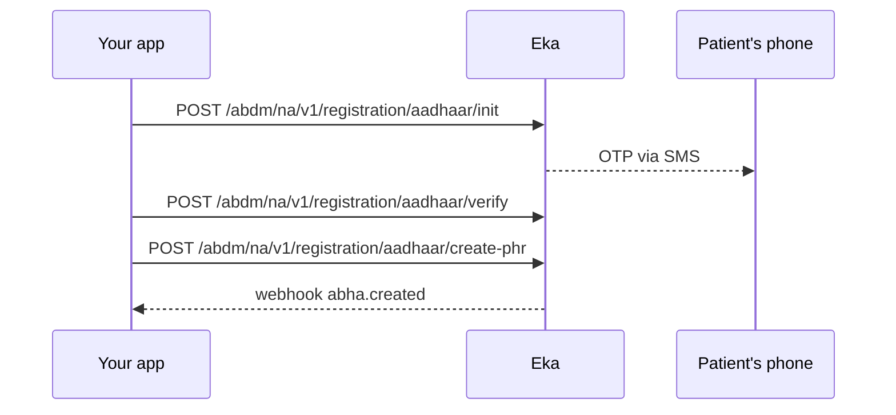

# Writing a workflow

A workflow is the page an integrator follows to make one thing happen, and the page a product skill executes step by step. It is complete when a developer who has never seen the product can finish it against sandbox without asking anyone.

## Frontmatter

```yaml
---
title: Create an ABHA with Aadhaar OTP
description: Verify the patient's Aadhaar with an OTP and create a KYC-verified ABHA number.
type: workflow
product: abdm-connect
journey: register-walk-in-patient
operations:
  - POST /abdm/na/v1/registration/aadhaar/init
  - POST /abdm/na/v1/registration/aadhaar/verify
  - POST /abdm/na/v1/registration/aadhaar/create-phr
webhooks:
  - abha.created
---
```

`operations` is every call the workflow makes, in order, `METHOD /path` exactly as the spec writes the path. `docs-check` fails the page if one is not in the spec, and uses the list to write the "Used in" block on each reference page. `webhooks` is every event the workflow waits for or consumes. `journey` is the journey page's file slug.

## Sections, in order

1. **When to use this.** Two or three sentences: the situation, and the alternatives if there are any ("For a patient without Aadhaar, use mobile OTP instead").
2. **Before you start.** A list: the auth token and how to get it (link to authorization), the role or config needed, any workflow that must have run first, any data you need in hand.
3. **Sequence.** A mermaid `sequenceDiagram` with participants Your app, Eka, and any third party (ABDM gateway, the patient's phone). One arrow per operation, labelled with `METHOD /path`.
4. **Steps.** A Mintlify `<Steps>` block, one `<Step>` per call. Each step: what it does in one sentence, a link to the reference page, which fields from the previous response it needs (`txn_id` from step 1), which fields in its response matter for the next step, and the decision if the response branches (`skip_state`).
5. **State you must persist.** A table: field, where it came from, how long to keep it, what it is for later. This is the section integrators get wrong most.
6. **When it fails.** A table: situation, error code, what to do. Link each code to the errors page. Cover at least: wrong input, expired transaction, rate limit, the third party being down.
7. **Test it.** The sandbox happy path as a checklist, with the test data to use, linking to the testing page. Name the failure cases from section 6 that are worth running too.

## Rules

- Every operation in the frontmatter appears in the sequence diagram and has a step. Every step's operation is in the frontmatter.
- No request or response schema. Link the reference page; it renders the schema from the spec. Name only the fields the flow depends on.
- Decisions are explicit. If a response field decides the next call, write the condition: "If `skip_state` is `abha_create` and `abha_profiles` is non-empty, call Auto-Login instead of Create."
- Async steps say how to wait: poll which endpoint at what interval until which value, or which webhook arrives.
- Keep secrets out: no real credentials, no real Aadhaar numbers; sandbox test values only, from the testing page.

## Deriving one from the spec

1. Pick the operations by tag from the spec (`/workflow-new` offers them).
2. Order them by data dependency: whatever produces `txn_id` goes before whatever consumes it.
3. For each response, list the fields the next call needs. That list is the "State you must persist" table.
4. For each operation's error responses in the spec, take the codes into the failure table.
5. Draw the diagram last; it should fall out of the step order.

## Worked example, abbreviated

This is a shortened sketch. The full, spec-checked page is `api-reference/user-app/abdm-connect/workflows/create-abha-aadhaar-otp.mdx`; read it before writing a workflow, and verify every field you name against the spec, as that page does.

```md
## When to use this

The patient has Aadhaar and the mobile linked to it. This produces a KYC-verified 14-digit ABHA number. If the patient has no Aadhaar, use [Create an ABHA address with mobile OTP](/abdm-connect/workflows/create-abha-mobile-otp).

## Before you start

- A client access token. See [Authorization](/api-reference/authorization/getting-started).
- Your facility onboarded as a HIP.
- The patient's consent to use Aadhaar, recorded on your side.

## Sequence



## Steps

<Steps>
  <Step title="Start the transaction">
    Send the Aadhaar number to [Init](/abdm-connect/api-reference/registration/aadhaar-init). Keep `txn_id` from the response; every later call needs it. The patient receives an OTP.
  </Step>
  <Step title="Verify the OTP">
    Send `txn_id`, the OTP and the patient's `mobile` to [Verify](/abdm-connect/api-reference/registration/aadhaar-verify). Read `skip_state`: if it is `abha_create` and `abha_profiles` is non-empty, the patient already has an ABHA; call [Auto-Login](/abdm-connect/api-reference/login/auto-login) and stop. If it is `confirm_mobile_otp`, the mobile sent is not the one linked to the Aadhaar; run the mobile verification sub-step before continuing.
  </Step>
  <Step title="Create the ABHA">
    Send `txn_id` and the chosen `abha_address` to [Create](/abdm-connect/api-reference/registration/aadhaar-create). The response carries the ABHA number at `profile.abha_number` and Eka's user id at `eka.oid`. The `abha.created` webhook fires as well.
  </Step>
</Steps>

## State you must persist

| Field | From | Keep | For |
|---|---|---|---|
| `txn_id` | Init | Until Create returns, at most 30 minutes | Every call in this workflow |
| `oid` | Create | Forever, on the patient record | Every later ABDM call for this patient |
| `abha_address` | Create | Forever, on the patient record | Care context linking |

## When it fails

| Situation | Code | Do |
|---|---|---|
| Wrong OTP | `MIS-1013` | Let the patient retry; after three, restart from Init |
| Too many OTP requests | `ABDM-1100` | Wait 30 minutes; show the patient the lockout |
| Mobile differs from the Aadhaar-linked one | `verify` returns `skip_state` `confirm_mobile_otp` | Run the mobile verification sub-step |

## Test it

- [ ] The sandbox test Aadhaar and OTP from the testing page, through to Create
- [ ] Wrong OTP once, then correct OTP
- [ ] Second run with the same Aadhaar: Verify returns an existing profile, Auto-Login path
```
